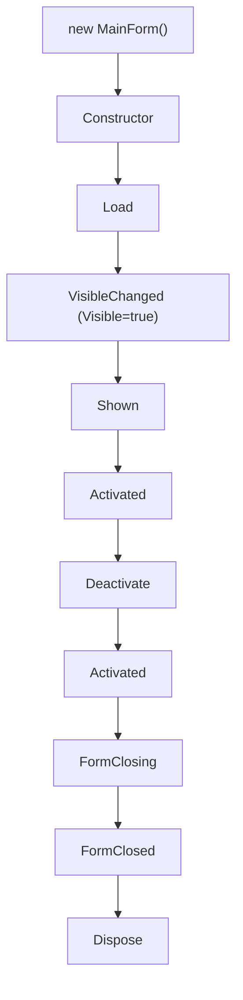

# WinForms 窗体开发基础：生命周期、控件与布局系统

<ProgressIndicator
  current="winforms/winforms-basics"
  items={[
    { slug: "winforms/winforms-roadmap", title: "路线图与岗位分析" },
    { slug: "winforms/winforms-basics", title: "WinForms 基础" },
    { slug: "winforms/winforms-serial-port", title: "串口通信实战" },
    { slug: "winforms/winforms-modbus-protocol", title: "Modbus 协议详解" },
    { slug: "winforms/winforms-multithreading-async", title: "多线程与异步" },
    { slug: "winforms/winforms-realtime-display", title: "实时数据展示" },
    { slug: "winforms/winforms-data-storage", title: "数据存储与导出" },
    { slug: "winforms/winforms-error-recovery", title: "异常处理与自动重连" },
    { slug: "winforms/winforms-project-temperature", title: "完整项目实战" },
  ]}
/>

上一篇梳理了上位机开发的岗位定位和技术栈全景。这一篇聚焦 WinForms 本身——窗体生命周期如何运转、事件驱动模型怎样工作、常用控件在工控场景怎么用、布局系统如何让界面适应不同分辨率、以及自定义 UserControl 的设计方法。把这些基础打牢，后续的串口通信、多线程、实时数据展示才有了正确的"画布"。

## 1 为什么上位机开发通常选择 WinForms

.NET 桌面开发有两个主流框架：WinForms 和 WPF。对于上位机开发，WinForms 是更常见的选择，原因并不是"WinForms 更好"，而是"WinForms 更适合上位机的典型需求"。

### 1.1 WinForms vs WPF 对比

| 维度 | WinForms | WPF |
|------|----------|-----|
| 开发效率 | 拖拽即用，快速出界面 | XAML 学习成本高，初期慢 |
| 性能 | 够用，控件数 < 1000 无压力 | 渲染管线更复杂，大数据量更优 |
| 控件生态 | 原生控件够用，第三方控件丰富（仪表盘、图表） | 原生控件基础，高级控件需自行实现或购买 |
| 学习曲线 | 低，Win32 逻辑直观 | 高，需理解依赖属性、路由事件、DataTemplate |
| 部署 | .NET 运行时 + exe，简单 | 同左，但 XAML 资源体积略大 |
| 数据绑定 | 手动赋值为主，简单直接 | 强数据绑定，MVVM 友好 |
| 自定义绘制 | OnPaint + GDI+，足够工控场景 | DirectX 渲染，动画和视觉效果更丰富 |

上位机界面的核心需求是：**快速搭建参数输入 / 数据展示界面，控件够用就行**。WinForms 拖一个 ComboBox 就能选串口、拖一个 DataGridView 就能显示数据——这种"所见即所得"的开发方式，在工控场景下效率远高于 WPF。

:::note
WPF 在需要精美 UI、复杂动画、或者必须 MVVM 架构的场景下更合适。如果你的上位机要给客户做产品级界面，WPF 值得考虑。但对于大多数项目，WinForms 的投入产出比更高。
:::

### 1.2 本文覆盖内容

- **窗体生命周期**——在正确的时机做正确的事（初始化通信、释放资源）
- **事件驱动编程模型**——理解 WinForms 的运行机制
- **常用控件详解**——按上位机场景分类讲解
- **布局系统**——Anchor / Dock / TableLayoutPanel，让界面适应分辨率
- **自定义 UserControl**——状态指示灯、参数卡片等工控常用控件
- **窗体间通信与配置管理**——实际项目必备

## 2 创建 WinForms 项目

<Steps>

### 打开 Visual Studio 创建项目

打开 Visual Studio 2022，选择 **创建新项目** → 搜索 **Windows Forms** → 选择 **Windows Forms 应用(.NET)**。

:::warning
注意选 **.NET 6/7/8** 版本，不是 **.NET Framework**。.NET（原 .NET Core）是微软当前的主力版本，性能更好、API 更现代。.NET Framework 4.8 仅做维护，不再有新功能。
:::

项目名称填 `ScadaApp`，点击创建。

### 认识入口文件 Program.cs

项目创建后，`Program.cs` 是程序入口：

<CodeAnnotation
  language="csharp"
  lines={[
    { code: 'namespace ScadaApp;', note: '.NET 6+ 支持文件级命名空间，不再需要大括号包裹' },
    { code: '' },
    { code: 'internal static class Program' },
    { code: '{' },
    { code: '    [STAThread]', note: '标记主线程为 STA（单线程单元），WinForms 和 COM 组件要求主线程必须是 STA' },
    { code: '    static void Main()' },
    { code: '    {' },
    { code: '        ApplicationConfiguration.Initialize();', note: '初始化应用配置：高 DPI、字体、默认字体等。等价于旧版的 Application.EnableVisualStyles() + Application.SetCompatibleTextRenderingDefault()' },
    { code: '        Application.Run(new MainForm());', note: '启动消息循环，以 MainForm 作为主窗体。主窗体关闭时，整个应用退出' },
    { code: '    }' },
    { code: '}' },
  ]}
/>

### 理解 .NET 6+ 与 .NET Framework 的区别

| 特性 | .NET 6+ | .NET Framework |
|------|---------|---------------|
| 顶级语句 | 支持（`Program.cs` 极简） | 不支持，必须写完整 `Main` |
| `ApplicationConfiguration.Initialize()` | 一个调用搞定初始化 | 需手动调 `EnableVisualStyles` 等 |
| SerialPort | 需 NuGet 包 `System.IO.Ports` | 内置 |
| 语音/JSON | 内置 `System.Text.Json` | 需 NuGet |
| 发布方式 | 单文件发布、AOT | 传统安装 |
| 性能 | 显著更快 | 较慢 |

:::tip
如果公司已有 .NET Framework 的老项目，不用急于迁移。新项目一定要用 .NET 6+。两者 API 差异很小，迁移成本主要在第三方控件兼容性。
:::

### 认识窗体三文件模型

每个窗体（如 `MainForm`）由三个文件组成：

| 文件 | 作用 | 你会编辑吗 |
|------|------|-----------|
| `MainForm.cs` | 业务逻辑：事件处理、数据操作 | 会——手动写代码 |
| `MainForm.Designer.cs` | 控件声明和布局初始化 | 通常不——由设计器自动生成 |
| `MainForm.resx` | 资源文件：图标、图片、字符串 | 偶尔——添加嵌入资源时 |

`MainForm.Designer.cs` 中的 `InitializeComponent()` 方法由设计器维护，它会初始化所有控件的属性和位置。**不要手动编辑这个文件**——设计器会覆盖你的修改。

```csharp
// MainForm.cs 中的典型结构
public partial class MainForm : Form
{
    public MainForm()
    {
        InitializeComponent();
    }
}
```

`partial class` 关键字让 `MainForm.cs` 和 `MainForm.Designer.cs` 编译时合并为同一个类。

</Steps>

## 3 窗体生命周期——深入理解

WinForms 窗体有一套明确的生存周期，理解每个事件的触发时机，才能在正确的位置做正确的事。这对上位机开发尤其重要——在构造函数里做耗时通信初始化会让窗体白屏，忘记在 `FormClosing` 里释放串口会导致端口占用。

### 3.1 完整生命周期事件链



| 事件 | 触发时机 | 典型用途 | 上位机场景 |
|------|---------|---------|-----------|
| **Constructor** | `new MainForm()` 时 | 调用 `InitializeComponent()`，设置控件初始属性 | 创建通信管理器实例，但不打开连接 |
| **Load** | 窗体首次显示前 | 一次性初始化 | 加载配置文件、初始化串口、填充下拉框 |
| **VisibleChanged** | `Visible` 属性变化时 | 窗体显示/隐藏逻辑 | — |
| **Shown** | 窗体首次显示后 | 需要窗体可见才能执行的操作 | 启动需要 UI 的后台任务 |
| **Activated** | 窗体获得焦点时 | 刷新数据 | 重新拉取最新数据 |
| **Deactivate** | 窗体失去焦点时 | 暂停实时更新 | 降低刷新频率 |
| **FormClosing** | 窗体即将关闭时 | 确认关闭、释放资源 | 关闭串口、停止定时器、保存配置 |
| **FormClosed** | 窗体已关闭后 | 清理 | 释放非托管资源 |
| **Dispose** | 对象被回收时 | 释放资源 | 释放 IDisposable 对象 |

### 3.2 Load 和 Shown 的区别

这是初学者常混淆的一对事件：

- **Load**：窗体**即将**显示，此时控件已创建但尚未绘制到屏幕。适合做不依赖视觉呈现的初始化。
- **Shown**：窗体**已经**显示，用户可以看到界面。适合做需要窗体可见后才执行的操作（如弹窗提示、聚焦控件）。

```csharp
protected override void OnLoad(EventArgs e)
{
    base.OnLoad(e);
    LoadConfig();
    FillPortNames();
    InitializeCommunication();
}

protected override void OnShown(EventArgs e)
{
    base.OnShown(e);
    txtIpAddress.Focus();
}
```

:::tip
上位机中大部分初始化应放在 `Load` 中。`Shown` 适合"必须等界面画出来再操作"的场景，比如自动调整控件大小后重新布局。
:::

### 3.3 上位机中的生命周期实践

```csharp
public partial class MainForm : Form
{
    private SerialPortManager _serialManager;
    private System.Windows.Forms.Timer _refreshTimer;
    private AppConfiguration _config;

    public MainForm()
    {
        InitializeComponent();
        _serialManager = new SerialPortManager();
        _refreshTimer = new System.Windows.Forms.Timer { Interval = 1000 };
        _config = new AppConfiguration();
    }

    protected override void OnLoad(EventArgs e)
    {
        base.OnLoad(e);

        _config = AppConfiguration.Load();
        ApplyConfig(_config);

        string[] ports = SerialPort.GetPortNames();
        cmbPortName.DataSource = ports;

        if (ports.Length > 0)
        {
            cmbPortName.SelectedIndex = 0;
        }
    }

    protected override void OnFormClosing(FormClosingEventArgs e)
    {
        base.OnFormClosing(e);

        if (_serialManager.IsOpen)
        {
            var result = MessageBox.Show(
                "串口正在通信中，确定要关闭吗？",
                "确认关闭",
                MessageBoxButtons.YesNo,
                MessageBoxIcon.Question);

            if (result == DialogResult.No)
            {
                e.Cancel = true;
                return;
            }
        }

        _serialManager.Close();
        _refreshTimer.Stop();
        _refreshTimer.Dispose();
        _config.Save();
    }
}
```

### 3.4 常见错误

:::warning 在构造函数中做耗时操作
`InitializeComponent()` 之后，窗体还没有显示。如果在这里做网络连接、串口初始化等耗时操作，用户会看到一个白屏窗体冻结数秒。正确做法：构造函数只创建对象实例，`Load` 中做初始化。
:::

:::warning 忘记在 FormClosing 释放资源
串口、TCP 连接、定时器如果不在关闭时释放，会导致端口占用、连接泄漏。上位机程序经常被反复启停，资源泄漏问题会很快暴露。
:::

:::warning 在 FormClosing 中不检查 e.Cancel
如果用户选择"不关闭"（`e.Cancel = true`），后续的释放代码仍然会执行。必须把释放逻辑放在 `if (!e.Cancel)` 之后，或者用 `return` 提前退出。
:::

## 4 事件驱动编程模型

WinForms 是事件驱动架构——程序的行为由事件（用户操作、系统通知）触发，而不是顺序执行的流程。理解事件机制是掌握 WinForms 的关键。

### 4.1 委托和事件基础

C# 的事件系统建立在委托之上：

```
事件发布者 ──定义事件──> 委托类型
     │
     │  触发事件
     ▼
事件订阅者 ──注册方法──> 事件处理器
```

```csharp
public delegate void TemperatureChangedHandler(double newTemperature);

public class TemperatureMonitor
{
    public event TemperatureChangedHandler TemperatureChanged;

    public void UpdateTemperature(double value)
    {
        TemperatureChanged?.Invoke(value);
    }
}
```

`?.Invoke` 是线程安全的调用方式——如果没有订阅者，不会抛出 `NullReferenceException`。

### 4.2 WinForms 事件机制

WinForms 控件的事件都遵循同一模式：

```csharp
button1.Click += new EventHandler(OnButtonClicked);
button1.Click += OnButtonClicked;
button1.Click += (sender, e) => { MessageBox.Show("Clicked!"); };
```

三种写法效果相同，区别在于：
- 第一种：完整写法，明确委托类型
- 第二种：C# 2.0+ 方法组转换，最常用
- 第三种：lambda 表达式，适合简单逻辑

### 4.3 订阅和取消订阅

事件订阅用 `+=`，取消用 `-=`。忘记取消订阅会导致对象无法被垃圾回收（内存泄漏）：

```csharp
protected override void OnLoad(EventArgs e)
{
    base.OnLoad(e);
    _serialManager.DataReceived += OnDataReceived;
    _serialManager.ConnectionLost += OnConnectionLost;
}

protected override void OnFormClosed(FormClosedEventArgs e)
{
    base.OnFormClosed(e);
    _serialManager.DataReceived -= OnDataReceived;
    _serialManager.ConnectionLost -= OnConnectionLost;
}
```

:::important
如果用 lambda 订阅事件，就无法用 `-=` 取消（因为没有方法名引用）。需要取消的事件必须用方法订阅，不用 lambda。
:::

### 4.4 常用事件分类

**鼠标事件：**

| 事件 | 触发时机 | 上位机场景 |
|------|---------|-----------|
| `Click` | 单击 | 按钮操作 |
| `DoubleClick` | 双击 | DataGridView 行双击查看详情 |
| `MouseEnter` / `MouseLeave` | 鼠标进入/离开 | 指示灯 hover 提示 |

**键盘事件：**

| 事件 | 触发时机 | 上位机场景 |
|------|---------|-----------|
| `KeyDown` | 按键按下 | Enter 提交、Esc 取消 |
| `KeyPress` | 字符键按下 | 输入验证（只允许数字） |
| `KeyUp` | 按键释放 | — |

**窗体事件：**

| 事件 | 触发时机 | 上位机场景 |
|------|---------|-----------|
| `Load` | 首次显示前 | 初始化 |
| `FormClosing` | 即将关闭 | 释放资源、确认关闭 |
| `Resize` | 大小改变 | 重新布局 |

**控件通用事件：**

| 事件 | 触发时机 | 上位机场景 |
|------|---------|-----------|
| `EnabledChanged` | 可用状态变化 | 禁用按钮时改变样式 |
| `VisibleChanged` | 可见状态变化 | — |
| `Validating` | 验证输入 | IP 地址格式校验 |

### 4.5 自定义事件完整示例

上位机中，通信管理器需要通过事件通知 UI 层——这是自定义事件最典型的应用场景：

```csharp
public class SerialPortManager
{
    public event Action<byte[]> DataReceived;
    public event Action<bool, string> ConnectionChanged;
    public event Action<string> AlarmTriggered;

    private void OnDataReceived(byte[] data)
    {
        DataReceived?.Invoke(data);
    }

    private void OnConnectionChanged(bool connected, string message)
    {
        ConnectionChanged?.Invoke(connected, message);
    }

    private void OnAlarmTriggered(string alarmMessage)
    {
        AlarmTriggered?.Invoke(alarmMessage);
    }
}
```

```csharp
public partial class MainForm : Form
{
    private readonly SerialPortManager _serialManager = new();

    protected override void OnLoad(EventArgs e)
    {
        base.OnLoad(e);
        _serialManager.DataReceived += HandleDataReceived;
        _serialManager.ConnectionChanged += HandleConnectionChanged;
        _serialManager.AlarmTriggered += HandleAlarmTriggered;
    }

    private void HandleDataReceived(byte[] data)
    {
        this.InvokeIfRequired(() =>
        {
            UpdateDataDisplay(data);
        });
    }

    private void HandleConnectionChanged(bool connected, string message)
    {
        this.InvokeIfRequired(() =>
        {
            lblStatus.Text = message;
            ledConnection.StatusColor = connected ? Color.Green : Color.Red;
        });
    }

    private void HandleAlarmTriggered(string alarmMessage)
    {
        this.InvokeIfRequired(() =>
        {
            MessageBox.Show(alarmMessage, "报警", MessageBoxButtons.OK, MessageBoxIcon.Warning);
        });
    }

    protected override void OnFormClosed(FormClosedEventArgs e)
    {
        base.OnFormClosed(e);
        _serialManager.DataReceived -= HandleDataReceived;
        _serialManager.ConnectionChanged -= HandleConnectionChanged;
        _serialManager.AlarmTriggered -= HandleAlarmTriggered;
    }
}
```

### 4.6 事件处理器命名规范

| 模式 | 命名 | 示例 |
|------|------|------|
| 控件事件 | `控件名_事件名` | `btnConnect_Click` |
| 自定义事件 | `Handle/On + 描述` | `HandleDataReceived` |
| 重写虚方法 | `On + 事件名` | `OnLoad`, `OnFormClosing` |

设计器自动生成的事件处理器用 `控件名_事件名` 风格。自定义事件处理器用 `Handle` 前缀，重写基类方法用 `On` 前缀——三者不混淆。

## 5 常用控件详解——上位机场景

### 5.1 基础控件

#### Button

上位机最常见的按钮场景：连接/断开、开始/停止采集。

```csharp
private void btnConnect_Click(object sender, EventArgs e)
{
    if (_serialManager.IsOpen)
    {
        _serialManager.Close();
        btnConnect.Text = "连接";
        btnConnect.BackColor = SystemColors.Control;
    }
    else
    {
        bool success = _serialManager.Open(cmbPortName.Text, (int)cmbBaudRate.SelectedValue);
        btnConnect.Text = success ? "断开" : "连接";
        btnConnect.BackColor = success ? Color.LightCoral : SystemColors.Control;
    }
}
```

常用属性：`Text`、`Enabled`、`BackColor`、`FlatStyle`。常用事件：`Click`。

#### TextBox

上位机中常用于 IP 地址、端口、参数输入。需要做输入验证：

```csharp
private void txtIpAddress_Validating(object sender, CancelEventArgs e)
{
    if (!IPAddress.TryParse(txtIpAddress.Text, out _))
    {
        errorProvider1.SetError(txtIpAddress, "请输入有效的 IP 地址");
        e.Cancel = true;
    }
    else
    {
        errorProvider1.SetError(txtIpAddress, string.Empty);
    }
}

private void txtPort_KeyPress(object sender, KeyPressEventArgs e)
{
    if (!char.IsDigit(e.KeyChar) && e.KeyChar != '\b')
    {
        e.Handled = true;
    }
}
```

常用属性：`Text`、`MaxLength`、`ReadOnly`、`PasswordChar`。常用事件：`TextChanged`、`Validating`、`KeyPress`。配合 `ErrorProvider` 组件显示验证提示。

#### ComboBox

串口选择、波特率选择是上位机最典型的下拉框场景：

```csharp
private void InitializePortSettings()
{
    cmbPortName.DataSource = SerialPort.GetPortNames();

    cmbBaudRate.DisplayMember = "Name";
    cmbBaudRate.ValueMember = "Value";
    cmbBaudRate.DataSource = new[]
    {
        new { Name = "9600", Value = 9600 },
        new { Name = "19200", Value = 19200 },
        new { Name = "38400", Value = 38400 },
        new { Name = "115200", Value = 115200 },
    };
    cmbBaudRate.SelectedIndex = 0;
}
```

动态刷新串口列表（USB 串口可能热插拔）：

```csharp
private void btnRefreshPorts_Click(object sender, EventArgs e)
{
    string current = cmbPortName.Text;
    cmbPortName.DataSource = SerialPort.GetPortNames();
    if (cmbPortName.Items.Contains(current))
    {
        cmbPortName.Text = current;
    }
}
```

常用属性：`DataSource`、`DisplayMember`、`ValueMember`、`SelectedIndex`、`DropDownStyle`。常用事件：`SelectedIndexChanged`。

#### Label

参数名称和状态显示。上位机中常动态改变颜色来表示状态：

```csharp
private void UpdateStatusLabel(string text, Color color)
{
    lblDeviceStatus.Text = text;
    lblDeviceStatus.ForeColor = color;
}
```

#### CheckBox / RadioButton

选项配置场景——CheckBox 用于独立选项，RadioButton 用于互斥选项：

```csharp
private void chkAutoReconnect_CheckedChanged(object sender, EventArgs e)
{
    _serialManager.AutoReconnectEnabled = chkAutoReconnect.Checked;
}

private void rbRtu_CheckedChanged(object sender, EventArgs e)
{
    grpRtuSettings.Visible = rbRtu.Checked;
    grpTcpSettings.Visible = !rbRtu.Checked;
}
```

#### NumericUpDown

数值输入控件，自带增减按钮和范围限制，非常适合温度设定、报警阈值等场景：

```csharp
nudAlarmHigh.Minimum = 0;
nudAlarmHigh.Maximum = 200;
nudAlarmHigh.DecimalPlaces = 1;
nudAlarmHigh.Increment = 0.5m;
nudAlarmHigh.Value = 80.0m;

private void nudAlarmHigh_ValueChanged(object sender, EventArgs e)
{
    _config.AlarmHighThreshold = (double)nudAlarmHigh.Value;
}
```

常用属性：`Minimum`、`Maximum`、`DecimalPlaces`、`Increment`、`Value`。常用事件：`ValueChanged`。

#### ProgressBar

数据加载、通信进度：

```csharp
progressBar1.Minimum = 0;
progressBar1.Maximum = 100;
progressBar1.Style = ProgressBarStyle.Continuous;

progressBar1.Style = ProgressBarStyle.Marquee;
progressBar1.MarqueeAnimationSpeed = 30;
```

`Style` 三种模式：`Blocks`（分段）、`Continuous`（连续）、`Marquee`（滚动，用于无法确定进度的场景）。

#### TrackBar

参数调节滑块——阀门开度、亮度等连续调节场景：

```csharp
trackBar1.Minimum = 0;
trackBar1.Maximum = 100;
trackBar1.TickFrequency = 10;
trackBar1.Value = 50;

private void trackBar1_Scroll(object sender, EventArgs e)
{
    lblValveOpening.Text = $"阀门开度: {trackBar1.Value}%";
}
```

### 5.2 数据展示控件

#### DataGridView

上位机中最核心的数据展示控件，用于实时数据表、报警列表、设备列表。

**列定义和数据绑定：**

```csharp
private void SetupDataGridView()
{
    dgvData.AutoGenerateColumns = false;
    dgvData.AllowUserToAddRows = false;
    dgvData.AllowUserToDeleteRows = false;
    dgvData.ReadOnly = true;
    dgvData.SelectionMode = DataGridViewSelectionMode.FullRowSelect;
    dgvData.MultiSelect = false;
    dgvData.AlternatingRowsDefaultCellStyle.BackColor = Color.FromArgb(245, 245, 245);

    dgvData.Columns.Add(new DataGridViewTextBoxColumn
    {
        DataPropertyName = "ParameterName",
        HeaderText = "参数名称",
        Width = 120,
        DefaultCellStyle = new DataGridViewCellStyle { Alignment = DataGridViewContentAlignment.MiddleLeft }
    });
    dgvData.Columns.Add(new DataGridViewTextBoxColumn
    {
        DataPropertyName = "Value",
        HeaderText = "当前值",
        Width = 100,
        DefaultCellStyle = new DataGridViewCellStyle { Format = "F2", Alignment = DataGridViewContentAlignment.MiddleRight }
    });
    dgvData.Columns.Add(new DataGridViewTextBoxColumn
    {
        DataPropertyName = "Unit",
        HeaderText = "单位",
        Width = 60
    });
    dgvData.Columns.Add(new DataGridViewTextBoxColumn
    {
        DataPropertyName = "UpdateTime",
        HeaderText = "更新时间",
        Width = 140,
        DefaultCellStyle = new DataGridViewCellStyle { Format = "HH:mm:ss" }
    });
}
```

**单元格格式化和行颜色——报警高亮：**

```csharp
private void dgvData_CellFormatting(object sender, DataGridViewCellFormattingEventArgs e)
{
    if (dgvData.Columns[e.ColumnIndex].DataPropertyName == "Value")
    {
        if (e.Value is double val && val > _alarmThreshold)
        {
            e.CellStyle.BackColor = Color.LightPink;
            e.CellStyle.ForeColor = Color.Red;
        }
    }
}
```

**性能优化：**

```csharp
private void BulkUpdateData(List<ParameterItem> items)
{
    dgvData.SuspendLayout();

    var bindingList = (BindingList<ParameterItem>)dgvData.DataSource;
    foreach (var item in items)
    {
        var existing = bindingList.FirstOrDefault(x => x.ParameterName == item.ParameterName);
        if (existing != null)
        {
            existing.Value = item.Value;
            existing.UpdateTime = item.UpdateTime;
        }
        else
        {
            bindingList.Add(item);
        }
    }

    dgvData.ResumeLayout();
}
```

:::tip
`SuspendLayout()` / `ResumeLayout()` 可以暂停控件布局计算，在批量更新时显著提升性能。同理，`BeginUpdate()` / `EndUpdate()`（ListView/TreeView）也是必备的批量更新模式。
:::

#### Chart

实时曲线是上位机最核心的展示能力。`System.Windows.Forms.DataVisualization.Charting.Chart` 控件功能强大但 API 繁琐，需要掌握核心概念：

```csharp
private void SetupChart()
{
    chart1.Series.Clear();
    chart1.ChartAreas.Clear();

    var area = new ChartArea("MainArea");
    area.AxisX.Title = "时间";
    area.AxisX.LabelStyle.Format = "HH:mm:ss";
    area.AxisX.IntervalType = DateTimeIntervalType.Seconds;
    area.AxisX.Interval = 5;
    area.AxisY.Title = "温度 (°C)";
    area.AxisY.Minimum = 0;
    area.AxisY.Maximum = 120;

    var alarmLine = new StripLine
    {
        Interval = 0,
        IntervalOffset = 80,
        StripWidth = 0.5,
        BackColor = Color.FromArgb(40, Color.Red),
        BorderColor = Color.Red,
        BorderDashStyle = ChartDashStyle.Dash
    };
    area.AxisY.StripLines.Add(alarmLine);

    chart1.ChartAreas.Add(area);

    var tempSeries = new Series("温度")
    {
        ChartType = SeriesChartType.Line,
        ChartArea = "MainArea",
        XValueType = ChartValueType.DateTime,
        Color = Color.DodgerBlue,
        BorderWidth = 2
    };
    chart1.Series.Add(tempSeries);

    var setPointSeries = new Series("设定值")
    {
        ChartType = SeriesChartType.Line,
        ChartArea = "MainArea",
        XValueType = ChartValueType.DateTime,
        Color = Color.Orange,
        BorderWidth = 2,
        BorderDashStyle = ChartDashStyle.Dash
    };
    chart1.Series.Add(setPointSeries);
}
```

**多 Y 轴（双轴图表）：**

```csharp
var area2 = new ChartArea("PressureArea");
area2.AxisY2.Title = "压力 (MPa)";
area2.AxisY2.Minimum = 0;
area2.AxisY2.Maximum = 2;

chart1.ChartAreas.Add(area2);

var pressureSeries = new Series("压力")
{
    ChartType = SeriesChartType.Line,
    ChartArea = "PressureArea",
    YAxisType = AxisType.Secondary,
    Color = Color.Green,
    BorderWidth = 2
};
chart1.Series.Add(pressureSeries);
```

**实时滚动曲线：**

```csharp
private void AddRealtimePoint(DateTime time, double value)
{
    var series = chart1.Series["温度"];
    series.Points.AddXY(time, value);

    while (series.Points.Count > 300)
    {
        series.Points.RemoveAt(0);
    }

    var area = chart1.ChartAreas["MainArea"];
    if (series.Points.Count > 60)
    {
        area.AxisX.ScaleView.Scroll(series.Points[series.Points.Count - 1].XValue);
    }
}
```

#### ListView

设备列表、文件列表场景。支持大图标、小图标、列表、详情四种视图：

```csharp
private void SetupDeviceList()
{
    lvDevices.View = View.Details;
    lvDevices.FullRowSelect = true;
    lvDevices.GridLines = true;
    lvDevices.Columns.Add("设备名称", 150);
    lvDevices.Columns.Add("IP 地址", 120);
    lvDevices.Columns.Add("状态", 80);
    lvDevices.Columns.Add("最后通信", 140);

    var item = new ListViewItem("温控仪-1");
    item.SubItems.Add("192.168.1.10");
    item.SubItems.Add("在线");
    item.SubItems.Add(DateTime.Now.ToString("HH:mm:ss"));
    item.ImageIndex = 0;
    lvDevices.Items.Add(item);
}
```

#### TreeView

设备树、组织结构——上位机常用左侧树形导航：

```csharp
private void SetupDeviceTree()
{
    tvDevices.Nodes.Clear();

    var rootNode = tvDevices.Nodes.Add("车间A");
    rootNode.ImageIndex = 0;

    var lineNode = rootNode.Nodes.Add("产线1");
    lineNode.ImageIndex = 1;

    lineNode.Nodes.Add("温控仪-1").ImageIndex = 2;
    lineNode.Nodes.Add("PLC-1").ImageIndex = 2;

    rootNode.Expand();
}

private void tvDevices_AfterSelect(object sender, TreeViewEventArgs e)
{
    string deviceName = e.Node.Text;
    LoadDeviceData(deviceName);
}
```

### 5.3 容器控件

#### Panel

最基础的分组容器，无标题、无边框。常用于分隔不同功能区域：

```csharp
panelTop.Dock = DockStyle.Top;
panelTop.Height = 60;
panelBottom.Dock = DockStyle.Bottom;
panelBottom.Height = 30;
panelCenter.Dock = DockStyle.Fill;
```

#### GroupBox

带标题的分组容器，上位机参数设置区域最常用：

```csharp
var grpSerial = new GroupBox { Text = "串口设置", Dock = DockStyle.Top, Height = 120 };
grpSerial.Controls.Add(new Label { Text = "端口:", Location = new Point(20, 30) });
grpSerial.Controls.Add(cmbPortName);
```

#### TabControl

多功能页面切换——上位机界面经常分"实时监控"、"参数设置"、"报警记录"、"历史数据"多个选项卡：

```csharp
tabControl1.Dock = DockStyle.Fill;
tabControl1.TabPages.AddRange(new[]
{
    new TabPage("实时监控"),
    new TabPage("参数设置"),
    new TabPage("报警记录"),
    new TabPage("历史数据"),
});
```

#### SplitContainer

左侧设备树 + 右侧数据区——上位机经典布局：

```csharp
splitContainer1.Dock = DockStyle.Fill;
splitContainer1.SplitterDistance = 220;
splitContainer1.Panel1.Controls.Add(tvDevices);
splitContainer1.Panel2.Controls.Add(tabControl1);
tvDevices.Dock = DockStyle.Fill;
tabControl1.Dock = DockStyle.Fill;
```

#### TableLayoutPanel

表单布局利器——行列式精确对齐，适合参数设置面板：

```csharp
var tlp = new TableLayoutPanel
{
    Dock = DockStyle.Fill,
    ColumnCount = 4,
    RowCount = 5,
    CellBorderStyle = TableLayoutPanelCellBorderStyle.Single,
};

tlp.ColumnStyles.Add(new ColumnStyle(SizeType.Absolute, 100));
tlp.ColumnStyles.Add(new ColumnStyle(SizeType.Percent, 40));
tlp.ColumnStyles.Add(new ColumnStyle(SizeType.Absolute, 100));
tlp.ColumnStyles.Add(new ColumnStyle(SizeType.Percent, 40));

tlp.Controls.Add(new Label { Text = "IP 地址:", Dock = DockStyle.Fill }, 0, 0);
tlp.Controls.Add(txtIpAddress, 1, 0);
tlp.Controls.Add(new Label { Text = "端口:", Dock = DockStyle.Fill }, 2, 0);
tlp.Controls.Add(txtPort, 3, 0);

tlp.Controls.Add(new Label { Text = "串口:", Dock = DockStyle.Fill }, 0, 1);
tlp.Controls.Add(cmbPortName, 1, 1);
tlp.Controls.Add(new Label { Text = "波特率:", Dock = DockStyle.Fill }, 2, 1);
tlp.Controls.Add(cmbBaudRate, 3, 1);
```

#### FlowLayoutPanel

流式布局——控件按添加顺序依次排列，换行自动折行。适合工具栏、状态指示灯区域：

```csharp
var flp = new FlowLayoutPanel
{
    Dock = DockStyle.Top,
    Height = 40,
    FlowDirection = FlowDirection.LeftToRight,
};

flp.Controls.Add(new StatusLed { Name = "led1", Label = "PLC-1" });
flp.Controls.Add(new StatusLed { Name = "led2", Label = "PLC-2" });
flp.Controls.Add(new StatusLed { Name = "led3", Label = "温控仪" });
```

### 5.4 状态控件

#### StatusStrip + ToolStripStatusLabel

底部状态栏——显示连接状态、采集频率、当前时间：

```csharp
var statusStrip = new StatusStrip();
var lblConnection = new ToolStripStatusLabel { Text = "未连接", Spring = false };
var lblAcquisition = new ToolStripStatusLabel { Text = "采集: 停止" };
var lblTime = new ToolStripStatusLabel { Spring = true, Text = "", TextAlign = ContentAlignment.MiddleRight };

statusStrip.Items.AddRange(new ToolStripItem[] { lblConnection, lblAcquisition, lblTime });

private void timerClock_Tick(object sender, EventArgs e)
{
    lblTime.Text = DateTime.Now.ToString("yyyy-MM-dd HH:mm:ss");
}
```

#### ToolStrip

工具栏——快捷操作按钮：

```csharp
var toolStrip = new ToolStrip();
toolStrip.Items.Add(new ToolStripButton("连接", null, btnConnect_Click));
toolStrip.Items.Add(new ToolStripButton("断开", null, btnDisconnect_Click));
toolStrip.Items.Add(new ToolStripSeparator());
toolStrip.Items.Add(new ToolStripButton("导出", null, btnExport_Click));
```

#### NotifyIcon

系统托盘——上位机经常需要最小化到托盘后台运行：

```csharp
private NotifyIcon _notifyIcon;

private void InitializeTray()
{
    _notifyIcon = new NotifyIcon
    {
        Icon = SystemIcons.Application,
        Text = "SCADA 上位机",
        Visible = true,
        ContextMenuStrip = new ContextMenuStrip()
    };

    _notifyIcon.ContextMenuStrip.Items.Add("显示主界面", null, (s, e) => ShowMainWindow());
    _notifyIcon.ContextMenuStrip.Items.Add("退出", null, (s, e) => Application.Exit());

    _notifyIcon.DoubleClick += (s, e) => ShowMainWindow();
}

private void ShowMainWindow()
{
    this.Show();
    this.WindowState = FormWindowState.Normal;
    this.Activate();
}

private void MainForm_Resize(object sender, EventArgs e)
{
    if (this.WindowState == FormWindowState.Minimized)
    {
        this.Hide();
        _notifyIcon.ShowBalloonTip(2000, "SCADA 上位机", "程序已最小化到托盘", ToolTipIcon.Info);
    }
}
```

#### Timer——三种 Timer 的对比

.NET 中有三种 Timer，上位机开发者必须区分：

| Timer | 线程 | 适用场景 | 特点 |
|-------|------|---------|------|
| `System.Windows.Forms.Timer` | UI 线程 | 界面刷新、简单定时 | 不阻塞 UI、精度约 55ms、不需要 Invoke |
| `System.Timers.Timer` | 线程池 | 后台定时任务 | 需要 Invoke 更新 UI、精度较高 |
| `System.Threading.Timer` | 线程池 | 精确定时、轻量 | 最轻量、需要 Invoke、回调重入问题 |

```csharp
private System.Windows.Forms.Timer _uiTimer;

private void InitializeTimer()
{
    _uiTimer = new System.Windows.Forms.Timer
    {
        Interval = 1000,
        Enabled = true
    };
    _uiTimer.Tick += OnRefreshTick;
}

private void OnRefreshTick(object sender, EventArgs e)
{
    lblTime.Text = DateTime.Now.ToString("HH:mm:ss");
    RefreshDataDisplay();
}
```

:::important
上位机界面刷新用 `System.Windows.Forms.Timer`，它的 Tick 事件在 UI 线程执行，可以直接操作控件。后台通信定时器用 `System.Timers.Timer`，但更新 UI 时必须 Invoke。
:::

## 6 布局系统——让界面适应不同分辨率

上位机可能部署在不同分辨率的工控机上——从 1024x768 的老旧触摸屏到 1920x1080 的新屏。布局系统决定了界面在不同分辨率下是否可用。

### 6.1 Anchor 锚点布局

Anchor 指定控件与容器边缘的绑定关系。控件会保持与锚定边缘的固定距离。

| Anchor 组合 | 行为 | 典型用途 |
|------------|------|---------|
| `Top, Left`（默认） | 固定位置，不随窗口缩放 | 小按钮、Label |
| `Top, Left, Right` | 宽度随窗口变化 | 顶部工具栏 |
| `Top, Bottom, Left, Right` | 宽高都随窗口变化 | DataGridView、Chart |
| `Bottom, Right` | 固定在右下角 | "确定"按钮 |
| `Top, Left, Bottom` | 高度随窗口变化 | 左侧 TreeView |

```csharp
btnConnect.Anchor = AnchorStyles.Bottom | AnchorStyles.Right;
dataGridView1.Anchor = AnchorStyles.Top | AnchorStyles.Bottom | AnchorStyles.Left | AnchorStyles.Right;
txtIpAddress.Anchor = AnchorStyles.Top | AnchorStyles.Left | AnchorStyles.Right;
```

:::tip
Anchor 是 WinForms 最常用的布局方式，90% 的场景用 Anchor 就够了。原则：大面积展示控件锚定四边，操作按钮锚定到角落。
:::

### 6.2 Dock 停靠布局

Dock 让控件紧贴容器的某个边缘，剩余空间由其他控件分配。

| Dock 值 | 行为 | 典型用途 |
|---------|------|---------|
| `Top` | 停靠顶部，宽度铺满 | 工具栏、标题栏 |
| `Bottom` | 停靠底部 | 状态栏 |
| `Left` | 停靠左侧，高度铺满 | 导航栏 |
| `Right` | 停靠右侧 | 属性面板 |
| `Fill` | 填充剩余空间 | 主内容区 |

:::warning
Dock 的顺序很重要。后添加的控件先分配空间。例如：先 Dock Bottom 的 StatusStrip 会占满底部，再 Dock Fill 的内容区会填充剩余空间。如果顺序反了，Fill 会先占满整个区域，StatusStrip 就看不见了。
:::

### 6.3 表单布局实战：用 TableLayoutPanel 设计参数设置面板

上位机经常需要设计参数设置面板——多个"标签 + 输入框"行对齐。用 TableLayoutPanel 是最优雅的方案：

```csharp
private TableLayoutPanel CreateSettingsPanel()
{
    var panel = new TableLayoutPanel
    {
        Dock = DockStyle.Fill,
        ColumnCount = 2,
        RowCount = 6,
        Padding = new Padding(10),
    };

    panel.ColumnStyles.Add(new ColumnStyle(SizeType.Absolute, 120));
    panel.ColumnStyles.Add(new ColumnStyle(SizeType.Percent, 100));

    AddSettingRow(panel, 0, "IP 地址:", CreateIpTextBox());
    AddSettingRow(panel, 1, "端口:", CreatePortTextBox());
    AddSettingRow(panel, 2, "从站地址:", CreateSlaveAddressCombo());
    AddSettingRow(panel, 3, "采样周期 (ms):", CreateSampleIntervalNumeric());
    AddSettingRow(panel, 4, "高温报警 (°C):", CreateAlarmHighNumeric());
    AddSettingRow(panel, 5, "低温报警 (°C):", CreateAlarmLowNumeric());

    return panel;
}

private void AddSettingRow(TableLayoutPanel panel, int row, string label, Control input)
{
    var lbl = new Label
    {
        Text = label,
        Dock = DockStyle.Fill,
        TextAlign = ContentAlignment.MiddleRight,
        Margin = new Padding(3, 8, 8, 8)
    };
    input.Dock = DockStyle.Fill;
    input.Margin = new Padding(3, 8, 3, 8);

    panel.Controls.Add(lbl, 0, row);
    panel.Controls.Add(input, 1, row);
}
```

### 6.4 典型上位机界面布局方案

把前面的布局知识组合起来，搭建一个典型的上位机界面：

```csharp
private void SetupMainLayout()
{
    this.Text = "SCADA 数据采集系统";
    this.Size = new Size(1280, 800);
    this.MinimumSize = new Size(1024, 600);

    var toolStrip = new ToolStrip { Dock = DockStyle.Top };
    toolStrip.Items.Add(new ToolStripButton("连接", null, OnConnect));
    toolStrip.Items.Add(new ToolStripButton("断开", null, OnDisconnect));
    toolStrip.Items.Add(new ToolStripSeparator());
    toolStrip.Items.Add(new ToolStripButton("导出", null, OnExport));

    var statusStrip = new StatusStrip { Dock = DockStyle.Bottom };
    statusStrip.Items.Add(new ToolStripStatusLabel("状态: 未连接"));
    statusStrip.Items.Add(new ToolStripStatusLabel { Spring = true });
    statusStrip.Items.Add(new ToolStripStatusLabel("时间"));

    var splitContainer = new SplitContainer
    {
        Dock = DockStyle.Fill,
        SplitterDistance = 220,
        Panel1MinSize = 150,
        Panel2MinSize = 400,
    };

    var treeView = new TreeView { Dock = DockStyle.Fill };
    splitContainer.Panel1.Controls.Add(treeView);

    var tabControl = new TabControl { Dock = DockStyle.Fill };
    tabControl.TabPages.AddRange(new[]
    {
        CreateRealtimeTabPage(),
        CreateHistoryTabPage(),
        CreateAlarmTabPage(),
        CreateSettingsTabPage(),
    });
    splitContainer.Panel2.Controls.Add(tabControl);

    this.Controls.Add(splitContainer);
    this.Controls.Add(statusStrip);
    this.Controls.Add(toolStrip);
}
```

:::important
`Controls.Add` 的顺序决定了 Dock 布局的空间分配。先添加的控件先分配空间：ToolStrip 占顶部、StatusStrip 占底部、SplitContainer 填充中间。这个顺序不能反。
:::

### 6.5 DPI 感知和自适应缩放

高 DPI 屏幕上 WinForms 默认会模糊。.NET 6+ 通过 `ApplicationConfiguration.Initialize()` 自动启用 DPI 感知，但需要注意：

```csharp
// Program.cs - .NET 6+ 默认已启用高 DPI 感知
// 如果需要手动控制，在项目文件中设置：
// <ApplicationHighDpiMode>SystemAware</ApplicationHighDpiMode>

// 自定义缩放逻辑（适用于需要像素精确控制的场景）
protected override void OnLoad(EventArgs e)
{
    base.OnLoad(e);

    float dpiScale = CreateGraphics().DpiX / 96f;
    if (dpiScale > 1.0f)
    {
        this.Font = new Font(this.Font.FontFamily,
            this.Font.Size * dpiScale, this.Font.Style);
    }
}
```

WinForms 的 `AutoScaleMode` 属性控制窗体缩放行为：

| 模式 | 行为 | 推荐场景 |
|------|------|---------|
| `Font`（默认） | 根据字体缩放 | 大多数项目 |
| `Dpi` | 根据 DPI 缩放 | 高 DPI 环境 |
| `None` | 不缩放 | 像素精确场景 |
| `Inherit` | 继承父窗体 | 子窗体 |

## 7 自定义 UserControl

WinForms 原生控件无法满足所有工控场景。自定义 UserControl 可以封装可复用的 UI 组件——状态指示灯、参数卡片、仪表盘等。

### 7.1 为什么需要自定义控件

上位机界面的典型需求：

- **状态指示灯**——绿色/红色/灰色，表示设备在线/故障/离线
- **参数卡片**——参数名 + 当前值 + 单位 + 报警变色
- **仪表盘**——半圆/全圆仪表，显示温度/压力等模拟量

这些控件如果每次都用 Label + PictureBox 拼凑，代码重复且难以维护。封装成 UserControl 后，拖拽即用、属性可配、事件可订阅。

### 7.2 ParameterCard 用户控件

参数卡片：显示参数名、当前值、单位，超限时自动变色报警。

```csharp
public partial class ParameterCard : UserControl
{
    private double _value;
    private double _alarmHigh = double.MaxValue;
    private double _alarmLow = double.MinValue;

    public string ParameterName
    {
        get => lblName.Text;
        set => lblName.Text = value;
    }

    public double Value
    {
        get => _value;
        set
        {
            _value = value;
            lblValue.Text = value.ToString("F1");
            UpdateAlarmState();
        }
    }

    public string Unit
    {
        get => lblUnit.Text;
        set => lblUnit.Text = value;
    }

    public double AlarmHigh
    {
        get => _alarmHigh;
        set { _alarmHigh = value; UpdateAlarmState(); }
    }

    public double AlarmLow
    {
        get => _alarmLow;
        set { _alarmLow = value; UpdateAlarmState(); }
    }

    public event Action<ParameterCard, bool> AlarmStateChanged;

    public ParameterCard()
    {
        InitializeComponent();
    }

    private void InitializeComponent()
    {
        this.Size = new Size(160, 80);
        this.BackColor = Color.White;
        this.BorderStyle = BorderStyle.FixedSingle;
        this.Padding = new Padding(8);

        lblName = new Label
        {
            Dock = DockStyle.Top,
            Font = new Font("Microsoft YaHei", 9F),
            ForeColor = Color.Gray,
            Height = 20
        };

        var valuePanel = new Panel { Dock = DockStyle.Fill };

        lblValue = new Label
        {
            Dock = DockStyle.Left,
            Font = new Font("Microsoft YaHei", 20F, FontStyle.Bold),
            ForeColor = Color.FromArgb(51, 51, 51),
            AutoSize = true
        };

        lblUnit = new Label
        {
            Dock = DockStyle.Left,
            Font = new Font("Microsoft YaHei", 9F),
            ForeColor = Color.Gray,
            Padding = new Padding(4, 12, 0, 0),
            AutoSize = true
        };

        valuePanel.Controls.Add(lblUnit);
        valuePanel.Controls.Add(lblValue);

        this.Controls.Add(valuePanel);
        this.Controls.Add(lblName);
    }

    private bool _isAlarming;

    private void UpdateAlarmState()
    {
        bool shouldAlarm = _value > _alarmHigh || _value < _alarmLow;

        if (shouldAlarm != _isAlarming)
        {
            _isAlarming = shouldAlarm;
            this.BackColor = shouldAlarm ? Color.FromArgb(255, 230, 230) : Color.White;
            lblValue.ForeColor = shouldAlarm ? Color.Red : Color.FromArgb(51, 51, 51);
            AlarmStateChanged?.Invoke(this, shouldAlarm);
        }
    }

    private Label lblName;
    private Label lblValue;
    private Label lblUnit;
}
```

使用方式：

```csharp
var tempCard = new ParameterCard
{
    ParameterName = "当前温度",
    Unit = "°C",
    AlarmHigh = 80,
    AlarmLow = 5,
    Location = new Point(20, 20)
};
tempCard.AlarmStateChanged += (card, isAlarm) =>
{
    if (isAlarm) LogAlarm(card.ParameterName, card.Value);
};
this.Controls.Add(tempCard);

tempCard.Value = 85.3;
```

### 7.3 StatusLed 指示灯控件

绿/红/灰三色指示灯，带闪烁功能：

```csharp
public class StatusLed : Control
{
    public enum LedState
    {
        Off,
        On,
        Alarm,
        Blinking
    }

    private LedState _state = LedState.Off;
    private bool _blinkVisible = true;
    private System.Windows.Forms.Timer _blinkTimer;
    private Color _onColor = Color.LimeGreen;
    private Color _alarmColor = Color.Red;
    private Color _offColor = Color.DarkGray;

    public LedState State
    {
        get => _state;
        set
        {
            _state = value;
            if (_state == LedState.Blinking)
            {
                _blinkTimer?.Start();
            }
            else
            {
                _blinkTimer?.Stop();
                _blinkVisible = true;
            }
            Invalidate();
        }
    }

    public Color OnColor
    {
        get => _onColor;
        set { _onColor = value; Invalidate(); }
    }

    public Color AlarmColor
    {
        get => _alarmColor;
        set { _alarmColor = value; Invalidate(); }
    }

    public StatusLed()
    {
        this.Size = new Size(20, 20);
        _blinkTimer = new System.Windows.Forms.Timer { Interval = 500 };
        _blinkTimer.Tick += (s, e) =>
        {
            _blinkVisible = !_blinkVisible;
            Invalidate();
        };
    }

    protected override void OnPaint(PaintEventArgs e)
    {
        base.OnPaint(e);

        Color drawColor = _state switch
        {
            LedState.On => _onColor,
            LedState.Alarm => _alarmColor,
            LedState.Blinking => _blinkVisible ? _alarmColor : _offColor,
            _ => _offColor
        };

        int diameter = Math.Min(Width, Height) - 4;
        int x = (Width - diameter) / 2;
        int y = (Height - diameter) / 2;

        e.Graphics.SmoothingMode = System.Drawing.Drawing2D.SmoothingMode.AntiAlias;

        using var brush = new SolidBrush(drawColor);
        e.Graphics.FillEllipse(brush, x, y, diameter, diameter);

        using var pen = new Pen(Color.FromArgb(100, Color.Black), 1);
        e.Graphics.DrawEllipse(pen, x, y, diameter, diameter);

        using var highlight = new SolidBrush(Color.FromArgb(60, Color.White));
        int hlSize = diameter / 3;
        e.Graphics.FillEllipse(highlight, x + 4, y + 4, hlSize, hlSize);
    }

    protected override void Dispose(bool disposing)
    {
        if (disposing)
        {
            _blinkTimer?.Dispose();
        }
        base.Dispose(disposing);
    }
}
```

使用方式：

```csharp
var led1 = new StatusLed { State = StatusLed.LedState.Off, Location = new Point(10, 10) };
this.Controls.Add(led1);

led1.State = StatusLed.LedState.On;
led1.State = StatusLed.LedState.Alarm;
led1.State = StatusLed.LedState.Blinking;
```

### 7.4 UserControl 的事件和属性设计原则

1. **暴露属性而非字段**——用 `public` 属性 + `private` 字段，属性变更时调用 `Invalidate()` 触发重绘
2. **事件命名用过去时或 `-ing` 形式**——`AlarmStateChanged`（已变化）、`FormClosing`（即将关闭）
3. **不要在 UserControl 内部做业务逻辑**——控件只负责展示，数据来源由外部提供
4. **Dispose 非托管资源**——Timer、Graphics 对象必须在 `Dispose` 中释放

## 8 窗体间通信

上位机经常需要主窗体打开子窗体（历史查询、参数设置、设备配置），两者之间需要传递数据。

### 8.1 主窗体 → 子窗体传参

通过构造函数传参是最简单、最可靠的方式：

```csharp
public class HistoryForm : Form
{
    private readonly DataStorage _storage;
    private readonly string _parameterName;

    public HistoryForm(DataStorage storage, string parameterName)
    {
        _storage = storage;
        _parameterName = parameterName;
        InitializeComponent();
    }
}

private void btnHistory_Click(object sender, EventArgs e)
{
    using var form = new HistoryForm(_storage, "温度");
    form.ShowDialog(this);
}
```

### 8.2 子窗体 → 主窗体回传（事件方式）

子窗体通过自定义事件向主窗体回传数据：

```csharp
public class SettingsForm : Form
{
    public event Action<AppConfiguration> SettingsSaved;

    private AppConfiguration _config;

    public SettingsForm(AppConfiguration config)
    {
        _config = config;
        InitializeComponent();
        LoadSettings(_config);
    }

    private void btnSave_Click(object sender, EventArgs e)
    {
        SaveCurrentSettings();
        SettingsSaved?.Invoke(_config);
        this.DialogResult = DialogResult.OK;
        this.Close();
    }
}
```

```csharp
private void btnSettings_Click(object sender, EventArgs e)
{
    using var form = new SettingsForm(_config);
    form.SettingsSaved += newConfig =>
    {
        _config = newConfig;
        ApplyConfig(_config);
    };
    form.ShowDialog(this);
}
```

### 8.3 DialogResult 使用

`ShowDialog()` 返回 `DialogResult`，用于判断用户操作结果：

```csharp
private void btnSetParameter_Click(object sender, EventArgs e)
{
    using var form = new ParameterSetForm();
    if (form.ShowDialog(this) == DialogResult.OK)
    {
        double setPoint = form.SetPointValue;
        ApplySetPoint(setPoint);
    }
}
```

子窗体中设置 `DialogResult`：

```csharp
private void btnOK_Click(object sender, EventArgs e)
{
    if (ValidateInput())
    {
        this.DialogResult = DialogResult.OK;
    }
}

private void btnCancel_Click(object sender, EventArgs e)
{
    this.DialogResult = DialogResult.Cancel;
}
```

:::tip
设置 `DialogResult` 会自动关闭模态窗体，不需要手动调 `Close()`。但 `Show()` 打开的非模态窗体不会。
:::

### 8.4 单例模式管理主窗体

上位机通常只允许一个主窗体实例。如果在 `Program.cs` 中用 `Application.Run(new MainForm())`，已经是单例。但如果需要从其他入口（如托盘图标、重启逻辑）访问主窗体，可以用静态引用：

```csharp
public partial class MainForm : Form
{
    public static MainForm Instance { get; private set; }

    public MainForm()
    {
        Instance = this;
        InitializeComponent();
    }

    protected override void OnFormClosed(FormClosedEventArgs e)
    {
        Instance = null;
        base.OnFormClosed(e);
    }
}
```

:::warning
单例引用要记得在窗体关闭时置 `null`，否则会阻止垃圾回收。使用时也要判空。
:::

## 9 配置管理

上位机需要记忆用户的配置：串口参数、IP 地址、报警阈值、窗口位置。每次启动都重新设置这些参数会严重影响操作体验。

### 9.1 ApplicationSettings 基础用法

WinForms 内置的 `ApplicationSettings` 可以自动持久化控件属性：

```csharp
public partial class MainForm : Form
{
    public MainForm()
    {
        InitializeComponent();
        this.DataBindings.Add(new Binding("Location", appSettings, "WindowLocation", true, DataSourceUpdateMode.OnPropertyChanged));
        this.DataBindings.Add(new Binding("Size", appSettings, "WindowSize", true, DataSourceUpdateMode.OnPropertyChanged));
    }

    protected override void OnFormClosing(FormClosingEventArgs e)
    {
        base.OnFormClosing(e);
        Properties.Settings.Default.Save();
    }
}
```

ApplicationSettings 适合简单场景，但不够灵活——数据存在用户目录的 XML 文件中，格式不可控，不支持复杂配置结构。

### 9.2 JSON 配置文件读写

更推荐用 JSON 配置文件——格式清晰、可手动编辑、支持复杂结构：

```csharp
public class AppConfiguration
{
    public string IpAddress { get; set; } = "192.168.1.10";
    public int Port { get; set; } = 502;
    public string PortName { get; set; } = "COM1";
    public int BaudRate { get; set; } = 9600;
    public byte SlaveAddress { get; set; } = 1;
    public int SampleInterval { get; set; } = 1000;
    public double AlarmHigh { get; set; } = 80.0;
    public double AlarmLow { get; set; } = 5.0;
    public WindowSetting Window { get; set; } = new();

    private static readonly string ConfigPath = Path.Combine(
        AppDomain.CurrentDomain.BaseDirectory, "appconfig.json");

    public static AppConfiguration Load()
    {
        if (!File.Exists(ConfigPath))
            return new AppConfiguration();

        try
        {
            string json = File.ReadAllText(ConfigPath);
            return System.Text.Json.JsonSerializer.Deserialize<AppConfiguration>(json)
                ?? new AppConfiguration();
        }
        catch
        {
            return new AppConfiguration();
        }
    }

    public void Save()
    {
        var options = new System.Text.Json.JsonSerializerOptions
        {
            WriteIndented = true
        };
        string json = System.Text.Json.JsonSerializer.Serialize(this, options);
        File.WriteAllText(ConfigPath, json);
    }
}

public class WindowSetting
{
    public int X { get; set; } = 100;
    public int Y { get; set; } = 100;
    public int Width { get; set; } = 1280;
    public int Height { get; set; } = 800;
    public bool IsMaximized { get; set; }
}
```

### 9.3 窗口位置和大小记忆

结合上面的 JSON 配置，实现窗口位置记忆：

```csharp
public partial class MainForm : Form
{
    private AppConfiguration _config;

    protected override void OnLoad(EventArgs e)
    {
        base.OnLoad(e);

        _config = AppConfiguration.Load();
        ApplyConfig(_config);
    }

    private void ApplyConfig(AppConfiguration config)
    {
        txtIpAddress.Text = config.IpAddress;
        nudPort.Value = config.Port;
        cmbBaudRate.Text = config.BaudRate.ToString();
        nudAlarmHigh.Value = (decimal)config.AlarmHigh;
        nudAlarmLow.Value = (decimal)config.AlarmLow;

        if (config.Window.IsMaximized)
        {
            this.WindowState = FormWindowState.Maximized;
        }
        else
        {
            this.Location = new Point(config.Window.X, config.Window.Y);
            this.Size = new Size(config.Window.Width, config.Window.Height);
        }
    }

    private void SaveWindowState()
    {
        if (this.WindowState == FormWindowState.Maximized)
        {
            _config.Window.IsMaximized = true;
        }
        else
        {
            _config.Window.X = this.Location.X;
            _config.Window.Y = this.Location.Y;
            _config.Window.Width = this.Size.Width;
            _config.Window.Height = this.Size.Height;
            _config.Window.IsMaximized = false;
        }
    }

    protected override void OnFormClosing(FormClosingEventArgs e)
    {
        base.OnFormClosing(e);
        SaveWindowState();
        _config.IpAddress = txtIpAddress.Text;
        _config.Port = (int)nudPort.Value;
        _config.BaudRate = int.Parse(cmbBaudRate.Text);
        _config.AlarmHigh = (double)nudAlarmHigh.Value;
        _config.AlarmLow = (double)nudAlarmLow.Value;
        _config.Save();
    }
}
```

:::tip
保存窗口位置时要处理"最小化"状态——最小化时 `Location` 和 `Size` 是不可靠的。应该用 `RestoreBounds` 获取还原后的位置：

```csharp
if (this.WindowState == FormWindowState.Minimized)
{
    _config.Window.X = this.RestoreBounds.X;
    _config.Window.Y = this.RestoreBounds.Y;
    _config.Window.Width = this.RestoreBounds.Width;
    _config.Window.Height = this.RestoreBounds.Height;
}
```
:::

---

## 小结

这篇覆盖了 WinForms 窗体开发的核心基础：

1. **窗体生命周期**——Constructor 做实例化，Load 做初始化，FormClosing 做资源释放
2. **事件驱动模型**——委托 → 事件 → 处理器，`+=` 订阅、`-=` 取消
3. **控件体系**——基础控件做输入，数据控件做展示，容器控件做布局，状态控件做信息
4. **布局系统**——Anchor 适应缩放，Dock 填充区域，TableLayoutPanel 表单对齐
5. **自定义 UserControl**——封装复用组件，暴露属性和事件，不内嵌业务逻辑
6. **窗体间通信**——构造函数传参、事件回传、DialogResult
7. **配置管理**——JSON 配置文件读写，窗口位置记忆

下一篇将深入[串口通信实战](/posts/winforms/winforms-serial-port)——这是上位机开发最核心的技能之一。
