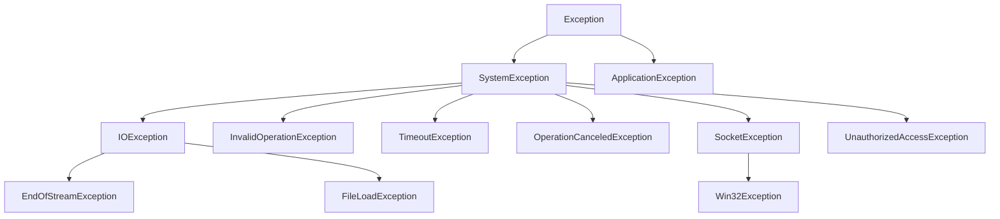
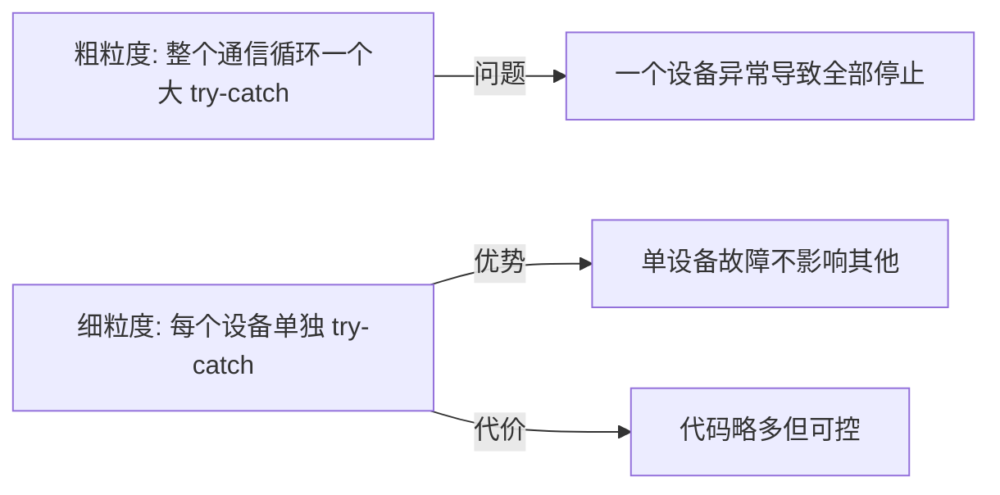
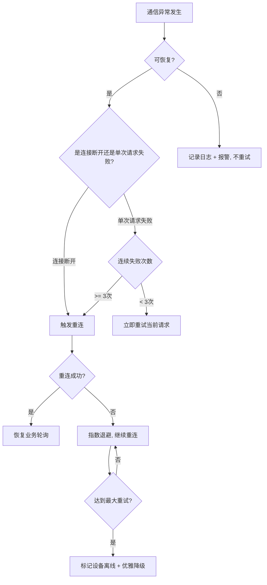
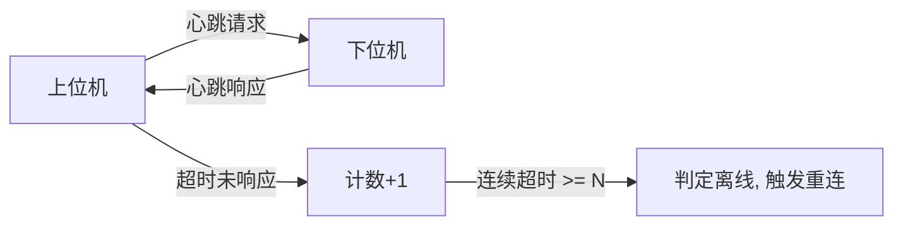
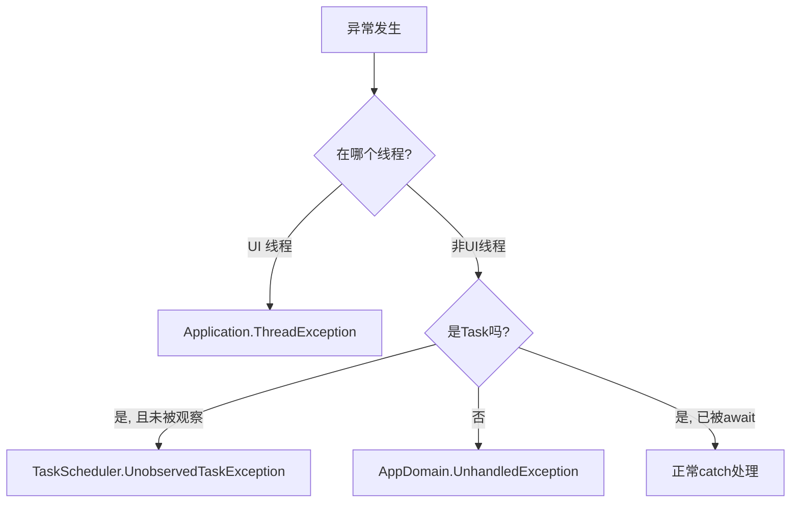
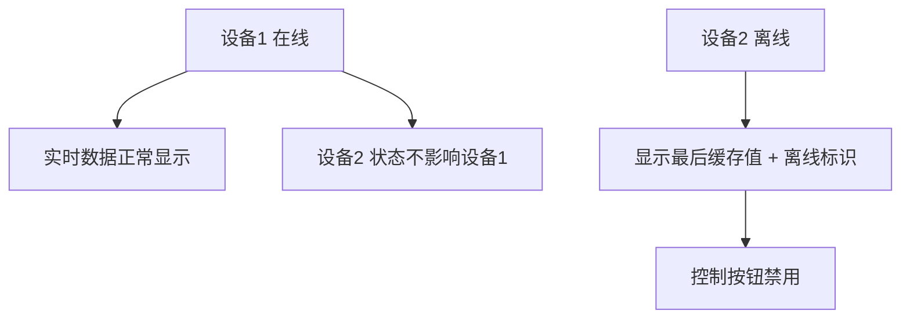

<ProgressIndicator
  current="winforms/winforms-error-recovery"
  items={[
    { slug: "winforms/winforms-roadmap", title: "路线图与岗位分析" },
    { slug: "winforms/winforms-basics", title: "WinForms 基础" },
    { slug: "winforms/winforms-serial-port", title: "串口通信实战" },
    { slug: "winforms/winforms-modbus-protocol", title: "Modbus 协议详解" },
    { slug: "winforms/winforms-multithreading-async", title: "多线程与异步" },
    { slug: "winforms/winforms-realtime-display", title: "实时数据展示" },
    { slug: "winforms/winforms-data-storage", title: "数据存储与导出" },
    { slug: "winforms/winforms-error-recovery", title: "异常处理与自动重连" },
    { slug: "winforms/winforms-project-temperature", title: "完整项目实战" },
  ]}
/>

# 异常处理与自动重连：让上位机在工业现场稳定运行

你在开发环境调试上位机时，一切正常——串口通信流畅、TCP 连接稳定、数据采集准确。但部署到工业现场后，情况变了：网线被踩断、PLC 周期性断电、USB 转串口线被操作员拔走、电磁干扰导致报文乱码……上位机弹出一堆未处理异常，然后卡死或崩溃。

**工业现场的异常不是"会不会发生"的问题，而是"什么时候发生、发生了怎么办"的问题。** 一个合格的上位机系统，必须在异常发生后自动恢复，至少要优雅降级，绝不能因为单个设备掉线就整个崩溃。

这篇文章会系统地讲解上位机中的异常处理与自动重连：从 .NET 异常体系回顾开始，到通信层的异常处理模式、自动重连机制的核心设计、心跳检测、看门狗、全局异常捕获、优雅降级，最后到系统健康检查。读完之后，你会拥有一套完整的高可用上位机构建方案。

:::tip 本篇是系列第 8 篇
本篇涉及的前置知识：串口通信（[/posts/winforms/winforms-serial-port](/posts/winforms/winforms-serial-port)）、Modbus 协议（[/posts/winforms/winforms-modbus-protocol](/posts/winforms/winforms-modbus-protocol)）、多线程与异步（[/posts/winforms/winforms-multithreading-async](/posts/winforms/winforms-multithreading-async)）。如果这些内容你还不熟悉，建议先阅读对应章节。
:::

---

## 一、.NET 异常体系回顾

### 1.1 Exception 类层次结构

.NET 的异常都继承自 `System.Exception`，上位机开发中最常遇到的异常集中在 I/O 和网络两个分支：



### 1.2 常见通信异常类型

上位机与下位机通信时，需要重点关注以下异常：

| 异常类型 | 常见场景 | 典型信息 |
|----------|----------|----------|
| `IOException` | 串口被拔出、端口不存在 | "端口 COM3 不存在" |
| `SocketException` | TCP 连接断开/拒绝 | 错误码 10054/10061 等 |
| `TimeoutException` | 读写超时 | "操作超时" |
| `UnauthorizedAccessException` | 串口被其他程序占用 | "对端口的访问被拒绝" |
| `InvalidOperationException` | 在未连接状态下读写 | "串口未打开" |
| `OperationCanceledException` | CancellationToken 触发 | 任务被取消 |

`SocketException` 的常见错误码在上位机开发中频繁出现：

| 错误码 | 常量名 | 含义 | 上位机应对 |
|--------|--------|------|-----------|
| 10054 | `ConnectionReset` | 连接被远端重置 | 服务器关闭连接，触发重连 |
| 10061 | `ConnectionRefused` | 连接被拒绝 | 服务器未启动，稍后重试 |
| 10065 | `HostUnreachable` | 主机不可达 | 网络断开，检查网络后重连 |
| 10060 | `TimedOut` | 连接超时 | 网络拥堵或服务器忙，延迟重试 |
| 10058 | `CannotSendAfterSocketShutdown` | Socket 关闭后发送 | 已断开，触发重连 |

### 1.3 InnerException 链

异常往往不是孤立发生的——外层异常包裹着内层异常，形成一条链。比如你调用 Modbus 读取寄存器时，底层 TCP 连接断开，会抛出 `SocketException`，Modbus 库把它包装成 `ModbusCommunicationException`，而你的业务层又可能把它包装成 `DeviceReadException`：

```csharp
try
{
    ushort[] values = await master.ReadHoldingRegistersAsync(1, 0, 10);
}
catch (Exception ex)
{
    Console.WriteLine($"外层异常: {ex.GetType().Name} - {ex.Message}");
    Console.WriteLine($"内层异常: {ex.InnerException?.GetType().Name} - {ex.InnerException?.Message}");
    Console.WriteLine($"最内层: {ex.InnerException?.InnerException?.GetType().Name}");
}
```

在日志记录和错误诊断时，务必遍历 `InnerException` 链，否则可能丢失关键错误信息。

### 1.4 自定义异常类

上位机项目中，建议针对业务领域定义自定义异常，让错误处理更有针对性：

```csharp
public class DeviceException : Exception
{
    public string DeviceId { get; }
    public bool IsRecoverable { get; }

    public DeviceException(string deviceId, string message, bool isRecoverable = true)
        : base(message)
    {
        DeviceId = deviceId;
        IsRecoverable = isRecoverable;
    }

    public DeviceException(string deviceId, string message, Exception innerException, bool isRecoverable = true)
        : base(message, innerException)
    {
        DeviceId = deviceId;
        IsRecoverable = isRecoverable;
    }
}

public class ModbusDeviceException : DeviceException
{
    public byte SlaveId { get; }
    public byte ModbusErrorCode { get; }

    public ModbusDeviceException(string deviceId, byte slaveId, byte errorCode, string message)
        : base(deviceId, message, isRecoverable: true)
    {
        SlaveId = slaveId;
        ModbusErrorCode = errorCode;
    }
}
```

`IsRecoverable` 属性特别重要——可恢复的异常触发重连，不可恢复的异常（如设备地址错误）只需报警，不需要反复重试。

---

## 二、通信层的异常处理模式

### 2.1 try-catch 的粒度选择

异常处理的粒度决定了系统的容错能力。粒度太粗，一个设备出问题会影响其他设备；粒度太细，代码会被 try-catch 淹没。



**推荐做法：以设备为单位做 try-catch**，外层再加一个全局兜底：

```csharp
public async Task PollAllDevicesAsync(CancellationToken ct)
{
    while (!ct.IsCancellationRequested)
    {
        foreach (var device in _devices)
        {
            try
            {
                await device.ReadAsync(ct);
            }
            catch (DeviceException ex)
            {
                device.MarkOffline(ex.Message);
                Logger.Warn($"设备 {device.Id} 读取失败: {ex.Message}");
            }
            catch (Exception ex)
            {
                device.MarkOffline($"未知异常: {ex.Message}");
                Logger.Error($"设备 {device.Id} 未预期异常", ex);
            }
        }

        await Task.Delay(_pollInterval, ct);
    }
}
```

### 2.2 串口通信异常场景

串口通信是上位机中最脆弱的环节，因为涉及物理硬件的插拔：

| 场景 | 触发的异常 | 处理策略 |
|------|-----------|----------|
| COM 端口不存在 | `IOException` | 提示用户，等待串口出现 |
| 端口被其他程序占用 | `UnauthorizedAccessException` | 提示关闭占用程序 |
| 串口使用中被拔出 | `IOException` | 标记离线，启动重连 |
| 数据校验错误 | 自定义校验异常 | 丢弃当前帧，继续接收 |
| 读写超时 | `TimeoutException` | 重试或标记设备无响应 |

串口被拔出是最常见的异常。`SerialPort` 在被拔出后，`Read` / `Write` 操作会抛出 `IOException`，而 `DataReceived` 事件会停止触发：

```csharp
private void SerialPort_DataReceived(object sender, SerialDataReceivedEventArgs e)
{
    try
    {
        var sp = (SerialPort)sender;
        int bytesToRead = sp.BytesToRead;
        byte[] buffer = new byte[bytesToRead];
        sp.Read(buffer, 0, bytesToRead);
        ProcessData(buffer);
    }
    catch (IOException ex)
    {
        OnConnectionLost($"串口读取异常: {ex.Message}");
    }
    catch (InvalidOperationException ex)
    {
        OnConnectionLost($"串口已关闭: {ex.Message}");
    }
}
```

### 2.3 TCP 通信异常场景

TCP 通信的异常类型更多，需要分别处理：

```csharp
public async Task<byte[]> SendAndReceiveAsync(byte[] request, CancellationToken ct)
{
    try
    {
        if (!_tcpClient.Connected)
            throw new InvalidOperationException("TCP 未连接");

        var stream = _tcpClient.GetStream();
        await stream.WriteAsync(request, 0, request.Length, ct);

        byte[] header = new byte[8];
        int bytesRead = await stream.ReadAsync(header, 0, header.Length, ct);
        if (bytesRead == 0)
            throw new IOException("远端关闭连接（Read 返回 0 字节）");

        int payloadLen = BitConverter.ToInt16(header, 4);
        byte[] payload = new byte[payloadLen];
        await ReadExactAsync(stream, payload, ct);

        return header.Concat(payload).ToArray();
    }
    catch (SocketException ex) when (ex.SocketErrorCode == SocketError.ConnectionReset)
    {
        OnConnectionLost("连接被远端重置");
        throw new DeviceException(_deviceId, "连接被重置", ex);
    }
    catch (SocketException ex) when (ex.SocketErrorCode == SocketError.TimedOut)
    {
        throw new TimeoutException("TCP 读写超时", ex);
    }
    catch (IOException ex) when (ex.InnerException is SocketException se)
    {
        OnConnectionLost($"底层 Socket 异常: {se.SocketErrorCode}");
        throw new DeviceException(_deviceId, "通信异常", ex);
    }
}
```

:::important Read 返回 0 字节的含义
TCP 的 `Read` 方法返回 0 表示远端已正常关闭连接（发送了 FIN），这不是错误，但意味着连接已断开，需要触发重连。很多开发者误以为返回 0 是超时，实际上超时会抛出 `TimeoutException` 或 `SocketException`。
:::

### 2.4 异常恢复策略选择

异常发生后，恢复策略取决于异常的性质：



---

## 三、自动重连机制 —— 核心设计

### 3.1 设计原则

自动重连不是简单地写个 `while(true) try { Connect(); break; } catch { }`，它需要遵守以下原则：

| 原则 | 说明 |
|------|------|
| 区分主动断开和异常断开 | 用户主动断开不应触发重连 |
| 重连间隔递增 | 指数退避，避免空转消耗 CPU 和网络 |
| 最大重试次数限制 | 避免无限重连占用资源 |
| 重连成功后恢复业务 | 不只是恢复连接，还要恢复轮询/订阅 |
| UI 反馈 | 显示连接状态、重连倒计时 |

### 3.2 TCP 自动重连

下面是一个完整的 `ReconnectableTcpClient` 类，支持自动重连、指数退避、状态通知：

```csharp
public class ReconnectableTcpClient : IDisposable
{
    private readonly string _host;
    private readonly int _port;
    private readonly int _maxRetryCount;
    private readonly TimeSpan _initialRetryDelay;
    private readonly TimeSpan _maxRetryDelay;

    private TcpClient? _tcpClient;
    private CancellationTokenSource? _connectCts;
    private CancellationTokenSource? _lifecycleCts;
    private readonly object _lock = new();

    public event EventHandler<ConnectionStateChangedEventArgs>? ConnectionStateChanged;

    public bool IsConnected
    {
        get
        {
            lock (_lock)
                return _tcpClient?.Connected ?? false;
        }
    }

    public ReconnectableTcpClient(string host, int port,
        int maxRetryCount = 20,
        TimeSpan? initialRetryDelay = null,
        TimeSpan? maxRetryDelay = null)
    {
        _host = host;
        _port = port;
        _maxRetryCount = maxRetryCount;
        _initialRetryDelay = initialRetryDelay ?? TimeSpan.FromSeconds(1);
        _maxRetryDelay = maxRetryDelay ?? TimeSpan.FromSeconds(30);
    }

    public async Task StartAsync(CancellationToken ct)
    {
        _lifecycleCts = CancellationTokenSource.CreateLinkedTokenSource(ct);
        await ConnectWithRetryAsync(_lifecycleCts.Token);
    }

    private async Task ConnectWithRetryAsync(CancellationToken ct)
    {
        int retryCount = 0;

        while (!ct.IsCancellationRequested && retryCount < _maxRetryCount)
        {
            try
            {
                NotifyState(ConnectionState.Connecting, retryCount, "正在连接...");
                _tcpClient = new TcpClient();
                await _tcpClient.ConnectAsync(_host, _port, ct);

                retryCount = 0;
                NotifyState(ConnectionState.Connected, 0, "连接成功");
                return;
            }
            catch (OperationCanceledException)
            {
                return;
            }
            catch (Exception ex)
            {
                retryCount++;
                var delay = CalculateBackoffDelay(retryCount);
                NotifyState(ConnectionState.Reconnecting, retryCount,
                    $"连接失败({ex.Message})，{delay.TotalSeconds:F0}秒后第{retryCount}次重试...");

                await Task.Delay(delay, ct).ContinueWith(_ => { });
            }
        }

        NotifyState(ConnectionState.Failed, retryCount,
            $"已达最大重试次数({_maxRetryCount})，放弃连接");
    }

    private TimeSpan CalculateBackoffDelay(int retryCount)
    {
        double seconds = _initialRetryDelay.TotalSeconds * Math.Pow(2, retryCount - 1);
        seconds = Math.Min(seconds, _maxRetryDelay.TotalSeconds);
        seconds += new Random().NextDouble() * 0.5;
        return TimeSpan.FromSeconds(seconds);
    }

    public async Task OnConnectionLostAsync(string reason)
    {
        NotifyState(ConnectionState.Disconnected, 0, reason);

        if (_lifecycleCts is { IsCancellationRequested: false })
        {
            try { _tcpClient?.Close(); } catch { }
            await ConnectWithRetryAsync(_lifecycleCts.Token);
        }
    }

    public NetworkStream GetStream()
    {
        lock (_lock)
        {
            if (_tcpClient?.Connected != true)
                throw new InvalidOperationException("TCP 未连接");
            return _tcpClient.GetStream();
        }
    }

    private void NotifyState(ConnectionState state, int retryCount, string message)
    {
        ConnectionStateChanged?.Invoke(this,
            new ConnectionStateChangedEventArgs(state, retryCount, message));
    }

    public void Dispose()
    {
        _lifecycleCts?.Cancel();
        _connectCts?.Cancel();
        _tcpClient?.Close();
        _lifecycleCts?.Dispose();
        _connectCts?.Dispose();
    }
}

public enum ConnectionState
{
    Disconnected,
    Connecting,
    Connected,
    Reconnecting,
    Failed
}

public class ConnectionStateChangedEventArgs : EventArgs
{
    public ConnectionState State { get; }
    public int RetryCount { get; }
    public string Message { get; }

    public ConnectionStateChangedEventArgs(ConnectionState state, int retryCount, string message)
    {
        State = state;
        RetryCount = retryCount;
        Message = message;
    }
}
```

<CodeAnnotation
  language="csharp"
  lines={[
    { code: 'private readonly TimeSpan _maxRetryDelay;', note: '退避上限，防止间隔过长' },
    { code: '', },
    { code: 'private async Task ConnectWithRetryAsync(CancellationToken ct)', note: '核心重连循环，指数退避 + 最大次数限制' },
    { code: '    var delay = CalculateBackoffDelay(retryCount);', note: '计算当前重试的等待时间' },
    { code: '    await Task.Delay(delay, ct).ContinueWith(_ => { });', note: 'ContinueWith 吞掉取消异常，外层循环会检查 ct' },
    { code: '', },
    { code: 'private TimeSpan CalculateBackoffDelay(int retryCount)', note: '指数退避公式：初始间隔 × 2^(重试次数-1)，加上随机抖动避免多个客户端同时重连' },
    { code: '    seconds += new Random().NextDouble() * 0.5;', note: '随机抖动 0~0.5秒，防止雷群效应' },
    { code: '', },
    { code: 'public async Task OnConnectionLostAsync(string reason)', note: '检测到断开后调用此方法，自动进入重连流程' },
  ]}
/>

### 3.3 串口自动重连

串口与 TCP 最大的区别是：串口是本地硬件资源，拔出后端口直接消失。重连策略需要感知串口的出现和消失。

#### WMI 事件监听串口变化

Windows 管理规范（WMI）提供了设备变化事件，可以检测 USB 串口的插拔：

```csharp
public class SerialPortWatcher : IDisposable
{
    private ManagementEventWatcher? _arrivalWatcher;
    private ManagementEventWatcher? _removalWatcher;

    public event EventHandler<SerialPortChangedEventArgs>? PortArrived;
    public event EventHandler<SerialPortChangedEventArgs>? PortRemoved;

    public void Start()
    {
        var arrivalQuery = new WqlEventQuery("SELECT * FROM __InstanceCreationEvent WITHIN 2 WHERE TargetInstance ISA 'Win32_SerialPort'");
        _arrivalWatcher = new ManagementEventWatcher(arrivalQuery);
        _arrivalWatcher.EventArrived += (s, e) =>
        {
            string? portName = (e.NewEvent["TargetInstance"] as ManagementBaseObject)?["DeviceID"]?.ToString();
            if (portName != null)
                PortArrived?.Invoke(this, new SerialPortChangedEventArgs(portName));
        };
        _arrivalWatcher.Start();

        var removalQuery = new WqlEventQuery("SELECT * FROM __InstanceDeletionEvent WITHIN 2 WHERE TargetInstance ISA 'Win32_SerialPort'");
        _removalWatcher = new ManagementEventWatcher(removalQuery);
        _removalWatcher.EventArrived += (s, e) =>
        {
            string? portName = (e.NewEvent["TargetInstance"] as ManagementBaseObject)?["DeviceID"]?.ToString();
            if (portName != null)
                PortRemoved?.Invoke(this, new SerialPortChangedEventArgs(portName));
        };
        _removalWatcher.Start();
    }

    public void Dispose()
    {
        _arrivalWatcher?.Stop();
        _arrivalWatcher?.Dispose();
        _removalWatcher?.Stop();
        _removalWatcher?.Dispose();
    }
}

public class SerialPortChangedEventArgs : EventArgs
{
    public string PortName { get; }
    public SerialPortChangedEventArgs(string portName) => PortName = portName;
}
```

:::warning WMI 需要引用 System.Management
使用前需在项目中添加 `<PackageReference Include="System.Management" Version="8.0.0" />`，并在代码中 `using System.Management;`。
:::

#### 完整的 ReconnectableSerialPort

```csharp
public class ReconnectableSerialPort : IDisposable
{
    private readonly string _portName;
    private readonly int _baudRate;
    private readonly int _maxRetryCount;
    private readonly TimeSpan _retryInterval;

    private SerialPort? _serialPort;
    private SerialPortWatcher? _watcher;
    private CancellationTokenSource? _lifecycleCts;
    private readonly object _lock = new();

    public event EventHandler<ConnectionStateChangedEventArgs>? ConnectionStateChanged;
    public event EventHandler<byte[]>? DataReceived;

    public bool IsOpen
    {
        get { lock (_lock) return _serialPort?.IsOpen ?? false; }
    }

    public ReconnectableSerialPort(string portName, int baudRate,
        int maxRetryCount = 30,
        TimeSpan? retryInterval = null)
    {
        _portName = portName;
        _baudRate = baudRate;
        _maxRetryCount = maxRetryCount;
        _retryInterval = retryInterval ?? TimeSpan.FromSeconds(3);
    }

    public async Task StartAsync(CancellationToken ct)
    {
        _lifecycleCts = CancellationTokenSource.CreateLinkedTokenSource(ct);

        _watcher = new SerialPortWatcher();
        _watcher.PortArrived += OnPortArrived;
        _watcher.Start();

        await OpenWithRetryAsync(_lifecycleCts.Token);
    }

    private async void OnPortArrived(object? sender, SerialPortChangedEventArgs e)
    {
        if (e.PortName == _portName && !IsOpen && _lifecycleCts is { IsCancellationRequested: false })
        {
            NotifyState(ConnectionState.Reconnecting, 0, $"检测到串口 {e.PortName} 插入，尝试重连...");
            await OpenWithRetryAsync(_lifecycleCts.Token);
        }
    }

    private async Task OpenWithRetryAsync(CancellationToken ct)
    {
        int retryCount = 0;

        while (!ct.IsCancellationRequested && retryCount < _maxRetryCount)
        {
            try
            {
                if (!PortExists(_portName))
                    throw new IOException($"端口 {_portName} 不存在");

                _serialPort = new SerialPort(_portName, _baudRate)
                {
                    ReadTimeout = 1000,
                    WriteTimeout = 1000
                };
                _serialPort.DataReceived += OnDataReceived;
                _serialPort.Open();

                NotifyState(ConnectionState.Connected, 0, $"串口 {_portName} 已打开");
                return;
            }
            catch (OperationCanceledException) { return; }
            catch (Exception ex)
            {
                retryCount++;
                NotifyState(ConnectionState.Reconnecting, retryCount,
                    $"串口打开失败({ex.Message})，{_retryInterval.TotalSeconds:F0}秒后第{retryCount}次重试...");

                await Task.Delay(_retryInterval, ct).ContinueWith(_ => { });
            }
        }

        NotifyState(ConnectionState.Failed, retryCount, "串口重连已达最大次数");
    }

    private bool PortExists(string portName)
    {
        return SerialPort.GetPortNames().Contains(portName);
    }

    private void OnDataReceived(object sender, SerialDataReceivedEventArgs e)
    {
        try
        {
            var sp = (SerialPort)sender;
            int bytesToRead = sp.BytesToRead;
            byte[] buffer = new byte[bytesToRead];
            sp.Read(buffer, 0, bytesToRead);
            DataReceived?.Invoke(this, buffer);
        }
        catch (IOException)
        {
            HandleConnectionLost("串口读取异常（可能已拔出）");
        }
        catch (InvalidOperationException)
        {
            HandleConnectionLost("串口已关闭");
        }
    }

    private async void HandleConnectionLost(string reason)
    {
        NotifyState(ConnectionState.Disconnected, 0, reason);

        try { _serialPort?.Close(); } catch { }

        if (_lifecycleCts is { IsCancellationRequested: false })
            await OpenWithRetryAsync(_lifecycleCts.Token);
    }

    public void Write(byte[] data)
    {
        lock (_lock)
        {
            if (_serialPort?.IsOpen != true)
                throw new InvalidOperationException("串口未打开");
            _serialPort.Write(data, 0, data.Length);
        }
    }

    private void NotifyState(ConnectionState state, int retryCount, string message)
    {
        ConnectionStateChanged?.Invoke(this,
            new ConnectionStateChangedEventArgs(state, retryCount, message));
    }

    public void Dispose()
    {
        _lifecycleCts?.Cancel();
        _watcher?.Dispose();
        _serialPort?.Close();
        _serialPort?.Dispose();
        _lifecycleCts?.Dispose();
    }
}
```

---

## 四、心跳检测机制

### 4.1 为什么需要心跳

TCP 自带的 KeepAlive 机制不够用，原因有三：

1. **默认间隔太长**：Windows 默认 2 小时才发一次 KeepAlive 探测，上位机需要秒级检测
2. **只检测 TCP 层连通**：对端机器可能还活着但应用已死（如 PLC 通信模块崩溃），TCP KeepAlive 无法发现
3. **无法区分设备类型**：心跳可以携带设备状态信息，KeepAlive 只是空 ACK

上位机需要应用层心跳：定期向设备发送请求，收到响应则认为设备在线，超时无响应则判定离线。

### 4.2 心跳包设计



心跳的核心参数：

| 参数 | 推荐值 | 说明 |
|------|--------|------|
| 心跳间隔 | 5~10 秒 | 视设备响应速度而定 |
| 单次超时 | 3 秒 | 单次请求等待时间 |
| 最大连续失败 | 3 次 | 超过则判定离线 |

### 4.3 Modbus 心跳

Modbus 设备最自然的心跳方式是定期读取一个固定寄存器，比如设备状态寄存器：

```csharp
public class HeartbeatMonitor : IDisposable
{
    private readonly IModbusMaster _master;
    private readonly byte _slaveId;
    private readonly ushort _heartbeatRegister;
    private readonly TimeSpan _interval;
    private readonly TimeSpan _timeout;
    private readonly int _maxConsecutiveFailures;

    private CancellationTokenSource? _cts;
    private int _consecutiveFailures;

    public event EventHandler<HeartbeatEventArgs>? HeartbeatReceived;
    public event EventHandler? DeviceOffline;
    public event EventHandler? DeviceOnline;

    public bool IsAlive => _consecutiveFailures == 0;

    public HeartbeatMonitor(
        IModbusMaster master,
        byte slaveId,
        ushort heartbeatRegister = 0,
        TimeSpan? interval = null,
        TimeSpan? timeout = null,
        int maxConsecutiveFailures = 3)
    {
        _master = master;
        _slaveId = slaveId;
        _heartbeatRegister = heartbeatRegister;
        _interval = interval ?? TimeSpan.FromSeconds(5);
        _timeout = timeout ?? TimeSpan.FromSeconds(3);
        _maxConsecutiveFailures = maxConsecutiveFailures;
    }

    public void Start(CancellationToken ct)
    {
        _cts = CancellationTokenSource.CreateLinkedTokenSource(ct);
        _ = RunHeartbeatLoopAsync(_cts.Token);
    }

    private async Task RunHeartbeatLoopAsync(CancellationToken ct)
    {
        while (!ct.IsCancellationRequested)
        {
            try
            {
                using var timeoutCts = new CancellationTokenSource(_timeout);
                using var linkedCts = CancellationTokenSource.CreateLinkedTokenSource(ct, timeoutCts.Token);

                ushort[] values = await _master.ReadHoldingRegistersAsync(
                    _slaveId, _heartbeatRegister, 1, linkedCts.Token);

                _consecutiveFailures = 0;
                HeartbeatReceived?.Invoke(this, new HeartbeatEventArgs(values[0]));

                if (_consecutiveFailures == 0)
                    DeviceOnline?.Invoke(this, EventArgs.Empty);
            }
            catch (Exception ex) when (ex is not OperationCanceledException)
            {
                _consecutiveFailures++;
                HeartbeatReceived?.Invoke(this, new HeartbeatEventArgs(ex));

                if (_consecutiveFailures >= _maxConsecutiveFailures)
                    DeviceOffline?.Invoke(this, EventArgs.Empty);
            }

            await Task.Delay(_interval, ct).ContinueWith(_ => { });
        }
    }

    public void Dispose()
    {
        _cts?.Cancel();
        _cts?.Dispose();
    }
}

public class HeartbeatEventArgs : EventArgs
{
    public bool IsSuccess { get; }
    public ushort? Value { get; }
    public Exception? Error { get; }

    public HeartbeatEventArgs(ushort value)
    {
        IsSuccess = true;
        Value = value;
    }

    public HeartbeatEventArgs(Exception error)
    {
        IsSuccess = false;
        Error = error;
    }
}
```

### 4.4 自定义协议心跳

如果设备不支持 Modbus，可以使用自定义心跳包。通常做法是发送一个固定格式的查询帧，期望收到固定格式的响应：

```csharp
private async Task<bool> SendCustomHeartbeatAsync(CancellationToken ct)
{
    byte[] request = BuildHeartbeatFrame();

    await _serialPort.WriteAsync(request, 0, request.Length, ct);

    byte[] response = new byte[ExpectedResponseLength];
    int totalRead = 0;
    var timeoutCts = new CancellationTokenSource(_timeout);

    while (totalRead < ExpectedResponseLength)
    {
        using var linkedCts = CancellationTokenSource.CreateLinkedTokenSource(ct, timeoutCts.Token);
        int bytesRead = await _serialPort.ReadAsync(response, totalRead,
            ExpectedResponseLength - totalRead, linkedCts.Token);
        if (bytesRead == 0) return false;
        totalRead += bytesRead;
    }

    return ValidateHeartbeatResponse(response);
}
```

---

## 五、看门狗（Watchdog）

### 5.1 概念

看门狗源自嵌入式系统：一个定时器必须在规定时间内被"喂狗"（重置），否则超时触发系统复位。在上位机中，看门狗用来监控关键任务是否在正常运行——如果某个轮询线程卡死或长时间无响应，看门狗触发恢复操作。

### 5.2 实现

```csharp
public class Watchdog : IDisposable
{
    private readonly TimeSpan _timeout;
    private readonly Action _onTimeout;
    private CancellationTokenSource? _cts;
    private volatile bool _fed;

    public Watchdog(TimeSpan timeout, Action onTimeout)
    {
        _timeout = timeout;
        _onTimeout = onTimeout;
    }

    public void Start()
    {
        _cts = new CancellationTokenSource();
        _ = MonitorAsync(_cts.Token);
    }

    public void Feed()
    {
        _fed = true;
    }

    private async Task MonitorAsync(CancellationToken ct)
    {
        while (!ct.IsCancellationRequested)
        {
            await Task.Delay(_timeout, ct).ContinueWith(_ => { });

            if (ct.IsCancellationRequested) break;

            if (!_fed)
            {
                _onTimeout();
            }

            _fed = false;
        }
    }

    public void Dispose()
    {
        _cts?.Cancel();
        _cts?.Dispose();
    }
}
```

使用看门狗监控轮询任务：

```csharp
public class DevicePoller
{
    private readonly Watchdog _watchdog;
    private readonly IDevice _device;

    public DevicePoller(IDevice device)
    {
        _device = device;
        _watchdog = new Watchdog(
            TimeSpan.FromSeconds(30),
            OnWatchdogTimeout);
    }

    public async Task RunAsync(CancellationToken ct)
    {
        _watchdog.Start();

        while (!ct.IsCancellationRequested)
        {
            try
            {
                await _device.ReadAsync(ct);
                _watchdog.Feed();
            }
            catch (Exception ex)
            {
                Logger.Warn($"设备读取异常: {ex.Message}");
            }

            await Task.Delay(1000, ct).ContinueWith(_ => { });
        }
    }

    private void OnWatchdogTimeout()
    {
        Logger.Error("看门狗超时！设备轮询可能卡死，执行恢复...");
        try { _device.Disconnect(); } catch { }
        _ = _device.ReconnectAsync();
    }
}
```

:::tip 看门狗超时时间设置
看门狗的超时时间应大于正常轮询周期。如果轮询周期是 1 秒，看门狗设 5~10 秒比较合理——给正常操作留余量，但不会在真正卡死时等太久。
:::

---

## 六、全局异常捕获 —— 最后一道防线

即使你对通信层做了完善的 try-catch，仍可能遗漏未处理的异常。全局异常捕获就是最后的兜底，防止程序直接崩溃。

### 6.1 三种全局异常事件

| 事件 | 覆盖范围 | 触发条件 |
|------|----------|----------|
| `Application.ThreadException` | UI 线程未处理异常 | WinForms 控件事件中抛出异常 |
| `AppDomain.UnhandledException` | 非 UI 线程未处理异常 | 后台线程、ThreadPool 中的异常 |
| `TaskScheduler.UnobservedTaskException` | Task 异常未被观察 | Task 抛出异常且未被 await/Wait/Result |



:::warning UnobservedTaskException 的时机
`TaskScheduler.UnobservedTaskException` 不是在 Task 完成时触发，而是在 Task 被 GC 回收时触发。这意味着异常可能延迟很久才被捕获，而且如果 Task 一直不被回收，事件可能永远不触发。所以**不要依赖它来处理 Task 异常**，始终 await 或处理 Task。
:::

### 6.2 完整的 Program.cs

```csharp
internal static class Program
{
    [STAThread]
    static void Main()
    {
        Application.SetUnhandledExceptionMode(UnhandledExceptionMode.CatchException);
        Application.ThreadException += Application_ThreadException;
        AppDomain.CurrentDomain.UnhandledException += CurrentDomain_UnhandledException;
        TaskScheduler.UnobservedTaskException += TaskScheduler_UnobservedTaskException;

        Application.EnableVisualStyles();
        Application.SetCompatibleTextRenderingDefault(false);
        Application.SetHighDpiMode(HighDpiMode.SystemAware);

        try
        {
            Application.Run(new MainForm());
        }
        catch (Exception ex)
        {
            HandleFatalException(ex);
        }
        finally
        {
            Cleanup();
        }
    }

    private static void Application_ThreadException(object sender, ThreadExceptionEventArgs e)
    {
        Logger.Error("UI 线程未处理异常", e.Exception);

        var result = MessageBox.Show(
            $"发生未预期的错误：\n\n{e.Exception.Message}\n\n是否继续运行？",
            "程序错误",
            MessageBoxButtons.YesNo,
            MessageBoxIcon.Error);

        if (result == DialogResult.No)
            Application.Exit();
    }

    private static void CurrentDomain_UnhandledException(object sender, UnhandledExceptionEventArgs e)
    {
        var ex = e.ExceptionObject as Exception;
        Logger.Fatal("非UI线程未处理异常", ex);

        if (e.IsTerminating)
        {
            try
            {
                DumpCrashLog(ex);
            }
            catch { }
        }
    }

    private static void TaskScheduler_UnobservedTaskException(object? sender, UnobservedTaskExceptionEventArgs e)
    {
        Logger.Error("Task 未观察异常", e.Exception);
        e.SetObserved();
    }

    private static void HandleFatalException(Exception ex)
    {
        Logger.Fatal("致命异常，程序即将退出", ex);
        DumpCrashLog(ex);
    }

    private static void DumpCrashLog(Exception? ex)
    {
        string crashDir = Path.Combine(AppDomain.CurrentDomain.BaseDirectory, "crash");
        Directory.CreateDirectory(crashDir);
        string fileName = $"crash_{DateTime.Now:yyyyMMdd_HHmmss}.log";
        string filePath = Path.Combine(crashDir, fileName);

        File.WriteAllText(filePath, $"""
            === Crash Report ===
            Time: {DateTime.Now:yyyy-MM-dd HH:mm:ss}
            OS: {Environment.OSVersion}
            .NET: {Environment.Version}
            Machine: {Environment.MachineName}

            Exception:
            {ex?.ToString() ?? "Unknown"}
            """);
    }

    private static void Cleanup()
    {
        Application.ThreadException -= Application_ThreadException;
        AppDomain.CurrentDomain.UnhandledException -= CurrentDomain_UnhandledException;
        TaskScheduler.UnobservedTaskException -= TaskScheduler_UnobservedTaskException;
    }
}
```

:::important Application.ThreadException 的局限
`Application.ThreadException` 只捕获通过 WinForms 消息循环派发的异常（即控件事件中抛出的异常）。如果你在 `Application.Run` 之前或在非 UI 线程的控件操作中抛出异常，它不会被捕获。必须同时设置 `Application.SetUnhandledExceptionMode(UnhandledExceptionMode.CatchException)` 才能确保所有 UI 线程异常都走这个事件。
:::

---

## 七、优雅降级

### 7.1 设计理念

优雅降级的核心思想：**系统部分失效时，已失效的功能不影响正常功能，用户能清楚地知道哪些功能不可用。**



### 7.2 设备离线时的界面处理

```csharp
public class DeviceViewModel : INotifyPropertyChanged
{
    private bool _isOnline;
    private double _currentValue;
    private double? _lastValidValue;
    private DateTime _lastUpdateTime;

    public bool IsOnline
    {
        get => _isOnline;
        set
        {
            if (_isOnline != value)
            {
                _isOnline = value;
                OnPropertyChanged(nameof(IsOnline));
                OnPropertyChanged(nameof(DisplayValue));
                OnPropertyChanged(nameof(StatusText));
                OnPropertyChanged(nameof(CanControl));
            }
        }
    }

    public string DisplayValue =>
        _isOnline ? _currentValue.ToString("F1")
        : _lastValidValue.HasValue ? $"-- (缓存: {_lastValidValue.Value:F1})"
        : "N/A";

    public string StatusText =>
        _isOnline ? "在线"
        : $"离线 (最后更新: {_lastUpdateTime:HH:mm:ss})";

    public bool CanControl => _isOnline;

    public void UpdateValue(double value)
    {
        _currentValue = value;
        _lastValidValue = value;
        _lastUpdateTime = DateTime.Now;
        IsOnline = true;
    }

    public void MarkOffline()
    {
        IsOnline = false;
    }

    public event PropertyChangedEventHandler? PropertyChanged;
    protected void OnPropertyChanged(string name) =>
        PropertyChanged?.Invoke(this, new PropertyChangedEventArgs(name));
}
```

### 7.3 WinForms 中的 UI 绑定

```csharp
public partial class DeviceControlPanel : UserControl
{
    private readonly DeviceViewModel _vm;

    public DeviceControlPanel(DeviceViewModel vm)
    {
        _vm = vm;
        InitializeComponent();
        SetupDataBindings();
    }

    private void SetupDataBindings()
    {
        lblStatus.DataBindings.Add("Text", _vm, "StatusText");
        lblValue.DataBindings.Add("Text", _vm, "DisplayValue");
        btnStart.DataBindings.Add("Enabled", _vm, "CanControl");
        btnStop.DataBindings.Add("Enabled", _vm, "CanControl");
        btnSetTemp.DataBindings.Add("Enabled", _vm, "CanControl");

        _vm.PropertyChanged += (s, e) =>
        {
            if (e.PropertyName == nameof(_vm.IsOnline))
            {
                this.BeginInvoke(new Action(() =>
                {
                    pnlDevice.BackColor = _vm.IsOnline
                        ? Color.FromArgb(230, 255, 230)
                        : Color.FromArgb(245, 245, 245);
                    picStatus.Image = _vm.IsOnline
                        ? Properties.Resources.online
                        : Properties.Resources.offline;
                }));
            }
        };
    }
}
```

### 7.4 数据缺失时的占位显示

在数据表格和曲线图中，缺失数据要用明确的占位符：

```csharp
public string FormatDataPoint(double? value)
{
    return value.HasValue ? value.Value.ToString("F2") : "--";
}

public void UpdateChart(Series series, DateTime timestamp, double? value)
{
    if (value.HasValue)
    {
        series.Points.AddXY(timestamp, value.Value);
    }
    else
    {
        int index = series.Points.AddXY(timestamp, double.NaN);
        series.Points[index].IsEmpty = true;
    }
}
```

---

## 八、通信重试策略

### 8.1 重试的粒度

重试分两个层次：**单次请求重试**和**连接级重连**，它们的目的不同：

| 层次 | 触发条件 | 典型重试次数 | 间隔 |
|------|----------|-------------|------|
| 单次请求重试 | 超时、校验错误、Modbus 异常响应 | 2~3 次 | 立即或短延迟 |
| 连接级重连 | 连接断开、设备离线 | 无限（有退避上限） | 指数退避 |

```csharp
public async Task<ushort[]> ReadWithRetryAsync(byte slaveId, ushort start, ushort count, CancellationToken ct)
{
    int maxRetries = 3;
    for (int attempt = 0; attempt <= maxRetries; attempt++)
    {
        try
        {
            return await _master.ReadHoldingRegistersAsync(slaveId, start, count, ct);
        }
        catch (TimeoutException) when (attempt < maxRetries)
        {
            await Task.Delay(200, ct);
            continue;
        }
        catch (SocketException ex) when (IsConnectionError(ex.SocketErrorCode))
        {
            await OnConnectionLostAsync($"Socket 错误: {ex.SocketErrorCode}");
            throw;
        }
    }

    throw new TimeoutException($"读取寄存器 {start}-{start + count - 1} 重试 {maxRetries} 次后仍超时");
}

private bool IsConnectionError(SocketError error)
{
    return error is SocketError.ConnectionReset
        or SocketError.ConnectionRefused
        or SocketError.HostUnreachable
        or SocketError.NetworkUnreachable
        or SocketError.NotConnected;
}
```

### 8.2 使用 Polly 重试库

[Polly](https://github.com/App-vNext/Polly) 是 .NET 生态中广泛使用的弹性和瞬态故障处理库，支持重试、熔断、超时、回退等策略：

```csharp
using Polly;
using Polly.Retry;

public class ResilientModbusClient
{
    private readonly IModbusMaster _master;
    private readonly AsyncRetryPolicy _retryPolicy;
    private readonly AsyncRetryPolicy _circuitBreakerRecovery;

    public ResilientModbusClient(IModbusMaster master)
    {
        _master = master;

        _retryPolicy = Policy
            .Handle<TimeoutException>()
            .Or<IOException>()
            .Or<SocketException>(ex => !IsConnectionError(ex.SocketErrorCode))
            .WaitAndRetryAsync(
                retryCount: 3,
                sleepDurationProvider: attempt => TimeSpan.FromMilliseconds(200 * attempt),
                onRetry: (ex, delay, retryCount, ctx) =>
                {
                    Logger.Warn($"第{retryCount}次重试，{delay.TotalMilliseconds}ms后执行。异常: {ex.Message}");
                });

        _circuitBreakerRecovery = Policy
            .Handle<SocketException>(ex => IsConnectionError(ex.SocketErrorCode))
            .Or<IOException>()
            .WaitAndRetryAsync(
                retryCount: 5,
                sleepDurationProvider: attempt => TimeSpan.FromSeconds(Math.Min(30, Math.Pow(2, attempt))),
                onRetry: async (ex, delay, retryCount, ctx) =>
                {
                    Logger.Warn($"连接异常，第{retryCount}次重连，{delay.TotalSeconds:F0}s后执行");
                    await ReconnectAsync();
                });
    }

    public async Task<ushort[]> ReadHoldingRegistersAsync(byte slaveId, ushort start, ushort count, CancellationToken ct)
    {
        return await _circuitBreakerRecovery.ExecuteAsync(async innerCt =>
        {
            return await _retryPolicy.ExecuteAsync(async retryCt =>
            {
                return await _master.ReadHoldingRegistersAsync(slaveId, start, count, retryCt);
            }, innerCt);
        }, ct);
    }
}
```

:::tip Polly 的选择建议
对于简单的上位机项目，手写重试逻辑足够；当项目需要组合多种策略（重试+熔断+超时+回退）时，Polly 的策略组合能力更有优势。Polly 通过 NuGet 安装：`dotnet add package Polly`。
:::

---

## 九、系统健康检查

### 9.1 自检清单

上位机启动时和运行中，应该定期检查以下关键资源：

| 检查项 | 检测方法 | 异常影响 |
|--------|----------|----------|
| 串口状态 | `SerialPort.GetPortNames()` | 无法通信 |
| 网络状态 | `NetworkInterface.GetIsNetworkAvailable()` + Ping | TCP 通信中断 |
| 数据库连接 | 执行简单查询 | 数据无法存储 |
| 磁盘空间 | `DriveInfo.AvailableFreeSpace` | 日志/数据写入失败 |
| 内存使用 | `Process.GetCurrentProcess().WorkingSet64` | 程序可能 OOM |

### 9.2 健康检查实现

```csharp
public class HealthCheckService
{
    private readonly List<IHealthCheck> _checks = new();

    public void Register(IHealthCheck check) => _checks.Add(check);

    public async Task<HealthReport> CheckAllAsync()
    {
        var results = new List<HealthCheckResult>();

        foreach (var check in _checks)
        {
            try
            {
                var result = await check.CheckAsync();
                results.Add(result);
            }
            catch (Exception ex)
            {
                results.Add(new HealthCheckResult(check.Name, HealthStatus.Unhealthy, ex.Message));
            }
        }

        var overallStatus = results.Any(r => r.Status == HealthStatus.Unhealthy)
            ? HealthStatus.Unhealthy
            : results.Any(r => r.Status == HealthStatus.Degraded)
                ? HealthStatus.Degraded
                : HealthStatus.Healthy;

        return new HealthReport(overallStatus, results);
    }
}

public interface IHealthCheck
{
    string Name { get; }
    Task<HealthCheckResult> CheckAsync();
}

public record HealthCheckResult(string Name, HealthStatus Status, string Message);

public enum HealthStatus { Healthy, Degraded, Unhealthy }

public record HealthReport(HealthStatus OverallStatus, IReadOnlyList<HealthCheckResult> Results);
```

具体的检查项实现：

```csharp
public class SerialPortHealthCheck : IHealthCheck
{
    private readonly string _portName;

    public string Name => $"串口 {_portName}";

    public SerialPortHealthCheck(string portName) => _portName = portName;

    public Task<HealthCheckResult> CheckAsync()
    {
        bool exists = SerialPort.GetPortNames().Contains(_portName);
        var status = exists ? HealthStatus.Healthy : HealthStatus.Unhealthy;
        var message = exists ? "端口可用" : "端口不存在";
        return Task.FromResult(new HealthCheckResult(Name, status, message));
    }
}

public class NetworkHealthCheck : IHealthCheck
{
    private readonly string _targetHost;

    public string Name => $"网络 {_targetHost}";

    public NetworkHealthCheck(string targetHost) => _targetHost = targetHost;

    public async Task<HealthCheckResult> CheckAsync()
    {
        if (!NetworkInterface.GetIsNetworkAvailable())
            return new HealthCheckResult(Name, HealthStatus.Unhealthy, "网络不可用");

        try
        {
            using var ping = new Ping();
            var reply = await ping.SendPingAsync(_targetHost, 3000);
            var status = reply.Status == IPStatus.Success
                ? HealthStatus.Healthy
                : HealthStatus.Degraded;
            return new HealthCheckResult(Name, status, $"Ping: {reply.Status}, {reply.RoundtripTime}ms");
        }
        catch (Exception ex)
        {
            return new HealthCheckResult(Name, HealthStatus.Unhealthy, ex.Message);
        }
    }
}

public class DiskSpaceHealthCheck : IHealthCheck
{
    private readonly string _driveName;
    private readonly long _minFreeBytes;

    public string Name => $"磁盘 {_driveName}";

    public DiskSpaceHealthCheck(string driveName, long minFreeBytesMB = 500)
    {
        _driveName = driveName;
        _minFreeBytes = minFreeBytesMB * 1024 * 1024;
    }

    public Task<HealthCheckResult> CheckAsync()
    {
        var drive = new DriveInfo(_driveName);
        if (!drive.IsReady)
            return Task.FromResult(new HealthCheckResult(Name, HealthStatus.Unhealthy, "驱动器未就绪"));

        bool enough = drive.AvailableFreeSpace >= _minFreeBytes;
        var status = enough ? HealthStatus.Healthy : HealthStatus.Degraded;
        var freeGB = drive.AvailableFreeSpace / (1024.0 * 1024 * 1024);
        return Task.FromResult(new HealthCheckResult(Name, status, $"可用空间: {freeGB:F1} GB"));
    }
}
```

### 9.3 健康检查面板 UI

在主窗体上添加一个状态栏，展示各检查项的实时状态：

```csharp
public partial class HealthStatusBar : UserControl
{
    private readonly HealthCheckService _healthService;
    private readonly Dictionary<string, PictureBox> _indicators = new();
    private System.Windows.Forms.Timer? _timer;

    public HealthStatusBar(HealthCheckService healthService)
    {
        _healthService = healthService;
        InitializeComponent();
        SetupLayout();
    }

    private void SetupLayout()
    {
        this.Dock = DockStyle.Bottom;
        this.Height = 28;
        this.BackColor = Color.FromArgb(240, 240, 240);

        var flowPanel = new FlowLayoutPanel
        {
            Dock = DockStyle.Fill,
            FlowDirection = FlowDirection.LeftToRight,
            AutoSize = true
        };

        foreach (var check in _healthService.GetChecks())
        {
            var indicator = new PictureBox
            {
                Size = new Size(16, 16),
                SizeMode = PictureBoxSizeMode.StretchImage,
                Tag = check.Name
            };
            _indicators[check.Name] = indicator;

            var label = new Label
            {
                Text = check.Name,
                AutoSize = true,
                Margin = new Padding(0, 4, 12, 0)
            };

            flowPanel.Controls.Add(indicator);
            flowPanel.Controls.Add(label);
        }

        this.Controls.Add(flowPanel);
    }

    public void StartPeriodicCheck(TimeSpan interval)
    {
        _timer = new System.Windows.Forms.Timer { Interval = (int)interval.TotalMilliseconds };
        _timer.Tick += async (s, e) => await UpdateIndicatorsAsync();
        _timer.Start();
        _ = UpdateIndicatorsAsync();
    }

    private async Task UpdateIndicatorsAsync()
    {
        var report = await _healthService.CheckAllAsync();

        this.BeginInvoke(new Action(() =>
        {
            foreach (var result in report.Results)
            {
                if (_indicators.TryGetValue(result.Name, out var indicator))
                {
                    indicator.BackColor = result.Status switch
                    {
                        HealthStatus.Healthy => Color.Green,
                        HealthStatus.Degraded => Color.Orange,
                        HealthStatus.Unhealthy => Color.Red,
                        _ => Color.Gray
                    };
                }
            }

            this.BackColor = report.OverallStatus switch
            {
                HealthStatus.Healthy => Color.FromArgb(230, 255, 230),
                HealthStatus.Degraded => Color.FromArgb(255, 248, 220),
                HealthStatus.Unhealthy => Color.FromArgb(255, 230, 230),
                _ => Color.FromArgb(240, 240, 240)
            };
        }));
    }
}
```

---

## 十、综合应用：把所有机制串起来

下面是一个将异常处理、自动重连、心跳、看门狗、优雅降级整合在一起的设备管理器：

```csharp
public class DeviceManager : IDisposable
{
    private readonly List<ManagedDevice> _devices = new();
    private readonly HealthCheckService _healthService = new();
    private readonly Watchdog? _globalWatchdog;

    public event EventHandler<DeviceStatusChangedEventArgs>? DeviceStatusChanged;

    public DeviceManager()
    {
        _globalWatchdog = new Watchdog(TimeSpan.FromMinutes(5), OnGlobalWatchdogTimeout);
    }

    public void AddDevice(ManagedDevice device)
    {
        _devices.Add(device);
        device.StatusChanged += (s, e) => DeviceStatusChanged?.Invoke(s, e);
    }

    public async Task StartAllAsync(CancellationToken ct)
    {
        _globalWatchdog?.Start();

        var tasks = _devices.Select(d => d.RunAsync(ct)).ToArray();

        await Task.WhenAll(tasks);
    }

    private void OnGlobalWatchdogTimeout()
    {
        Logger.Fatal("全局看门狗超时！所有设备轮询可能已停滞");
        foreach (var device in _devices.Where(d => !d.IsAlive))
        {
            device.ForceReconnect();
        }
    }

    public async Task<HealthReport> GetHealthReportAsync()
    {
        return await _healthService.CheckAllAsync();
    }

    public void Dispose()
    {
        _globalWatchdog?.Dispose();
        foreach (var device in _devices)
            device.Dispose();
    }
}

public class ManagedDevice : IDisposable
{
    private readonly ReconnectableTcpClient _tcpClient;
    private readonly HeartbeatMonitor _heartbeat;
    private readonly Watchdog _deviceWatchdog;
    private readonly DeviceViewModel _viewModel;

    public bool IsAlive => _viewModel.IsOnline;
    public event EventHandler<DeviceStatusChangedEventArgs>? StatusChanged;

    public ManagedDevice(string deviceId, string host, int port)
    {
        _viewModel = new DeviceViewModel();
        _tcpClient = new ReconnectableTcpClient(host, port);

        _heartbeat = new HeartbeatMonitor(
            master: null!,
            slaveId: 1,
            interval: TimeSpan.FromSeconds(5),
            timeout: TimeSpan.FromSeconds(3));

        _heartbeat.DeviceOnline += (s, e) =>
        {
            _viewModel.IsOnline = true;
            StatusChanged?.Invoke(this, new DeviceStatusChangedEventArgs(deviceId, true));
        };

        _heartbeat.DeviceOffline += (s, e) =>
        {
            _viewModel.IsOnline = false;
            StatusChanged?.Invoke(this, new DeviceStatusChangedEventArgs(deviceId, false));
        };

        _tcpClient.ConnectionStateChanged += (s, e) =>
        {
            if (e.State == ConnectionState.Failed)
            {
                _viewModel.MarkOffline();
                StatusChanged?.Invoke(this, new DeviceStatusChangedEventArgs(deviceId, false, e.Message));
            }
        };

        _deviceWatchdog = new Watchdog(TimeSpan.FromSeconds(30), () =>
        {
            Logger.Error($"设备 {deviceId} 看门狗超时");
            _ = _tcpClient.OnConnectionLostAsync("看门狗超时");
        });
    }

    public async Task RunAsync(CancellationToken ct)
    {
        _deviceWatchdog.Start();
        await _tcpClient.StartAsync(ct);

        while (!ct.IsCancellationRequested)
        {
            try
            {
                if (_tcpClient.IsConnected)
                {
                    await PollAsync(ct);
                    _deviceWatchdog.Feed();
                }
            }
            catch (DeviceException ex)
            {
                _viewModel.MarkOffline();
                await _tcpClient.OnConnectionLostAsync(ex.Message);
            }

            await Task.Delay(1000, ct).ContinueWith(_ => { });
        }
    }

    public void ForceReconnect()
    {
        _ = _tcpClient.OnConnectionLostAsync("强制重连");
    }

    private async Task PollAsync(CancellationToken ct)
    {
        var stream = _tcpClient.GetStream();
        byte[] request = BuildReadRequest();
        await stream.WriteAsync(request, 0, request.Length, ct);

        byte[] response = new byte[20];
        await ReadExactAsync(stream, response, ct);

        var value = ParseResponse(response);
        _viewModel.UpdateValue(value);
    }

    private static async Task ReadExactAsync(NetworkStream stream, byte[] buffer, CancellationToken ct)
    {
        int totalRead = 0;
        while (totalRead < buffer.Length)
        {
            int bytesRead = await stream.ReadAsync(buffer, totalRead, buffer.Length - totalRead, ct);
            if (bytesRead == 0)
                throw new IOException("远端关闭连接");
            totalRead += bytesRead;
        }
    }

    private byte[] BuildReadRequest() => new byte[] { 0x01, 0x03, 0x00, 0x00, 0x00, 0x0A, 0xC5, 0xCD };
    private double ParseResponse(byte[] data) => BitConverter.ToInt16(data, 9) / 10.0;

    public void Dispose()
    {
        _deviceWatchdog.Dispose();
        _heartbeat.Dispose();
        _tcpClient.Dispose();
    }
}

public class DeviceStatusChangedEventArgs : EventArgs
{
    public string DeviceId { get; }
    public bool IsOnline { get; }
    public string? Message { get; }

    public DeviceStatusChangedEventArgs(string deviceId, bool isOnline, string? message = null)
    {
        DeviceId = deviceId;
        IsOnline = isOnline;
        Message = message;
    }
}
```

---

## 总结

这篇文章涵盖了上位机高可用设计的完整方案，核心要点回顾：

| 机制 | 解决的问题 | 关键实现 |
|------|-----------|----------|
| 异常处理体系 | 通信异常的分类处理 | 自定义异常 + InnerException 链 |
| 自动重连 | 连接断开后自动恢复 | 指数退避 + CancellationToken |
| 心跳检测 | 及时发现设备离线 | 定期请求 + 超时计数 |
| 看门狗 | 监控关键任务活跃 | 定时喂狗 + 超时恢复 |
| 全局异常捕获 | 防止未处理异常崩溃 | ThreadException + UnhandledException + UnobservedTaskException |
| 优雅降级 | 部分失效不影响整体 | 离线标识 + 缓存值 + 操作限制 |
| 重试策略 | 瞬态故障自动恢复 | 立即重试 + 指数退避 + Polly |
| 健康检查 | 系统自检与预警 | 多维度检查 + 状态面板 |

:::important 工业现场的第一原则
**稳定性 > 功能**。一个功能丰富但动不动崩溃的上位机，远不如一个功能简单但 7×24 稳定运行的系统有价值。在开发上位机时，请始终把异常处理和容错设计放在首位。
:::

下一篇 [/posts/winforms/winforms-project-temperature](/posts/winforms/winforms-project-temperature) 将把本系列所有知识整合到一个完整的温控系统上位机项目中，从需求分析到最终交付，完成你的第一个可交付的上位机项目。
