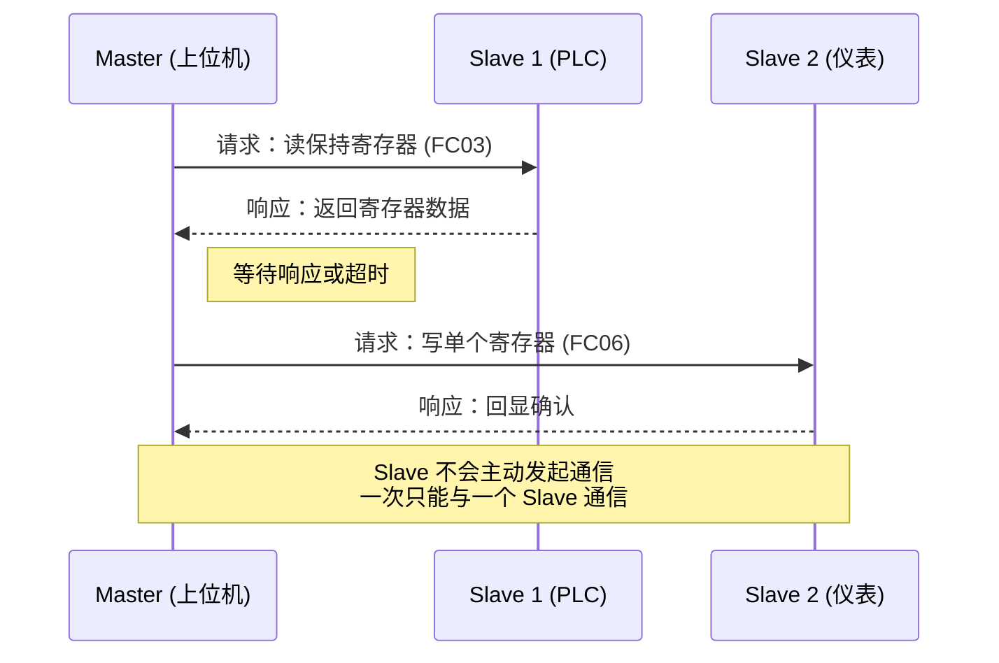

<ProgressIndicator
  current="winforms/winforms-modbus-protocol"
  items={[
    { slug: "winforms/winforms-roadmap", title: "路线图与岗位分析" },
    { slug: "winforms/winforms-basics", title: "WinForms 基础" },
    { slug: "winforms/winforms-serial-port", title: "串口通信实战" },
    { slug: "winforms/winforms-modbus-protocol", title: "Modbus 协议详解" },
    { slug: "winforms/winforms-multithreading-async", title: "多线程与异步" },
    { slug: "winforms/winforms-realtime-display", title: "实时数据展示" },
    { slug: "winforms/winforms-data-storage", title: "数据存储与导出" },
    { slug: "winforms/winforms-error-recovery", title: "异常处理与自动重连" },
    { slug: "winforms/winforms-project-temperature", title: "完整项目实战" },
  ]}
/>

# Modbus 协议详解：从报文结构到 C# 完整实现

如果说串口通信是上位机的"手"，那 Modbus 就是上位机的"语言"。在上一篇 [/posts/winforms/winforms-serial-port](串口通信实战) 中，我们掌握了如何通过串口收发原始字节；但工业设备不会随便给你一堆字节——它们遵循固定的协议格式。而 **Modbus** 就是工业领域使用最广泛的协议，几乎没有之一。

几乎所有 PLC、变频器、智能仪表都原生支持 Modbus。无论你做温控、电力监控、环保监测还是产线数据采集，Modbus 都是最可能遇到的通信协议。掌握 Modbus，意味着你能直接和 80% 以上的工业设备对话。

本文将从 Modbus 的数据模型出发，逐步拆解 RTU/TCP 两种变体的报文结构，详解每一个常用功能码的请求与响应格式，然后分别用手写代码和 NModbus 库实现完整的 C# 通信类。

## Modbus 协议概览

### 历史与地位

Modbus 由 Modicon 公司（现施耐德电气）于 **1979 年**发布，最初是为了让其 PLC 产品之间能够互相通信。由于协议简单、公开、易于实现，它迅速成为工业通信的事实标准。虽然 Modbus 组织后来推出了 Modbus Plus、Modbus UDP 等变体，但上位机开发中最常用的只有两种：

- **Modbus RTU**——基于串口（RS-232/RS-485），二进制编码，效率最高
- **Modbus TCP**——基于以太网（TCP/IP），去掉了 CRC 校验，增加了 MBAP 头

:::note
还有第三种模式 **Modbus ASCII**，用可打印字符编码报文，调试方便但效率低，实际项目极少使用，本文不展开。
:::

### 三种传输模式对比

| 特性 | Modbus RTU | Modbus ASCII | Modbus TCP |
|------|-----------|-------------|-----------|
| 物理层 | RS-232 / RS-485 | RS-232 / RS-485 | TCP/IP 以太网 |
| 编码方式 | 二进制 | ASCII 字符 | 二进制 |
| 校验方式 | CRC16 | LRC | 无（TCP 保证完整性） |
| 默认端口 | — | — | 502 |
| 传输效率 | 高 | 低 | 高 |
| 典型应用 | 现场设备通信 | 调试/老设备 | 局域网/远程监控 |

### Master/Slave 通信模型

Modbus 采用**主从模式**（Master/Slave）——通信总是由 Master 发起，Slave 被动响应。Slave 之间不能互相通信，Slave 也不会主动上报数据。



:::important 一问一答原则
Master 发出一个请求后，必须等待 Slave 响应（或超时）才能发送下一个请求。这是 Modbus RTU 的硬性规则——总线上同一时刻只有一个事务在进行。Modbus TCP 虽然基于 TCP 连接可以并发，但大多数实现仍然遵循串行请求模式。
:::

## Modbus 数据模型：四种数据对象

Modbus 定义了四种数据对象，每种有不同的地址范围和读写属性：

| 数据类型 | 地址前缀 | 地址范围 | 读写 | 大小 | 典型应用 |
|---------|---------|---------|------|------|---------|
| Coil（线圈） | 0x | 00001~09999 | 读写 | 1 bit | 继电器输出、阀门开关 |
| Discrete Input（离散输入） | 1x | 10001~19999 | 只读 | 1 bit | 限位开关、状态信号 |
| Input Register（输入寄存器） | 3x | 30001~39999 | 只读 | 16 bit | 传感器测量值（温度、压力） |
| Holding Register（保持寄存器） | 4x | 40001~49999 | 读写 | 16 bit | 设定参数、控制命令、输出值 |

### 地址编号规则

Modbus 使用 **5 位地址编号**，第一位区分数据类型：

- `00001` = 0x 区 Coil，协议地址为 `0x0000`
- `10001` = 1x 区 Discrete Input，协议地址为 `0x0000`
- `30001` = 3x 区 Input Register，协议地址为 `0x0000`
- `40001` = 4x 区 Holding Register，协议地址为 `0x0000`

:::warning 地址偏移陷阱
5 位地址编号从 1 开始，但报文中的协议地址从 0 开始！例如读取地址 `40001`，报文中起始地址应填 `0x0000`；读取 `40010`，报文中填 `0x0009`。这是初学者最容易犯的错误之一。
:::

### 寄存器与实际值的映射

一个 Holding Register 是 16 位无符号整数（0~65535），但实际物理量往往是浮点数或有符号整数。常见的映射方式：

| 数据类型 | 占用寄存器 | 映射方式 | 示例 |
|---------|-----------|---------|------|
| 无符号整数 | 1 | 直接读取 | 1234 → 1234 |
| 有符号整数 | 1 | 补码转换 | 0xFFFF → -1 |
| 浮点数（放大倍数） | 1 | 值 × 放大倍数 | 2350 × 0.1 = 235.0℃ |
| IEEE 754 浮点 | 2 | 两个寄存器拼合 | 高位寄存器 + 低位寄存器 |
| 32 位整数 | 2 | 两个寄存器拼合 | 高位寄存器左移16位加低位寄存器 |

```csharp
static float RawToFloat(ushort raw, double scale = 0.1)
{
    return (float)(raw * scale);
}

static float RegistersToFloat(ushort highReg, ushort lowReg)
{
    uint combined = ((uint)highReg << 16) | lowReg;
    byte[] bytes = BitConverter.GetBytes(combined);
    return BitConverter.ToSingle(bytes, 0);
}
```

## 功能码详解

功能码（Function Code）定义了 Master 请求的操作类型。以下是上位机开发中最常用的 8 个功能码：

| 功能码 | 操作 | 数据类型 | 常用程度 |
|-------|------|---------|---------|
| 01 | 读线圈 | Coil | ★★★ |
| 02 | 读离散输入 | Discrete Input | ★★ |
| 03 | 读保持寄存器 | Holding Register | ★★★★★ |
| 04 | 读输入寄存器 | Input Register | ★★★★ |
| 05 | 写单个线圈 | Coil | ★★ |
| 06 | 写单个寄存器 | Holding Register | ★★★★ |
| 15 | 写多个线圈 | Coil | ★★ |
| 16 | 写多个寄存器 | Holding Register | ★★★★ |

:::tip FC03 是绝对的主力
实际项目中，90% 以上的 Modbus 通信都是 FC03（读保持寄存器）和 FC06/FC16（写寄存器）。先吃透这几个，再看其余功能码会非常轻松。
:::

### 功能码 01：读线圈

读取从站中连续的线圈状态（ON/OFF）。

**请求报文：**

| 字段 | 字节数 | 值（示例） | 说明 |
|------|--------|-----------|------|
| 从站地址 | 1 | 0x01 | Slave 1 |
| 功能码 | 1 | 0x01 | 读线圈 |
| 起始地址高字节 | 1 | 0x00 | 起始地址 0x0000 |
| 起始地址低字节 | 1 | 0x00 | — |
| 数量高字节 | 1 | 0x00 | 读取 8 个线圈 |
| 数量低字节 | 1 | 0x08 | — |
| CRC 低字节 | 1 | 0x3D | CRC16 |
| CRC 高字节 | 1 | 0xC6 | — |

**响应报文：**

| 字段 | 字节数 | 值（示例） | 说明 |
|------|--------|-----------|------|
| 从站地址 | 1 | 0x01 | — |
| 功能码 | 1 | 0x01 | — |
| 字节数 | 1 | 0x01 | 数据占 1 字节 |
| 数据 | 1 | 0xCD | 8 个线圈的位状态 |
| CRC 低字节 | 1 | — | — |
| CRC 高字节 | 1 | — | — |

**位打包规则**：一个字节包含 8 个线圈的状态。最低位（bit 0）对应起始地址的线圈，最高位（bit 7）对应起始地址 +7 的线圈。`0xCD` = `1100 1101`，表示线圈 1=ON, 2=OFF, 3=ON, 4=ON, 5=OFF, 6=OFF, 7=ON, 8=ON。

### 功能码 02：读离散输入

结构与 FC01 完全相同，只是读取的是 Discrete Input（1x 区，只读）。请求报文中功能码为 `0x02`，响应格式与 FC01 一致。

### 功能码 03：读保持寄存器

**最常用的功能码**。读取从站中连续的 Holding Register 值。

**完整报文示例**：读取从站 1，地址 0 开始的 3 个保持寄存器。

请求：`01 03 00 00 00 03 C5 CB`

```
01       从站地址 = 1
03       功能码 = 读保持寄存器
00 00    起始地址 = 0
00 03    数量 = 3
C5 CB    CRC16
```

响应：`01 03 06 00 0A 01 02 00 64 C8 72`

```
01       从站地址 = 1
03       功能码 = 03
06       字节数 = 6（3 个寄存器 × 2 字节）
00 0A    第 1 个寄存器值 = 10
01 02    第 2 个寄存器值 = 258
00 64    第 3 个寄存器值 = 100
C8 72    CRC16
```

:::note 多寄存器的字节排列
每个寄存器 2 字节，高字节在前（大端序）。3 个寄存器按地址从低到高依次排列，连续存放。
:::

### 功能码 04：读输入寄存器

结构与 FC03 完全相同，只是读取的是 Input Register（3x 区，只读）。功能码为 `0x04`，请求和响应格式与 FC03 一致。

### 功能码 05：写单个线圈

向从站写入单个线圈的 ON/OFF 状态。

**特殊值**：`0xFF00` = ON，`0x0000` = OFF。

请求示例（设置线圈地址 0 为 ON）：`01 05 00 00 FF 00 8D EB`

```
01       从站地址 = 1
05       功能码 = 写单个线圈
00 00    线圈地址 = 0
FF 00    值 = ON
8D EB    CRC16
```

**响应报文**：回显确认，请求和响应完全相同。

### 功能码 06：写单个寄存器

向从站写入单个 Holding Register 的值。**常用功能码**。

请求示例（写入寄存器地址 1，值为 500）：`01 06 00 01 01 F4 98 1A`

```
01       从站地址 = 1
06       功能码 = 写单个寄存器
00 01    寄存器地址 = 1
01 F4    值 = 500（0x01F4）
98 1A    CRC16
```

**响应报文**：回显确认，请求和响应完全相同。

### 功能码 15：写多个线圈

向从站写入多个连续线圈的 ON/OFF 状态。请求报文中需要指定位数和对应的字节数据。

请求示例（写入线圈地址 0 开始的 10 个线圈）：

```
01       从站地址 = 1
0F       功能码 = 写多个线圈
00 00    起始地址 = 0
00 0A    数量 = 10
02       字节数 = 2（10 位需要 2 字节）
CD 01    数据：第 1 字节 = 0xCD, 第 2 字节 = 0x01
CRC      CRC16
```

响应报文：只返回从站地址 + 功能码 + 起始地址 + 数量 + CRC，不回显数据。

### 功能码 16：写多个寄存器

向从站写入多个连续 Holding Register 的值。**常用功能码**。与 FC06 的区别是可以一次写多个寄存器。

请求报文比其他功能码多了**字节数**字段：

```
01       从站地址 = 1
10       功能码 = 写多个寄存器
00 01    起始地址 = 1
00 02    数量 = 2 个寄存器
04       字节数 = 4（2 个寄存器 × 2 字节）
00 0A    第 1 个寄存器值 = 10
01 02    第 2 个寄存器值 = 258
CRC      CRC16
```

:::warning 字节数字段容易遗漏
FC16 请求报文在"数量"字段之后有一个"字节数"字段，值 = 寄存器数量 × 2。这是唯一一个在数据区前有字节数指示的写操作功能码，初学者常遗漏此字段。
:::

## Modbus RTU 协议详解

### 帧结构

```
┌──────────┬──────────┬──────────────┬──────────┬──────────┐
│ 从站地址  │  功能码   │    数据区     │ CRC 低字节│ CRC 高字节│
│ 1 字节   │ 1 字节   │  N 字节      │ 1 字节   │ 1 字节   │
└──────────┴──────────┴──────────────┴──────────┴──────────┘
```

**关键特征：**

- **帧间间隔**：3.5 个字符时间的静默间隔标志一帧的开始和结束（9600bps 下约 4ms）
- **帧内间隔**：1.5 个字符时间，超过则帧无效（9600bps 下约 1.7ms）
- **字节序**：大端序（Big-Endian），高字节在前
- **CRC16**：低字节先发，高字节后发

### CRC16 校验详解

Modbus RTU 使用 **CRC-16/MODBUS** 校验，多项式为 `0xA001`（即 `0x8005` 的位反转）。

算法步骤：

1. 预置 CRC 寄存器为 `0xFFFF`
2. 取第一个字节，与 CRC 低字节异或
3. 对每一位：若最低位为 1，先右移一位，再与 `0xA001` 异或；若为 0，直接右移一位
4. 重复步骤 2~3 处理所有字节
5. 最终 CRC 寄存器的值即为校验码，**低字节在前**发送

<CodeAnnotation
  language="csharp"
  lines={[
    { code: 'static ushort Crc16(byte[] data)', note: '返回 ushort，低字节在前发送' },
    { code: '{' },
    { code: '    ushort crc = 0xFFFF;', note: '初始值固定为 0xFFFF' },
    { code: '    foreach (byte b in data)' },
    { code: '    {' },
    { code: '        crc ^= b;', note: '与 CRC 低字节异或（ushort 会自动取低8位）' },
    { code: '        for (int i = 0; i < 8; i++)' },
    { code: '        {' },
    { code: '            if ((crc & 0x0001) != 0)', note: '检查最低位' },
    { code: '            {' },
    { code: '                crc >>= 1;', note: '先右移' },
    { code: '                crc ^= 0xA001;', note: '再与多项式异或' },
    { code: '            }' },
    { code: '            else' },
    { code: '            {' },
    { code: '                crc >>= 1;', note: '最低位为0，只右移' },
    { code: '            }' },
    { code: '        }' },
    { code: '    }' },
    { code: '    return crc;' },
    { code: '}' },
  ]}
/>

### RTU 通信抓包分析

假设我们读取从站 1、地址 0 开始的 2 个保持寄存器（FC03）：

**发送：** `01 03 00 00 00 02 C4 0B`

| 偏移 | 字节 | 含义 |
|------|------|------|
| 0 | 01 | 从站地址 = 1 |
| 1 | 03 | 功能码 = 读保持寄存器 |
| 2-3 | 00 00 | 起始地址 = 0 |
| 4-5 | 00 02 | 数量 = 2 |
| 6-7 | C4 0B | CRC16 = 0x0BC4（低字节在前） |

**接收：** `01 03 04 00 64 01 2C 8B A3`

| 偏移 | 字节 | 含义 |
|------|------|------|
| 0 | 01 | 从站地址 = 1 |
| 1 | 03 | 功能码 = 03 |
| 2 | 04 | 字节数 = 4（2 寄存器 × 2 字节） |
| 3-4 | 00 64 | 第 1 个寄存器 = 100 |
| 5-6 | 01 2C | 第 2 个寄存器 = 300 |
| 7-8 | 8B A3 | CRC16 |

## Modbus TCP 协议详解

### 与 RTU 的核心区别

| 对比项 | Modbus RTU | Modbus TCP |
|-------|-----------|-----------|
| 传输层 | 串口（RS-485） | TCP（以太网） |
| 校验 | CRC16 | 无（TCP 保证数据完整性） |
| 额外头部 | 无 | MBAP 头（7 字节） |
| 默认端口 | — | 502 |
| 从站地址 | 报文第 1 字节 | MBAP 头中的 Unit ID |
| 并发 | 串行，一次一个事务 | 支持多事务并发 |

### MBAP 头详解

Modbus TCP 在标准 Modbus PDU 前增加了 7 字节的 **MBAP 头**（Modbus Application Protocol Header）：

```
┌────────────┬────────────┬──────────┬────────────┐
│ 事务 ID     │  协议 ID    │  长度     │ 单元标识    │
│ 2 字节      │  2 字节     │ 2 字节   │ 1 字节     │
│ (Transaction ID)│ (Protocol ID)│ (Length) │ (Unit ID)  │
└────────────┴────────────┴──────────┴────────────┘
```

| 字段 | 字节数 | 说明 |
|------|--------|------|
| Transaction ID | 2 | 事务标识，由 Master 分配，响应中原样返回，用于匹配请求-响应 |
| Protocol ID | 2 | 协议标识，Modbus 固定为 `0x0000` |
| Length | 2 | 后续字节数（Unit ID + PDU 的总长度） |
| Unit ID | 1 | 单元标识，等同于 RTU 中的从站地址 |

### TCP 报文完整示例

与上面 RTU 示例相同——读取从站 1、地址 0 开始的 2 个保持寄存器：

**请求：** `00 01 00 00 00 06 01 03 00 00 00 02`

```
00 01    Transaction ID = 1
00 00    Protocol ID = 0 (Modbus)
00 06    Length = 6（后续 6 字节：Unit ID + FC + 起始地址 + 数量）
01       Unit ID = 1（等同于 RTU 从站地址）
03       功能码 = 03
00 00    起始地址 = 0
00 02    数量 = 2
```

**响应：** `00 01 00 00 00 07 01 03 04 00 64 01 2C`

```
00 01    Transaction ID = 1（与请求匹配）
00 00    Protocol ID = 0
00 07    Length = 7（后续 7 字节：Unit ID + FC + 字节数 + 4 字节数据）
01       Unit ID = 1
03       功能码 = 03
04       字节数 = 4
00 64    第 1 个寄存器 = 100
01 2C    第 2 个寄存器 = 300
```

:::tip TCP 多事务并发
Modbus TCP 利用 Transaction ID 可以同时发送多个请求，根据响应中的 Transaction ID 匹配对应的请求。但在实际应用中，建议仍使用串行请求模式——大多数从站设备不支持真正的并发处理。
:::

## Modbus 异常响应

当从站无法正确执行请求时，会返回**异常响应**。

### 异常响应格式

异常响应的特征：**功能码最高位置 1**（即功能码 + 0x80），后跟 1 字节异常码。

```
[从站地址] [功能码 + 0x80] [异常码]
```

示例：请求从站 1 执行功能码 0x07（不支持的功能码），响应为 `01 86 01`——功能码 `0x86 = 0x07 + 0x80`，异常码 `0x01` = Illegal Function。

### 异常码详解

| 异常码 | 名称 | 含义 |
|--------|------|------|
| 01 | Illegal Function | 从站不支持该功能码 |
| 02 | Illegal Data Address | 请求的地址不存在或不可访问 |
| 03 | Illegal Data Value | 请求的数据值超出合法范围 |
| 04 | Slave Device Failure | 从站内部故障（如设备损坏） |
| 05 | Acknowledge | 从站已收到请求但尚未完成（用于长耗时操作） |
| 06 | Slave Device Busy | 从站忙，无法响应（常出现在同时有其他 Master 访问） |
| 07 | Negative Acknowledge | 从站无法执行该功能 |

:::warning 02 和 03 的区分
异常码 02 是"地址不对"——你问了一个设备上根本不存在的寄存器。异常码 03 是"值不对"——地址是对的，但你写的值超出范围，比如向温度设定寄存器写入 99999。
:::

### 异常响应的 C# 检测

```csharp
void CheckException(byte[] response)
{
    byte functionCode = response[1];
    if ((functionCode & 0x80) != 0)
    {
        byte exceptionCode = response[2];
        string msg = exceptionCode switch
        {
            1 => "Illegal Function",
            2 => "Illegal Data Address",
            3 => "Illegal Data Value",
            4 => "Slave Device Failure",
            5 => "Acknowledge",
            6 => "Slave Device Busy",
            7 => "Negative Acknowledge",
            _ => $"Unknown Exception ({exceptionCode})"
        };
        throw new ModbusException($"从站返回异常: {msg}", exceptionCode);
    }
}
```

## C# 手写 Modbus RTU Master

手写实现是理解协议最好的方式。以下代码完整实现了 Modbus RTU Master 的核心功能。

```csharp
using System.IO.Ports;

public class ModbusException : Exception
{
    public byte ExceptionCode { get; }
    public ModbusException(string message, byte exceptionCode) : base(message)
    {
        ExceptionCode = exceptionCode;
    }
}

public class ModbusRtuMaster : IDisposable
{
    private readonly SerialPort _port;
    private readonly object _lock = new();
    private int _timeout = 1000;

    public ModbusRtuMaster(string portName, int baudRate = 9600,
        Parity parity = Parity.None, int dataBits = 8, StopBits stopBits = StopBits.One)
    {
        _port = new SerialPort(portName, baudRate, parity, dataBits, stopBits)
        {
            ReadTimeout = _timeout,
            WriteTimeout = _timeout
        };
    }

    public void Open()
    {
        if (!_port.IsOpen) _port.Open();
        _port.DiscardInBuffer();
        _port.DiscardOutBuffer();
    }

    public void Close()
    {
        if (_port.IsOpen) _port.Close();
    }

    public void Dispose()
    {
        Close();
        _port.Dispose();
    }

    static ushort Crc16(byte[] data)
    {
        ushort crc = 0xFFFF;
        foreach (byte b in data)
        {
            crc ^= b;
            for (int i = 0; i < 8; i++)
            {
                if ((crc & 0x0001) != 0)
                {
                    crc >>= 1;
                    crc ^= 0xA001;
                }
                else
                {
                    crc >>= 1;
                }
            }
        }
        return crc;
    }

    static void AppendCrc(List<byte> frame)
    {
        ushort crc = Crc16(frame.ToArray());
        frame.Add((byte)(crc & 0xFF));
        frame.Add((byte)((crc >> 8) & 0xFF));
    }

    static bool VerifyCrc(byte[] data)
    {
        if (data.Length < 4) return false;
        ushort received = (ushort)(data[^2] | (data[^1] << 8));
        ushort calculated = Crc16(data[..^2]);
        return received == calculated;
    }

    byte[] SendAndReceive(byte[] request, int expectedPduLength)
    {
        lock (_lock)
        {
            _port.DiscardInBuffer();
            _port.Write(request, 0, request.Length);

            int totalLength = 1 + 1 + expectedPduLength + 2;
            byte[] response = new byte[totalLength];
            int offset = 0;
            DateTime start = DateTime.UtcNow;

            while (offset < totalLength)
            {
                if ((DateTime.UtcNow - start).TotalMilliseconds > _timeout)
                    throw new TimeoutException("Modbus 响应超时");

                int available = _port.BytesToRead;
                if (available > 0)
                {
                    int toRead = Math.Min(available, totalLength - offset);
                    int read = _port.Read(response, offset, toRead);
                    offset += read;
                }
                else
                {
                    Thread.Sleep(10);
                }
            }

            if (!VerifyCrc(response))
                throw new InvalidOperationException("CRC 校验失败");

            if (response[1] >= 0x80)
            {
                byte exCode = response[2];
                throw new ModbusException($"异常码: {exCode}", exCode);
            }

            return response;
        }
    }

    public ushort[] ReadHoldingRegisters(byte slaveId, ushort startAddress, ushort quantity)
    {
        var frame = new List<byte> { slaveId, 0x03 };
        frame.Add((byte)(startAddress >> 8));
        frame.Add((byte)(startAddress & 0xFF));
        frame.Add((byte)(quantity >> 8));
        frame.Add((byte)(quantity & 0xFF));
        AppendCrc(frame);

        byte[] response = SendAndReceive(frame.ToArray(), 1 + quantity * 2);
        ushort[] values = new ushort[quantity];
        for (int i = 0; i < quantity; i++)
        {
            int offset = 3 + i * 2;
            values[i] = (ushort)((response[offset] << 8) | response[offset + 1]);
        }
        return values;
    }

    public ushort[] ReadInputRegisters(byte slaveId, ushort startAddress, ushort quantity)
    {
        var frame = new List<byte> { slaveId, 0x04 };
        frame.Add((byte)(startAddress >> 8));
        frame.Add((byte)(startAddress & 0xFF));
        frame.Add((byte)(quantity >> 8));
        frame.Add((byte)(quantity & 0xFF));
        AppendCrc(frame);

        byte[] response = SendAndReceive(frame.ToArray(), 1 + quantity * 2);
        ushort[] values = new ushort[quantity];
        for (int i = 0; i < quantity; i++)
        {
            int offset = 3 + i * 2;
            values[i] = (ushort)((response[offset] << 8) | response[offset + 1]);
        }
        return values;
    }

    public bool[] ReadCoils(byte slaveId, ushort startAddress, ushort quantity)
    {
        var frame = new List<byte> { slaveId, 0x01 };
        frame.Add((byte)(startAddress >> 8));
        frame.Add((byte)(startAddress & 0xFF));
        frame.Add((byte)(quantity >> 8));
        frame.Add((byte)(quantity & 0xFF));
        AppendCrc(frame);

        int byteCount = (quantity + 7) / 8;
        byte[] response = SendAndReceive(frame.ToArray(), 1 + byteCount);
        bool[] coils = new bool[quantity];
        for (int i = 0; i < quantity; i++)
        {
            int byteIndex = 3 + i / 8;
            int bitIndex = i % 8;
            coils[i] = (response[byteIndex] & (1 << bitIndex)) != 0;
        }
        return coils;
    }

    public void WriteSingleRegister(byte slaveId, ushort address, ushort value)
    {
        var frame = new List<byte> { slaveId, 0x06 };
        frame.Add((byte)(address >> 8));
        frame.Add((byte)(address & 0xFF));
        frame.Add((byte)(value >> 8));
        frame.Add((byte)(value & 0xFF));
        AppendCrc(frame);

        SendAndReceive(frame.ToArray(), 4);
    }

    public void WriteMultipleRegisters(byte slaveId, ushort startAddress, ushort[] values)
    {
        var frame = new List<byte> { slaveId, 0x10 };
        frame.Add((byte)(startAddress >> 8));
        frame.Add((byte)(startAddress & 0xFF));
        frame.Add((byte)(values.Length >> 8));
        frame.Add((byte)(values.Length & 0xFF));
        frame.Add((byte)(values.Length * 2));

        foreach (ushort val in values)
        {
            frame.Add((byte)(val >> 8));
            frame.Add((byte)(val & 0xFF));
        }
        AppendCrc(frame);

        SendAndReceive(frame.ToArray(), 4);
    }
}
```

### 使用示例

```csharp
using var master = new ModbusRtuMaster("COM3", 9600);
master.Open();

ushort[] regs = master.ReadHoldingRegisters(1, 0, 3);
Console.WriteLine($"温度: {regs[0] * 0.1}℃");
Console.WriteLine($"湿度: {regs[1] * 0.1}%");
Console.WriteLine($"压力: {regs[2]} kPa");

master.WriteSingleRegister(1, 10, 500);
```

:::important 线程安全
`SendAndReceive` 方法内部使用 `lock` 确保同一时刻只有一个 Modbus 事务在进行。如果你在多线程环境中使用，`lock` 会自动排队等待，避免多个线程同时发送请求导致报文混乱。
:::

## C# 手写 Modbus TCP Master

Modbus TCP 实现的核心区别：用 `TcpClient` 替代 `SerialPort`，构造 MBAP 头替代 CRC 校验。

```csharp
using System.Net.Sockets;
using System.Net;

public class ModbusTcpMaster : IDisposable
{
    private TcpClient? _client;
    private NetworkStream? _stream;
    private readonly object _lock = new();
    private ushort _transactionId = 0;
    private int _timeout = 1000;
    private readonly string _host;
    private readonly int _port;

    public ModbusTcpMaster(string host, int port = 502)
    {
        _host = host;
        _port = port;
    }

    public void Connect()
    {
        _client = new TcpClient { SendTimeout = _timeout, ReceiveTimeout = _timeout };
        _client.Connect(_host, _port);
        _stream = _client.GetStream();
    }

    public void Disconnect()
    {
        _stream?.Close();
        _client?.Close();
        _stream = null;
        _client = null;
    }

    public void Dispose()
    {
        Disconnect();
    }

    byte[] BuildMbapHeader(byte unitId, int pduLength)
    {
        ushort tid = _transactionId++;
        int length = pduLength + 1;
        return new byte[]
        {
            (byte)(tid >> 8), (byte)(tid & 0xFF),
            0x00, 0x00,
            (byte)(length >> 8), (byte)(length & 0xFF),
            unitId
        };
    }

    byte[] SendAndReceive(byte unitId, byte[] pdu)
    {
        lock (_lock)
        {
            byte[] header = BuildMbapHeader(unitId, pdu.Length);
            byte[] request = header.Concat(pdu).ToArray();

            _stream!.Write(request, 0, request.Length);

            byte[] respHeader = ReadExact(_stream, 7);
            ushort respTid = (ushort)((respHeader[0] << 8) | respHeader[1]);
            ushort respLen = (ushort)((respHeader[4] << 8) | respHeader[5]);

            byte[] respPdu = ReadExact(_stream, respLen);

            byte functionCode = respPdu[1];
            if ((functionCode & 0x80) != 0)
            {
                byte exCode = respPdu[2];
                throw new ModbusException($"异常码: {exCode}", exCode);
            }

            return respPdu;
        }
    }

    static byte[] ReadExact(NetworkStream stream, int count)
    {
        byte[] buffer = new byte[count];
        int offset = 0;
        while (offset < count)
        {
            int read = stream.Read(buffer, offset, count - offset);
            if (read == 0)
                throw new IOException("连接已关闭");
            offset += read;
        }
        return buffer;
    }

    public ushort[] ReadHoldingRegisters(byte unitId, ushort startAddress, ushort quantity)
    {
        byte[] pdu = new byte[]
        {
            0x03,
            (byte)(startAddress >> 8), (byte)(startAddress & 0xFF),
            (byte)(quantity >> 8), (byte)(quantity & 0xFF)
        };

        byte[] respPdu = SendAndReceive(unitId, pdu);
        ushort[] values = new ushort[quantity];
        for (int i = 0; i < quantity; i++)
        {
            int offset = 2 + i * 2;
            values[i] = (ushort)((respPdu[offset] << 8) | respPdu[offset + 1]);
        }
        return values;
    }

    public ushort[] ReadInputRegisters(byte unitId, ushort startAddress, ushort quantity)
    {
        byte[] pdu = new byte[]
        {
            0x04,
            (byte)(startAddress >> 8), (byte)(startAddress & 0xFF),
            (byte)(quantity >> 8), (byte)(quantity & 0xFF)
        };

        byte[] respPdu = SendAndReceive(unitId, pdu);
        ushort[] values = new ushort[quantity];
        for (int i = 0; i < quantity; i++)
        {
            int offset = 2 + i * 2;
            values[i] = (ushort)((respPdu[offset] << 8) | respPdu[offset + 1]);
        }
        return values;
    }

    public void WriteSingleRegister(byte unitId, ushort address, ushort value)
    {
        byte[] pdu = new byte[]
        {
            0x06,
            (byte)(address >> 8), (byte)(address & 0xFF),
            (byte)(value >> 8), (byte)(value & 0xFF)
        };
        SendAndReceive(unitId, pdu);
    }

    public void WriteMultipleRegisters(byte unitId, ushort startAddress, ushort[] values)
    {
        var pdu = new List<byte>
        {
            0x10,
            (byte)(startAddress >> 8), (byte)(startAddress & 0xFF),
            (byte)(values.Length >> 8), (byte)(values.Length & 0xFF),
            (byte)(values.Length * 2)
        };
        foreach (ushort val in values)
        {
            pdu.Add((byte)(val >> 8));
            pdu.Add((byte)(val & 0xFF));
        }
        SendAndReceive(unitId, pdu.ToArray());
    }
}
```

### RTU vs TCP 代码对比

| 差异点 | ModbusRtuMaster | ModbusTcpMaster |
|-------|----------------|-----------------|
| 连接对象 | `SerialPort` | `TcpClient` + `NetworkStream` |
| 校验 | CRC16 计算 + 验证 | 无（TCP 保证） |
| 帧头 | 无（从站地址在报文第1字节） | MBAP 头（7字节） |
| 事务匹配 | 串行，无需匹配 | Transaction ID 匹配 |
| 读取方式 | 逐字节读取 + 长度判断 | 精确读取指定字节数 |
| 响应解析 | 去掉头尾2+1字节 | 去掉 MBAP 头后解析 PDU |

:::tip 精确读取
TCP 实现中 `ReadExact` 方法精确读取指定字节数，比 RTU 的逐字节读取方式更可靠。这是因为 TCP 是流式协议，我们事先知道 MBAP 头中的 Length 字段，可以确定后续需要读取多少字节。
:::

## 使用 NModbus5 第三方库

手写实现适合学习和对协议有精细控制的场景。生产项目中，推荐使用成熟的第三方库——**NModbus** 是 .NET 生态中最流行的 Modbus 库。

### 安装

```bash
dotnet add package NModbus
```

### 基本使用

```csharp
using NModbus;

// RTU
using var port = new SerialPort("COM3", 9600, Parity.None, 8, StopBits.One);
port.Open();
var factory = new ModbusFactory();
IModbusMaster rtuMaster = factory.CreateRtuMaster(port);

ushort[] regs = rtuMaster.ReadHoldingRegisters(1, 0, 3);
rtuMaster.WriteSingleRegister(1, 10, 500);
```

```csharp
// TCP
using var tcpClient = new TcpClient("192.168.1.100", 502);
var factory = new ModbusFactory();
IModbusMaster tcpMaster = factory.CreateTcpMaster(tcpClient);

ushort[] regs = tcpMaster.ReadHoldingRegisters(1, 0, 3);
tcpMaster.WriteSingleRegister(1, 10, 500);
```

### 完整操作示例

```csharp
using NModbus;
using System.IO.Ports;

IModbusMaster master;
SerialPort? serialPort = null;
TcpClient? tcpClient = null;

var factory = new ModbusFactory();

serialPort = new SerialPort("COM3", 9600, Parity.None, 8, StopBits.One);
serialPort.Open();
master = factory.CreateRtuMaster(serialPort);
master.Transport.ReadTimeout = 1000;
master.Transport.WriteTimeout = 1000;

ushort[] holdingRegs = master.ReadHoldingRegisters(slaveAddress: 1, startAddress: 0, numberOfPoints: 10);
ushort[] inputRegs = master.ReadInputRegisters(slaveAddress: 1, startAddress: 0, numberOfPoints: 5);
bool[] coils = master.ReadCoils(slaveAddress: 1, startAddress: 0, numberOfPoints: 8);
bool[] inputs = master.ReadInputs(slaveAddress: 1, startAddress: 0, numberOfPoints: 4);

master.WriteSingleRegister(slaveAddress: 1, registerAddress: 10, value: 500);
master.WriteMultipleRegisters(slaveAddress: 1, startAddress: 20, data: new ushort[] { 100, 200, 300 });
master.WriteSingleCoil(slaveAddress: 1, coilAddress: 0, value: true);
```

### 手写 vs NModbus：何时选择

| 维度 | 手写实现 | NModbus |
|------|---------|---------|
| 学习价值 | 高，深入理解协议 | 低，封装了细节 |
| 代码量 | 200+ 行 | 5~10 行 |
| 可控性 | 完全可控，可针对性优化 | 依赖库行为，出问题难排查 |
| 协议覆盖 | 需逐个实现功能码 | 全部功能码开箱即用 |
| 维护成本 | 自行维护 | 社区维护 |
| 适用场景 | 学习、特殊需求、精简部署 | 生产项目、快速交付 |

:::tip 实际建议
**学习和面试准备阶段用手写**——面试官想看到你理解报文结构和 CRC 计算。**生产项目用 NModbus**——除非有非常特殊的需求（如自定义帧格式、与非标设备通信），否则没有必要重复造轮子。
:::

## Modbus 调试工具和技巧

开发 Modbus 通信程序时，你需要验证你的代码是否能正确收发报文。以下工具可以帮助你独立调试，无需真实设备。

### 常用模拟器

| 工具 | 类型 | 特点 |
|------|------|------|
| **ModRSSim** | Slave 模拟器 | 免费轻量，支持 RTU/TCP，可自定义寄存器值 |
| **Simply Modbus** | Slave + Master | 界面友好，实时显示报文内容，适合学习 |
| **ModScan32** | Master 工具 | 经典上位机调试工具，支持 RTU/TCP |
| **Modbus Slave** | Slave 模拟器 | 商业软件，功能完善，可模拟复杂设备 |

### 用 C# 写一个简易 Modbus Slave 模拟器

在没有模拟器的情况下，你可以快速写一个只支持 FC03 的 TCP Slave，用于测试你的 Master 代码：

```csharp
using System.Net;
using System.Net.Sockets;

public class SimpleModbusTcpSlave
{
    private readonly ushort[] _registers = new ushort[100];
    private readonly int _port;

    public SimpleModbusTcpSlave(int port = 502)
    {
        _port = port;
        for (int i = 0; i < _registers.Length; i++)
            _registers[i] = (ushort)(i * 10);
    }

    public void SetRegister(int address, ushort value)
    {
        if (address >= 0 && address < _registers.Length)
            _registers[address] = value;
    }

    public async Task StartAsync(CancellationToken ct = default)
    {
        var listener = new TcpListener(IPAddress.Any, _port);
        listener.Start();
        Console.WriteLine($"Modbus TCP Slave 监听端口 {_port}");

        while (!ct.IsCancellationRequested)
        {
            TcpClient client = await listener.AcceptTcpClientAsync(ct);
            _ = HandleClientAsync(client, ct);
        }
    }

    async Task HandleClientAsync(TcpClient client, CancellationToken ct)
    {
        using var stream = client.GetStream();
        byte[] buffer = new byte[260];

        while (!ct.IsCancellationRequested && client.Connected)
        {
            int read = await stream.ReadAsync(buffer, 0, buffer.Length, ct);
            if (read == 0) break;

            byte[] header = buffer[..7];
            ushort tid = (ushort)((header[0] << 8) | header[1]);
            ushort len = (ushort)((header[4] << 8) | header[5]);
            byte unitId = header[6];

            byte[] pdu = buffer[7..(7 + len - 1)];
            byte fc = pdu[0];

            byte[] response;
            if (fc == 0x03)
            {
                ushort addr = (ushort)((pdu[1] << 8) | pdu[2]);
                ushort qty = (ushort)((pdu[3] << 8) | pdu[4]);
                byte byteCount = (byte)(qty * 2);

                var resp = new List<byte> { unitId, fc, byteCount };
                for (int i = 0; i < qty && (addr + i) < _registers.Length; i++)
                {
                    resp.Add((byte)(_registers[addr + i] >> 8));
                    resp.Add((byte)(_registers[addr + i] & 0xFF));
                }

                int pduLen = resp.Count;
                var mbap = new List<byte>
                {
                    (byte)(tid >> 8), (byte)(tid & 0xFF),
                    0x00, 0x00,
                    (byte)(pduLen >> 8), (byte)(pduLen & 0xFF)
                };
                mbap.AddRange(resp);
                response = mbap.ToArray();
            }
            else
            {
                var mbap = new List<byte>
                {
                    (byte)(tid >> 8), (byte)(tid & 0xFF),
                    0x00, 0x00,
                    0x00, 0x03,
                    unitId,
                    (byte)(fc | 0x80),
                    0x01
                };
                response = mbap.ToArray();
            }

            await stream.WriteAsync(response, 0, response.Length, ct);
        }
    }
}
```

### 常见问题排查

| 现象 | 可能原因 | 排查方法 |
|------|---------|---------|
| 无响应 | 串口参数错误、从站地址不对、接线问题 | 用 ModScan32 直接测试设备 |
| 异常码 02 | 地址偏移（5位地址 vs 协议地址） | 确认设备文档的寄存器地址是从0还是从1开始 |
| CRC 错误 | 字节序错误、波特率不匹配 | 抓包对比，确认大端序 |
| 读到错误值 | 字节序/字序问题 | 尝试交换高低字节或高低字 |
| 响应不完整 | 超时时间太短、帧间间隔不够 | 增大超时到 2000ms，检查帧间延时 |
| 多次读取不一致 | 从站正在更新寄存器 | 增大读取间隔，或从站侧加锁 |

:::details 字节序与字序详解
Modbus 协议本身规定大端序（高字节在前），但多寄存器组合时**字序**（哪个寄存器是高位）没有统一标准。常见的字序模式：

| 模式 | 高位字 | 低位字 | 设备类型 |
|------|--------|--------|---------|
| Big-Endian（AB CD） | 地址 N | 地址 N+1 | 多数欧系 PLC |
| Little-Endian（CD AB） | 地址 N+1 | 地址 N | 部分日系 PLC |
| Big-Endian Byte Swap（BA DC） | — | — | 少见 |
| Little-Endian Byte Swap（DC BA） | — | — | 少见 |

遇到读出的浮点数不对时，尝试交换两个字的位置或交换每个字的高低字节。
:::

---

## 小结

本文从 Modbus 的数据模型出发，详解了四种数据对象、八个常用功能码的报文结构，深入分析了 RTU 和 TCP 两种变体的差异与实现要点，然后分别用手写代码和 NModbus 库实现了完整的 C# 通信类。关键要点：

- **Modbus 数据模型**四种对象——Coil、Discrete Input、Holding Register、Input Register——地址前缀和读写属性各不相同
- **功能码**定义操作类型，FC03（读保持寄存器）占实际使用 90% 以上
- **RTU** 帧的关键是 CRC16 校验和帧间隔；**TCP** 帧的关键是 MBAP 头和事务 ID
- **异常响应**的特征是功能码 +0x80，必须检测并处理
- 手写实现适合学习，NModbus 适合生产，理解协议是根本

下一篇 [/posts/winforms/winforms-multithreading-async](多线程与异步) 将解决上位机开发中最核心的架构问题——如何在通信和数据采集的同时保持 UI 响应，这也是面试的高频考点。