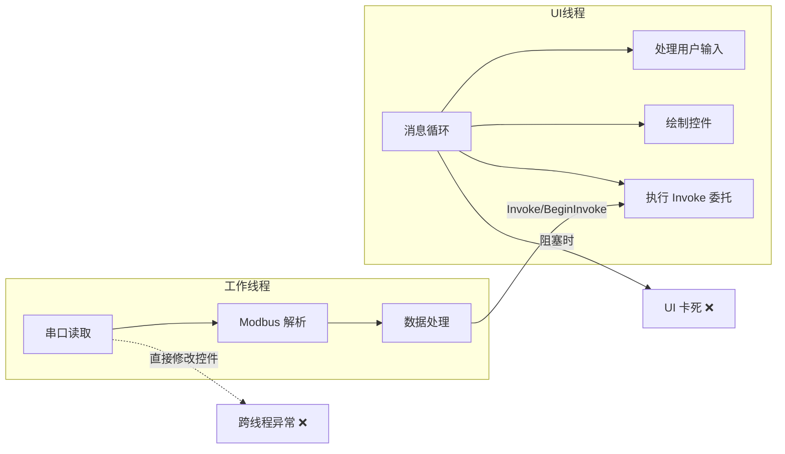
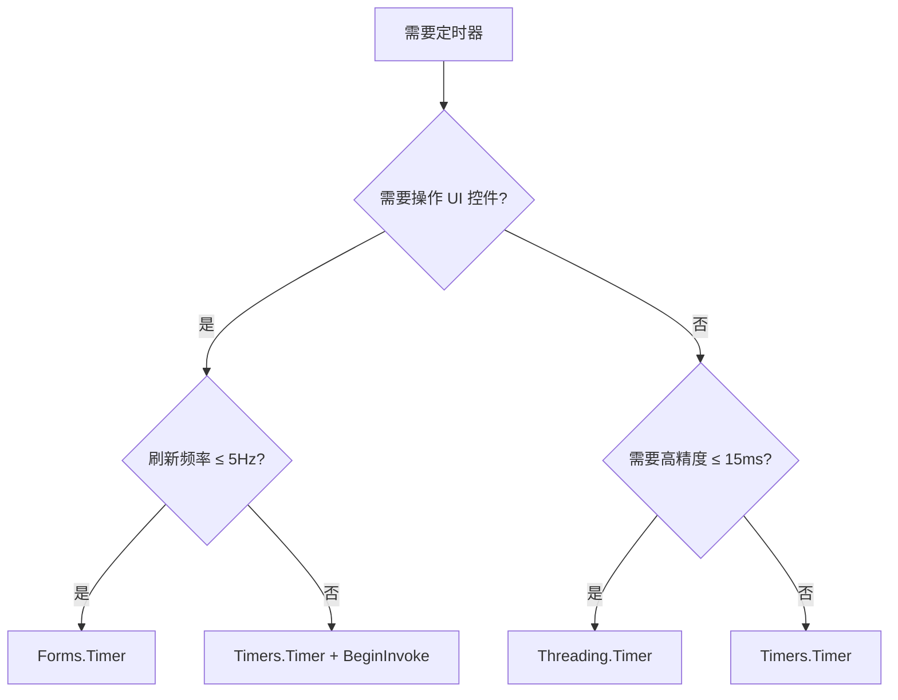

<ProgressIndicator
  current="winforms/winforms-multithreading-async"
  items={[
    { slug: "winforms/winforms-roadmap", title: "路线图与岗位分析" },
    { slug: "winforms/winforms-basics", title: "WinForms 基础" },
    { slug: "winforms/winforms-serial-port", title: "串口通信实战" },
    { slug: "winforms/winforms-modbus-protocol", title: "Modbus 协议详解" },
    { slug: "winforms/winforms-multithreading-async", title: "多线程与异步" },
    { slug: "winforms/winforms-realtime-display", title: "实时数据展示" },
    { slug: "winforms/winforms-data-storage", title: "数据存储与导出" },
    { slug: "winforms/winforms-error-recovery", title: "异常处理与自动重连" },
    { slug: "winforms/winforms-project-temperature", title: "完整项目实战" },
  ]}
/>

# 多线程与异步编程：让上位机 UI 永不卡死

上位机程序有一个最基本的要求：**UI 不能卡死**。操作员需要随时看到实时数据、点击按钮、响应报警——如果界面冻住了，整个监控系统就失去了意义。然而上位机的日常操作——串口读数据、Modbus 轮询、文件写入——全都是耗时操作。把耗时操作放在 UI 线程上执行，界面就会"卡死"；不放在 UI 线程上，又要面对跨线程访问控件的问题。

这就是本文要解决的核心矛盾：**如何在后台执行耗时操作，同时安全、高效地更新 UI**。

读完本文，你将彻底理解 WinForms 的线程模型，掌握 `Invoke`、`async/await`、`SynchronizationContext` 的原理与用法，能写出线程安全、不卡顿、不死锁的上位机代码。

## 一、WinForms 线程模型 —— 核心原理

### 1.1 UI 线程的概念和职责

WinForms 应用启动时，`Application.Run()` 会在当前线程上启动一个**消息循环（Message Loop）**。这个线程就是 UI 线程，也叫主线程。它的职责只有一个：**从消息队列中取出消息，分发到对应的控件进行处理**。

消息队列中的消息包括：

| 消息类型 | 示例 |
|---------|------|
| 用户输入 | 鼠标点击、键盘按键、滚轮滚动 |
| 绘制请求 | `WM_PAINT`，控件需要重绘自身 |
| 定时器 | `WM_TIMER`，`System.Windows.Forms.Timer` 触发 |
| 自定义消息 | `Invoke`/`BeginInvoke` 投递的委托 |
| 系统事件 | 窗口大小改变、焦点切换 |

UI 线程必须**及时处理这些消息**，界面才能响应用户操作、正确刷新显示。如果 UI 线程被一个耗时操作阻塞（比如同步的串口读取），消息队列就会堆积，界面就"冻住"了。

### 1.2 消息循环机制

消息循环的伪代码本质如下：

```csharp
while (GetMessage(out var msg))
{
    TranslateMessage(ref msg);
    DispatchMessage(ref msg);
}
```

`GetMessage` 从队列取消息，`DispatchMessage` 将消息路由到对应窗口的窗口过程（WndProc）。每处理完一条消息，控件才有机会响应下一条。

:::important 消息循环是 UI 线程的生命线
任何阻塞 UI 线程超过约 100ms 的操作都会让用户感知到"卡顿"。超过 500ms，Windows 会弹出"程序未响应"的灰白遮罩。上位机中一次 Modbus 轮询可能耗时 50-200ms，如果同步执行，UI 就会周期性卡顿。
:::

### 1.3 为什么控件不能跨线程访问

WinForms 控件不是线程安全的。底层原因是：每个 Windows 窗口（`HWND`）与**创建它的线程的消息泵绑定**，窗口消息只能由创建线程处理。控件的各种属性和方法（如 `Text`、`Visible`、`Invalidate()`）最终都会发送 Windows 消息，而这些消息必须由 UI 线程 dispatch。

如果工作线程直接修改控件属性，可能出现：

- 修改发生在控件正在绘制的过程中，导致渲染不一致
- 消息被打乱，控件状态混乱
- 竞态条件导致数据损坏或异常

.NET 默认在 Debug 模式下会检测跨线程访问，抛出 `InvalidOperationException`：

```
跨线程操作无效: 从不是创建控件"textBox1"的线程访问它。
```

这个检查由 `Control.CheckForIllegalCrossThreadCalls` 控制（默认 `true`）。**不要把它设为 `false` 来回避问题**——这只是关掉检测，不安全访问仍然存在。

### 1.4 UI 线程与工作线程交互模型



正确的工作模式：工作线程完成数据采集和处理后，通过 `Invoke`/`BeginInvoke` 将"更新 UI"这个动作投递到 UI 线程的消息队列，由 UI 线程执行。

## 二、Invoke 机制 —— 跨线程更新 UI

### 2.1 InvokeRequired 属性

`Control.InvokeRequired` 返回 `true` 表示当前线程不是控件的创建线程，需要通过 `Invoke` 切换到 UI 线程。这是跨线程更新 UI 的判断依据。

```csharp
private void UpdateTemperature(double temp)
{
    if (txtTemperature.InvokeRequired)
    {
        txtTemperature.Invoke(new Action<double>(UpdateTemperature), temp);
        return;
    }
    txtTemperature.Text = $"温度: {temp:F1}°C";
}
```

这个方法无论从哪个线程调用都能安全工作：UI 线程调用时 `InvokeRequired` 为 `false`，直接更新；工作线程调用时走 `Invoke` 路径。

### 2.2 Invoke 和 BeginInvoke

| 方法 | 行为 | 阻塞情况 |
|------|------|---------|
| `Control.Invoke(delegate)` | 将委托投递到 UI 线程，**等待执行完毕**后返回 | 工作线程阻塞，直到 UI 线程执行完委托 |
| `Control.BeginInvoke(delegate)` | 将委托投递到 UI 线程，**立即返回** | 工作线程不阻塞，委托异步执行 |

```csharp
// 同步：工作线程等待 UI 更新完成后才继续
lblStatus.Invoke(new Action(() => lblStatus.Text = "已连接"));

// 异步：投递后立即继续工作，不等待 UI 更新
lblStatus.BeginInvoke(new Action(() => lblStatus.Text = "已连接"));
```

### 2.3 如何选择

- **需要等 UI 更新完成后再继续**（比如更新后需要读取控件状态）→ 用 `Invoke`
- **只管通知 UI 更新，不等结果**（比如推送数据到界面）→ 用 `BeginInvoke`
- **高频更新场景**（比如每 10ms 刷新一次数据）→ 必须用 `BeginInvoke`，否则 `Invoke` 的同步等待会严重拖慢工作线程

:::tip 上位机推荐策略
上位机数据采集循环中，**几乎总是用 `BeginInvoke`**。采集线程不需要等 UI 画完再采集下一帧。用 `Invoke` 会让采集频率受 UI 刷新速度拖累。
:::

### 2.4 封装 InvokeIfRequired 扩展方法

每个方法都写 `if (InvokeRequired)` 太冗余。封装一个扩展方法：

```csharp
public static class ControlExtensions
{
    public static void InvokeIfRequired(this Control control, Action action)
    {
        if (control.InvokeRequired)
            control.BeginInvoke(action);
        else
            action();
    }
}
```

使用时一行搞定：

```csharp
this.InvokeIfRequired(() =>
{
    txtTemperature.Text = $"{temp:F1}°C";
    lblStatus.Text = "采集中";
});
```

### 2.5 Invoke 的性能考量

高频调用 `Invoke`/`BeginInvoke` 会有性能问题，因为每次调用都要构造委托、投递消息、UI 线程取消息执行。优化策略：

**策略1：批量更新** —— 不要每个数据点都 Invoke 一次，攒一批再更新：

```csharp
private readonly ConcurrentQueue<DataPoint> _dataQueue = new();

// 工作线程：数据入队，不直接 Invoke
void OnDataReceived(DataPoint point)
{
    _dataQueue.Enqueue(point);
}

// UI 线程：定时器批量消费队列
void RefreshTimer_Tick(object sender, EventArgs e)
{
    var batch = new List<DataPoint>();
    while (_dataQueue.TryDequeue(out var point))
    {
        batch.Add(point);
        if (batch.Count >= 100) break;
    }
    if (batch.Count > 0)
    {
        UpdateChart(batch);
    }
}
```

**策略2：降低 Invoke 频率** —— 采集频率可以很高（100Hz），但 UI 刷新 10-20Hz 就够了，人眼分辨不出更高频率。

### 2.6 死锁陷阱

`Invoke` 最危险的陷阱是死锁：

```csharp
// ❌ 死锁代码
private readonly object _lock = new();

void WorkerThread()
{
    lock (_lock)
    {
        // 工作线程持有锁，调用 Invoke 等待 UI 线程
        this.Invoke(new Action(() =>
        {
            // UI 线程尝试获取同一个锁 → 死锁！
            lock (_lock)
            {
                txtData.Text = "updated";
            }
        }));
    }
}
```

工作线程持有 `_lock` 同时等待 UI 线程执行委托，UI 线程执行委托时又等待 `_lock`——经典 AB-BA 死锁。

:::warning 避免死锁的核心原则
**永远不要在持有锁的情况下调用 `Invoke`**。锁保护数据，`Invoke` 更新 UI——这两个职责应该分离。先在锁内取出数据，释放锁后再 `Invoke` 更新界面。
:::

正确写法：

```csharp
// ✅ 先取数据，释放锁，再更新 UI
void WorkerThread()
{
    string data;
    lock (_lock)
    {
        data = _latestData;
    }
    this.BeginInvoke(new Action(() => txtData.Text = data));
}
```

## 三、SynchronizationContext —— 深入理解

### 3.1 SynchronizationContext 是什么

`SynchronizationContext` 是 .NET 提供的异步编程基础设施，抽象了"将一个委托投递到特定上下文执行"的能力。不同 UI 框架有自己的实现：

| 框架 | 实现 | 投递方式 |
|------|------|---------|
| WinForms | `WindowsFormsSynchronizationContext` | `Post` → `BeginInvoke`，`Send` → `Invoke` |
| WPF | `DispatcherSynchronizationContext` | `Post` → `Dispatcher.BeginInvoke` |
| ASP.NET | `AspNetSynchronizationContext` | 请求上下文恢复 |

WinForms 应用启动时，`Application.Run()` 会自动在 UI 线程上安装 `WindowsFormsSynchronizationContext`。此后在 UI 线程上 `SynchronizationContext.Current` 就不为 `null`。

### 3.2 Post() 和 Send()

```csharp
var sc = SynchronizationContext.Current; // UI 线程上获取

// 异步投递（等价于 BeginInvoke）
sc.Post(_ => txtStatus.Text = "完成", null);

// 同步发送（等价于 Invoke）
sc.Send(_ => txtStatus.Text = "完成", null);
```

### 3.3 async/await 如何利用 SynchronizationContext

这是理解 `async/await` 在 WinForms 中行为的关键：

```csharp
private async void btnStart_Click(object sender, EventArgs e)
{
    lblStatus.Text = "开始采集";           // ① UI 线程执行
    var data = await ReadSensorAsync();    // ② await 启动异步操作，立即返回
                                           //    UI 线程被释放，继续处理消息循环
    // ③ 异步操作完成后，因为当前 SynchronizationContext 是
    //    WindowsFormsSynchronizationContext，
    //    await 的后续代码被 Post 回 UI 线程执行
    lblStatus.Text = $"采集完成: {data}";  // ④ 安全！在 UI 线程上
}
```

`await` 的完整流程：

1. 执行到 `await`，检查当前 `SynchronizationContext`
2. 异步操作启动，`await` 之后的代码（continuation）被注册为回调
3. **UI 线程被释放**，回到消息循环处理用户操作
4. 异步操作完成，框架通过 `SynchronizationContext.Post()` 将 continuation 投递回 UI 线程
5. UI 线程从消息队列取出 continuation，继续执行 `await` 之后的代码

### 3.4 ConfigureAwait(false)

`ConfigureAwait(false)` 告诉 `await`：**不要捕获 SynchronizationContext，continuation 在任意线程上执行**。

```csharp
// UI 线程调用，continuation 在线程池线程执行
var data = await ReadSensorAsync().ConfigureAwait(false);
// ❌ 这里不在 UI 线程上了！不能直接操作控件
txtData.Text = data; // 可能抛异常
```

适用场景：

- **类库代码**：不需要更新 UI 的底层方法，用 `ConfigureAwait(false)` 避免不必要的上下文切换
- **性能敏感路径**：减少上下文切换开销

```csharp
// 类库方法：不需要 UI 上下文
public async Task<byte[]> ReadModbusAsync(byte slaveId, ushort startAddr, ushort count)
{
    var request = BuildRequest(slaveId, startAddr, count);
    await _stream.WriteAsync(request).ConfigureAwait(false);
    var response = new byte[256];
    var bytesRead = await _stream.ReadAsync(response).ConfigureAwait(false);
    return ParseResponse(response, bytesRead);
}

// UI 层调用类库方法后，回到 UI 线程更新界面
private async void btnRead_Click(object sender, EventArgs e)
{
    var data = await ReadModbusAsync(1, 0, 10); // 这里不用 ConfigureAwait(false)
    txtResult.Text = BitConverter.ToString(data); // 安全回到 UI 线程
}
```

:::tip 简单原则
**UI 层代码不用 `ConfigureAwait(false)`**，让 await 自动回到 UI 线程。**类库/业务逻辑层代码用 `ConfigureAwait(false)`**，避免依赖 UI 上下文。
:::

## 四、async/await 在 WinForms 中的完整指南

### 4.1 async/await 基础回顾

`async` 标记方法为异步方法，`await` 等待一个异步操作完成而不阻塞当前线程。编译器将 `async` 方法转换为状态机，`await` 处是状态机的暂停/恢复点。

### 4.2 WinForms 中 await 的线程切换

关键认知：**`await` 之后的代码在哪个线程执行，取决于 `SynchronizationContext`**。

```csharp
private async void btnStart_Click(object sender, EventArgs e)
{
    Debug.WriteLine($"1. Thread: {Thread.CurrentThread.ManagedThreadId}"); // UI 线程

    await Task.Delay(100); // 异步等待

    Debug.WriteLine($"2. Thread: {Thread.CurrentThread.ManagedThreadId}"); // 还是 UI 线程！
    // 因为 WinForms SynchronizationContext 把 continuation Post 回了 UI 线程
}
```

而如果用 `ConfigureAwait(false)`：

```csharp
private async void btnStart_Click(object sender, EventArgs e)
{
    Debug.WriteLine($"1. Thread: {Thread.CurrentThread.ManagedThreadId}"); // UI 线程

    await Task.Delay(100).ConfigureAwait(false);

    Debug.WriteLine($"2. Thread: {Thread.CurrentThread.ManagedThreadId}"); // 线程池线程！
    txtData.Text = "xxx"; // ❌ 跨线程异常
}
```

### 4.3 async void vs async Task vs async Task\<T\>

| 返回类型 | 用途 | 异常处理 |
|---------|------|---------|
| `async void` | **只能**用于事件处理器 | 未捕获异常直接导致应用崩溃 |
| `async Task` | 不返回结果的异步方法 | 异常存储在 Task 中，await 时抛出 |
| `async Task<T>` | 返回结果的异步方法 | 异常存储在 Task 中，await 时抛出 |

:::warning async void 的危险
`async void` 方法中抛出的异常不会被调用者捕获，而是直接上升到 `SynchronizationContext`，在 WinForms 中会导致应用崩溃。**`async void` 只能用于事件处理器**，且必须包裹 `try-catch`。
:::

### 4.4 异步事件处理器的完整模式

```csharp
private async void btnStart_Click(object sender, EventArgs e)
{
    try
    {
        btnStart.Enabled = false;
        lblStatus.Text = "采集中...";

        var result = await CollectDataAsync();

        lblStatus.Text = $"完成: {result}";
    }
    catch (OperationCanceledException)
    {
        lblStatus.Text = "已取消";
    }
    catch (Exception ex)
    {
        lblStatus.Text = $"错误: {ex.Message}";
        MessageBox.Show($"采集失败: {ex.Message}", "错误",
            MessageBoxButtons.OK, MessageBoxIcon.Error);
    }
    finally
    {
        btnStart.Enabled = true;
    }
}
```

要点：
- **try-catch 包住整个方法体**，防止 `async void` 异常崩溃
- **finally 中恢复控件状态**（启用按钮等）
- 处理 `OperationCanceledException`，支持取消

### 4.5 异步数据采集循环的正确写法

上位机最常见的需求：持续轮询设备数据。错误和正确的写法对比：

```csharp
// ❌ 错误：同步循环阻塞 UI 线程
private void btnStart_Click(object sender, EventArgs e)
{
    while (true)
    {
        var data = ReadSensor();   // 阻塞！UI 卡死
        txtData.Text = data;       // 永远执行不到
    }
}

// ❌ 错误：在 async void 中死循环
private async void btnStart_Click(object sender, EventArgs e)
{
    while (true)
    {
        var data = await ReadSensorAsync();
        txtData.Text = data;
        // 无法停止！没有取消机制
    }
}
```

正确写法——支持取消的异步循环：

```csharp
private CancellationTokenSource _cts;

private async void btnStart_Click(object sender, EventArgs e)
{
    _cts = new CancellationTokenSource();
    btnStart.Enabled = false;
    btnStop.Enabled = true;

    try
    {
        await DataCollectionLoopAsync(_cts.Token);
    }
    catch (OperationCanceledException)
    {
        lblStatus.Text = "采集已停止";
    }
    catch (Exception ex)
    {
        lblStatus.Text = $"采集异常: {ex.Message}";
    }
    finally
    {
        btnStart.Enabled = true;
        btnStop.Enabled = false;
    }
}

private void btnStop_Click(object sender, EventArgs e)
{
    _cts?.Cancel();
}

private async Task DataCollectionLoopAsync(CancellationToken ct)
{
    while (!ct.IsCancellationRequested)
    {
        var data = await ReadSensorAsync(ct);
        UpdateUI(data);

        await Task.Delay(100, ct); // 采集间隔，支持取消
    }
}

private void UpdateUI(SensorData data)
{
    txtTemperature.Text = $"{data.Temperature:F1}°C";
    txtPressure.Text = $"{data.Pressure:F2} MPa";
    lblStatus.Text = $"最后更新: {DateTime.Now:HH:mm:ss.fff}";
}
```

### 4.6 CancellationTokenSource 详解

`CancellationTokenSource` 是 .NET 中统一的取消机制：

```csharp
var cts = new CancellationTokenSource();

// 设置超时自动取消
cts.CancelAfter(TimeSpan.FromSeconds(30));

// 请求取消
cts.Cancel();

// 检查取消状态
if (cts.Token.IsCancellationRequested) { }

// 在异步操作中传递 Token
await Task.Delay(1000, cts.Token); // 取消时抛 OperationCanceledException
await _stream.ReadAsync(buffer, cts.Token);
```

### 4.7 常见错误：.Result 和 .Wait() 死锁

在 WinForms 中，同步等待异步方法会导致经典死锁：

```csharp
// ❌ 死锁！
private void btnStart_Click(object sender, EventArgs e)
{
    var data = ReadSensorAsync().Result; // UI 线程阻塞，等待 Result
    // ReadSensorAsync 完成后试图回到 UI 线程（SynchronizationContext），
    // 但 UI 线程被 .Result 阻塞了 → 死锁
}

// ❌ 同样死锁
private void btnStart_Click(object sender, EventArgs e)
{
    var task = ReadSensorAsync();
    task.Wait(); // 同样的死锁
}
```

**解决方案**：一路 `async/await` 到底，不要同步等待异步方法。如果必须在同步上下文中调用异步方法，使用 `Task.Run` 包裹：

```csharp
// ✅ 紧急方案：在线程池线程上运行，避开 SynchronizationContext
private void SomeSyncMethod()
{
    var data = Task.Run(() => ReadSensorAsync()).Result;
    // Task.Run 在线程池线程执行，ReadSensorAsync 不会被 Post 回 UI 线程
}
```

但这只是应急方案，**正确做法是让调用链全部异步化**。

## 五、Thread 和 ThreadPool —— 底层线程管理

### 5.1 Thread 类

`Thread` 是最基础的线程抽象，直接映射操作系统线程：

```csharp
var thread = new Thread(() =>
{
    while (true)
    {
        var data = ReadSerialPort();
        this.BeginInvoke(new Action(() => txtData.Text = data));
        Thread.Sleep(100);
    }
});
thread.IsBackground = true;
thread.Start();
```

### 5.2 前台线程 vs 后台线程

| 属性 | 前台线程（IsBackground = false） | 后台线程（IsBackground = true） |
|------|------|------|
| 应用退出行为 | 应用会等待所有前台线程结束才退出 | 应用退出时立即终止 |
| 默认值 | `Thread` 默认前台线程 | `ThreadPool` 线程都是后台线程 |

:::warning 上位机必须设置 IsBackground = true
上位机中如果不把工作线程设为后台线程，关闭窗口时应用不会退出——工作线程还在跑。这是初学者最常遇到的问题之一：窗体关了但进程还在。
:::

### 5.3 ThreadPool

线程池维护一组可复用的线程，避免频繁创建销毁线程的开销：

```csharp
ThreadPool.QueueUserWorkItem(state =>
{
    var result = HeavyComputation();
    this.BeginInvoke(new Action(() => lblResult.Text = result.ToString()));
});
```

线程池特点：
- 线程都是后台线程
- 自动管理线程数量（根据 CPU 核数和工作量动态调整）
- 适合短时间的、独立的操作
- 不适合长时间阻塞的操作（会"占坑"，影响其他工作项）

### 5.4 三种方式的选择

| 场景 | 推荐方式 |
|------|---------|
| 需要精确控制线程（设置优先级、STA 等） | `Thread` |
| 短时间后台操作 | `Task.Run()`（内部用 ThreadPool） |
| 长时间运行的后台操作 | `Task.Run()` + `TaskCreationOptions.LongRunning` |
| 需要等待结果 | `Task<T>` + `await` |
| 简单的一次性后台操作 | `ThreadPool.QueueUserWorkItem` |

**现代 .NET 开发中，99% 的场景用 `Task` 就够了**，不需要直接操作 `Thread` 或 `ThreadPool`。

## 六、Task 和 Task\<T\> —— 推荐的异步编程方式

### 6.1 Task.Run()

`Task.Run()` 将工作调度到线程池执行，返回 `Task` 或 `Task<T>`：

```csharp
// 无返回值
await Task.Run(() =>
{
    ProcessData(rawData);
});

// 有返回值
var result = await Task.Run(() =>
{
    return ComputeResult(input);
});
```

### 6.2 Task.Delay() 替代 Thread.Sleep()

```csharp
// ❌ 阻塞线程
Thread.Sleep(1000);

// ✅ 异步等待，不阻塞线程
await Task.Delay(1000);
```

`Thread.Sleep` 阻塞当前线程，在线程池中会浪费一个线程资源。`Task.Delay` 使用定时器实现，等待期间不占用线程。

### 6.3 Task.WhenAll() —— 并行执行

上位机常见需求：同时向多个设备采集数据：

```csharp
private async Task<Dictionary<int, SensorData>> PollAllDevicesAsync(CancellationToken ct)
{
    var tasks = new List<Task<(int DeviceId, SensorData Data)>>();

    for (int i = 1; i <= 10; i++)
    {
        int deviceId = i;
        tasks.Add(Task.Run(async () =>
        {
            var data = await ReadDeviceAsync(deviceId, ct);
            return (deviceId, data);
        }, ct));
    }

    var results = await Task.WhenAll(tasks);
    return results.ToDictionary(r => r.DeviceId, r => r.Data);
}
```

`WhenAll` 等待所有 Task 完成，任何一个抛异常时，`WhenAll` 返回的 Task 也会包含异常。

### 6.4 Task.WhenAny() —— 竞争执行

用于"哪个先完成就用哪个"的场景：

```csharp
var quickTask = ReadFromCacheAsync();
var slowTask = ReadFromDatabaseAsync();

var completedTask = await Task.WhenAny(quickTask, slowTask);

if (completedTask == quickTask)
{
    var data = await quickTask;
    DisplayData(data);
}
```

### 6.5 TaskCompletionSource\<T\> —— 手动控制 Task 状态

将基于事件的异步模式包装为 Task：

```csharp
public Task<byte[]> ReadAsync(byte[] request, CancellationToken ct)
{
    var tcs = new TaskCompletionSource<byte[]>();

    ct.Register(() => tcs.TrySetCanceled());

    void OnDataReceived(object sender, DataReceivedEventArgs e)
    {
        _port.DataReceived -= OnDataReceived;
        tcs.TrySetResult(e.Data);
    }

    void OnError(object sender, ErrorEventArgs e)
    {
        _port.ErrorReceived -= OnError;
        tcs.TrySetException(e.GetException());
    }

    _port.DataReceived += OnDataReceived;
    _port.ErrorReceived += OnError;
    _port.Write(request);

    return tcs.Task;
}
```

### 6.6 LongRunning 任务

长时间运行的任务如果用默认的 `Task.Run()`，会占用线程池线程，影响其他工作。指定 `LongRunning` 会让 CLR 创建专用线程：

```csharp
await Task.Factory.StartNew(() =>
{
    while (!ct.IsCancellationRequested)
    {
        PollDevices(ct);
        Thread.Sleep(100);
    }
}, ct, TaskCreationOptions.LongRunning, TaskScheduler.Default);
```

:::note
`LongRunning` 是一个提示而非强制要求，CLR 可能忽略它。但在实际中，对于持续运行的采集循环，指定 `LongRunning` 是一个好习惯。
:::

## 七、三种 Timer 对比 —— 上位机定时任务选择

上位机中定时器无处不在：采集定时器、刷新定时器、心跳定时器。.NET 中有三种 Timer，选错会导致各种诡异问题。

### 7.1 对比表

| 特性 | System.Windows.Forms.Timer | System.Timers.Timer | System.Threading.Timer |
|------|---------------------------|---------------------|----------------------|
| 触发线程 | UI 线程 | ThreadPool 线程 | ThreadPool 线程 |
| 精度 | ~55ms | ~15ms | ~1ms |
| 需要 Invoke | 不需要 | 需要 | 需要 |
| 设计器支持 | 可拖到窗体 | 无 | 无 |
| AutoReset | 无（始终重复） | 可选 | 可选 |
| 线程安全 | 否（仅 UI 线程） | 是（SynchronizingObject） | 是 |
| 适用场景 | UI 刷新、界面动画 | 数据处理、后台任务 | 高精度定时、紧凑周期 |

### 7.2 System.Windows.Forms.Timer —— UI 刷新专用

Tick 事件在 UI 线程触发，可以直接操作控件：

```csharp
private System.Windows.Forms.Timer _refreshTimer;

private void InitializeRefreshTimer()
{
    _refreshTimer = new System.Windows.Forms.Timer();
    _refreshTimer.Interval = 200; // 200ms 刷新一次
    _refreshTimer.Tick += RefreshTimer_Tick;
    _refreshTimer.Start();
}

private void RefreshTimer_Tick(object sender, EventArgs e)
{
    // 直接操作控件，不需要 Invoke
    lblClock.Text = DateTime.Now.ToString("HH:mm:ss.fff");
    UpdateChart();
    RefreshAlarmList();
}
```

:::warning Tick 中不要做耗时操作
`Forms.Timer` 的 Tick 在 UI 线程执行，如果 Tick 处理函数耗时过长，会阻塞消息循环，导致界面卡顿甚至 Timer 堆积（上一次 Tick 还没处理完，下一次又排进队列了）。
:::

### 7.3 System.Timers.Timer —— 后台数据处理

```csharp
private System.Timers.Timer _collectTimer;

private void InitializeCollectTimer()
{
    _collectTimer = new System.Timers.Timer(100); // 100ms 采集一次
    _collectTimer.AutoReset = true;
    _collectTimer.Elapsed += CollectTimer_Elapsed;

    // 设置 SynchronizingObject 后，Elapsed 在 UI 线程触发
    // 不设置则在 ThreadPool 线程触发
    // _collectTimer.SynchronizingObject = this;

    _collectTimer.Start();
}

private void CollectTimer_Elapsed(object sender, ElapsedEventArgs e)
{
    // 在 ThreadPool 线程执行，需要 Invoke 更新 UI
    var data = ReadAllSensors();
    this.BeginInvoke(new Action(() =>
    {
        DisplayData(data);
    }));
}
```

`SynchronizingObject` 属性：设置后 `Elapsed` 事件在指定对象的线程上触发。设置为 `this`（窗体）就等效于 `Forms.Timer`，但不推荐这样做——用 `Forms.Timer` 更清晰。

### 7.4 System.Threading.Timer —— 高精度定时

```csharp
private Timer _heartbeatTimer;

private void InitializeHeartbeat()
{
    _heartbeatTimer = new Timer(
        callback: _ => SendHeartbeat(),
        state: null,
        dueTime: 0,              // 立即开始
        period: 10               // 每 10ms 触发一次
    );
}

private void SendHeartbeat()
{
    // ThreadPool 线程，高精度
    _serialPort?.Write(HEARTBEAT_FRAME);
}
```

`System.Threading.Timer` 是最轻量的定时器，精度最高，但没有设计器支持，回调在 ThreadPool 线程执行。

### 7.5 上位机 Timer 选用建议



| 上位机场景 | 推荐 Timer | 原因 |
|-----------|-----------|------|
| 界面数据刷新（5-20Hz） | `Forms.Timer` | 直接操作控件，简单 |
| 数据采集（10-100Hz） | `Timers.Timer` 或 `Threading.Timer` | 后台线程不阻塞 UI |
| 心跳发送（高精度） | `Threading.Timer` | 精度要求高，不涉及 UI |
| 报警检查（1Hz） | `Forms.Timer` | 频率低，需要更新 UI |

## 八、线程同步原语

上位机中多个线程经常需要访问共享资源（串口、数据缓冲区、配置），必须正确同步，否则会出现数据竞争、数据损坏等难以排查的问题。

### 8.1 lock 语句

`lock` 是最常用的互斥机制，底层基于 `Monitor`：

```csharp
private readonly object _serialPortLock = new();

private byte[] SendAndReceive(byte[] request)
{
    lock (_serialPortLock)
    {
        _port.Write(request, 0, request.Length);
        Thread.Sleep(50); // 等待响应
        return ReadResponse();
    }
}
```

`lock` 要点：
- **锁对象必须是引用类型**，推荐用 `private readonly object`
- **永远不要 lock `this`、lock `typeof(...)`、lock 字符串**
- **lock 范围越小越好**，只在必要的临界区加锁
- 不要在 lock 内调用 `Invoke`（会导致死锁）

### 8.2 Monitor —— lock 的底层实现

`lock (obj) { ... }` 等价于：

```csharp
Monitor.Enter(obj);
try
{
    // 临界区
}
finally
{
    Monitor.Exit(obj);
}
```

`Monitor` 还提供 `TryEnter`，可以设置超时：

```csharp
if (Monitor.TryEnter(_lock, TimeSpan.FromSeconds(5)))
{
    try
    {
        // 获取锁成功
    }
    finally
    {
        Monitor.Exit(_lock);
    }
}
else
{
    // 获取锁超时，可能存在死锁
}
```

### 8.3 Mutex —— 跨进程互斥

`Mutex` 可以跨进程使用，适合上位机中"只允许一个实例运行"的场景：

```csharp
private static Mutex _singleInstanceMutex;

[STAThread]
static void Main()
{
    _singleInstanceMutex = new Mutex(true, "ScadaApp_SingleInstance", out bool createdNew);
    if (!createdNew)
    {
        MessageBox.Show("程序已在运行！", "提示", MessageBoxButtons.OK, MessageBoxIcon.Information);
        return;
    }

    ApplicationConfiguration.Initialize();
    Application.Run(new MainForm());

    GC.KeepAlive(_singleInstanceMutex); // 防止被 GC 回收
}
```

:::note
`Mutex` 比其他同步原语慢很多（涉及内核态切换），**只在需要跨进程同步时使用**。单进程内的互斥用 `lock` 或 `Monitor`。
:::

### 8.4 Semaphore / SemaphoreSlim —— 限制并发数

控制同时访问某资源的线程数量：

```csharp
// 限制最多 3 个并发 Modbus 请求
private readonly SemaphoreSlim _modbusConcurrency = new(3, 3);

private async Task<byte[]> ReadModbusAsync(byte slaveId, ushort address, CancellationToken ct)
{
    await _modbusConcurrency.WaitAsync(ct);
    try
    {
        return await SendModbusRequestAsync(slaveId, address, ct);
    }
    finally
    {
        _modbusConcurrency.Release();
    }
}
```

`SemaphoreSlim` 是 `Semaphore` 的轻量版本，支持 `WaitAsync`，推荐在异步代码中使用。

### 8.5 AutoResetEvent / ManualResetEvent / ManualResetEventSlim

信号通知机制——一个线程发信号，另一个线程等待：

```csharp
// 数据就绪通知
private readonly ManualResetEventSlim _dataReady = new(false, 0);

// 工作线程：数据采集完毕后发信号
void CollectData()
{
    while (!_cts.IsCancellationRequested)
    {
        var data = ReadSensor();
        _latestData = data;
        _dataReady.Set();   // 通知：数据已就绪
        Thread.Sleep(100);
    }
}

// 处理线程：等待数据就绪后处理
void ProcessData()
{
    while (!_cts.IsCancellationRequested)
    {
        _dataReady.Wait();       // 阻塞等待信号
        _dataReady.Reset();      // 重置信号
        Process(_latestData);
    }
}
```

| 类型 | 行为 |
|------|------|
| `AutoResetEvent` | `Set()` 释放一个等待线程后自动重置 |
| `ManualResetEvent` | `Set()` 释放所有等待线程，需手动 `Reset()` |
| `ManualResetEventSlim` | `ManualResetEvent` 的轻量版，短时间等待性能更好 |

### 8.6 ReaderWriterLockSlim —— 读写锁

适合"读多写少"的场景，允许多个线程同时读，但写时独占：

```csharp
private readonly ReaderWriterLockSlim _dataLock = new();
private SensorData _latestData;

// 多个线程可以同时读
public SensorData GetLatestData()
{
    _dataLock.EnterReadLock();
    try
    {
        return _latestData;
    }
    finally
    {
        _dataLock.ExitReadLock();
    }
}

// 写入时独占
public void UpdateData(SensorData data)
{
    _dataLock.EnterWriteLock();
    try
    {
        _latestData = data;
    }
    finally
    {
        _dataLock.ExitWriteLock();
    }
}
```

### 8.7 ConcurrentDictionary —— 线程安全字典

上位机中常用线程安全字典存储设备状态：

```csharp
private readonly ConcurrentDictionary<int, DeviceStatus> _deviceStatus = new();

// 工作线程：更新设备状态（线程安全，无需加锁）
void UpdateDeviceStatus(int deviceId, DeviceStatus status)
{
    _deviceStatus.AddOrUpdate(deviceId, status, (key, old) => status);
}

// UI 线程：读取所有设备状态
void RefreshDeviceList()
{
    foreach (var kv in _deviceStatus)
    {
        // 更新界面...
    }
}
```

### 8.8 上位机同步原语选择

| 场景 | 推荐原语 |
|------|---------|
| 串口互斥访问 | `lock` / `Monitor` |
| 采集线程与处理线程通信 | `ManualResetEventSlim` |
| 限制并发请求数 | `SemaphoreSlim` |
| 设备状态存储 | `ConcurrentDictionary` |
| 实时数据缓存（读多写少） | `ReaderWriterLockSlim` |
| 单实例程序互斥 | `Mutex` |
| 数据队列 | `ConcurrentQueue` + `ConcurrentDictionary` |

## 九、BackgroundWorker —— 传统方案

`BackgroundWorker` 是 .NET 早期提供的组件，封装了工作线程 + `Invoke` 更新 UI 的模式。在 `async/await` 出现之前，它是 WinForms 后台操作的标准方案。

### 9.1 三个核心事件

```csharp
private BackgroundWorker _worker;

private void InitializeWorker()
{
    _worker = new BackgroundWorker
    {
        WorkerReportsProgress = true,
        WorkerSupportsCancellation = true
    };
    _worker.DoWork += Worker_DoWork;
    _worker.ProgressChanged += Worker_ProgressChanged;
    _worker.RunWorkerCompleted += Worker_RunWorkerCompleted;
}

private void Worker_DoWork(object sender, DoWorkEventArgs e)
{
    var worker = (BackgroundWorker)sender;
    var devices = (List<int>)e.Argument;

    for (int i = 0; i < devices.Count; i++)
    {
        if (worker.CancellationPending)
        {
            e.Cancel = true;
            return;
        }

        var data = ReadDevice(devices[i]);
        worker.ReportProgress((i + 1) * 100 / devices.Count, data);
    }

    e.Result = "全部完成";
}

private void Worker_ProgressChanged(object sender, ProgressChangedEventArgs e)
{
    // UI 线程，可直接操作控件
    progressBar.Value = e.ProgressPercentage;
    var data = (SensorData)e.UserState;
    txtData.Text = data.ToString();
}

private void Worker_RunWorkerCompleted(object sender, RunWorkerCompletedEventArgs e)
{
    // UI 线程
    if (e.Cancelled)
        lblStatus.Text = "已取消";
    else if (e.Error != null)
        lblStatus.Text = $"错误: {e.Error.Message}";
    else
        lblStatus.Text = e.Result.ToString();
}
```

### 9.2 与 async/await 的对比

| 特性 | BackgroundWorker | async/await |
|------|-----------------|-------------|
| 代码组织 | 分散在三个事件中 | 集中在一个方法中 |
| 取消支持 | `CancellationPending` + `e.Cancel` | `CancellationToken` |
| 进度报告 | `ReportProgress` | 自定义方式（`IProgress<T>`） |
| 异常处理 | `RunWorkerCompleted` 中检查 `e.Error` | `try-catch` |
| 可组合性 | 差（无法 await） | 好（可组合多个异步操作） |
| 学习成本 | 低 | 中 |

:::tip 建议
**新项目优先用 `async/await`**。`BackgroundWorker` 只在维护旧代码时才需要。`async/await` 的代码更简洁、可组合性更强、异常处理更自然。
:::

## 十、常见反模式与最佳实践

### 10.1 反模式 1：UI 线程执行耗时操作

```csharp
// ❌ UI 卡死
private void btnRead_Click(object sender, EventArgs e)
{
    var data = _serialPort.ReadAll(); // 阻塞 500ms
    txtData.Text = data;
}

// ✅ 异步执行
private async void btnRead_Click(object sender, EventArgs e)
{
    var data = await Task.Run(() => _serialPort.ReadAll());
    txtData.Text = data;
}
```

### 10.2 反模式 2：频繁 Invoke 导致性能问题

```csharp
// ❌ 每 10ms Invoke 一次，每次只更新一个值
void HighFrequencyUpdate()
{
    for (int i = 0; i < 1000; i++)
    {
        var value = ReadChannel(i);
        this.Invoke(new Action(() => txtCh.Text = value.ToString()));
    }
}

// ✅ 批量更新
void HighFrequencyUpdate()
{
    var values = new string[1000];
    for (int i = 0; i < 1000; i++)
    {
        values[i] = ReadChannel(i).ToString();
    }
    this.BeginInvoke(new Action(() =>
    {
        for (int i = 0; i < 1000; i++)
        {
            dataGridView1.Rows[i].Cells[0].Value = values[i];
        }
    }));
}
```

### 10.3 反模式 3：lock 范围过大

```csharp
// ❌ 整个采集循环都在锁内
lock (_lock)
{
    var request = BuildRequest();
    _port.Write(request);
    Thread.Sleep(50);
    var response = ReadResponse();
    var data = ParseResponse(response);
    _latestData = data; // 只有这行需要锁
}

// ✅ 只锁必要的临界区
SensorData data;
var request = BuildRequest();
_port.Write(request);
Thread.Sleep(50);
var response = ReadResponse();
data = ParseResponse(response);

lock (_lock)
{
    _latestData = data;
}
```

### 10.4 反模式 4：async void 未 try-catch

```csharp
// ❌ 异常直接崩溃
private async void btnStart_Click(object sender, EventArgs e)
{
    var data = await ReadSensorAsync(); // 如果抛异常 → 崩溃
    txtData.Text = data.ToString();
}

// ✅ 必须 try-catch
private async void btnStart_Click(object sender, EventArgs e)
{
    try
    {
        var data = await ReadSensorAsync();
        txtData.Text = data.ToString();
    }
    catch (Exception ex)
    {
        lblError.Text = ex.Message;
    }
}
```

### 10.5 反模式 5：.Result 死锁

```csharp
// ❌ WinForms 中同步等待异步方法 → 死锁
private void btnStart_Click(object sender, EventArgs e)
{
    var result = GetDataAsync().Result;
}

// ✅ 一路 async
private async void btnStart_Click(object sender, EventArgs e)
{
    var result = await GetDataAsync();
}
```

### 10.6 反模式 6：Timer 重入

`System.Timers.Timer` 和 `System.Threading.Timer` 的回调在 ThreadPool 线程执行，如果上一次回调还没执行完，下一次回调就会在另一个线程上同时执行：

```csharp
// ❌ 可能重入：采集耗时 > 定时间隔
private Timer _collectTimer;

void StartCollection()
{
    _collectTimer = new Timer(_ => Collect(), null, 0, 100);
}

async void Collect()
{
    // 如果这次执行耗时 200ms，下一个 100ms 到期时
    // 又会在新线程上触发 Collect → 两个 Collect 并行！
    var data = await ReadAllDevicesAsync();
    ProcessData(data);
}

// ✅ 防重入方案1：用锁
private readonly object _collectLock = new();

void Collect()
{
    if (!Monitor.TryEnter(_collectLock)) return; // 上次还没完，跳过
    try
    {
        var data = ReadAllDevices();
        ProcessData(data);
    }
    finally
    {
        Monitor.Exit(_collectLock);
    }
}

// ✅ 防重入方案2：改用 async 循环（推荐）
private async Task CollectLoopAsync(CancellationToken ct)
{
    while (!ct.IsCancellationRequested)
    {
        var data = await ReadAllDevicesAsync(ct);
        ProcessData(data);
        await Task.Delay(100, ct);
    }
}
```

### 10.7 最佳实践总结

| 原则 | 说明 |
|------|------|
| UI 线程只做 UI | 所有耗时操作放到后台线程或异步方法 |
| 优先 async/await | 比 Thread/ThreadPool/BackgroundWorker 更简洁安全 |
| 用 BeginInvoke 而非 Invoke | 高频更新场景避免同步等待 |
| 批量更新 UI | 攒一批数据，一次 Invoke 更新 |
| lock 范围最小化 | 只锁真正需要互斥的临界区 |
| 永远不要在 lock 内 Invoke | 避免死锁 |
| async void 必须 try-catch | 防止未处理异常崩溃 |
| 不要 .Result / .Wait() | 在 UI 上下文中会死锁 |
| Timer 防重入 | 用锁或改用 async 循环 |
| 工作线程设 IsBackground | 确保应用能正常退出 |
| 用 CancellationToken | 统一的取消机制，替代布尔标志 |

---

## 小结

本文从 WinForms 线程模型出发，系统讲解了上位机多线程和异步编程的完整知识体系：

1. **WinForms 线程模型**：UI 线程 + 消息循环，控件与创建线程绑定
2. **Invoke 机制**：`InvokeRequired` + `Invoke`/`BeginInvoke` 实现跨线程 UI 更新
3. **SynchronizationContext**：`async/await` 自动回到 UI 线程的底层机制
4. **async/await 完整指南**：正确的异步事件处理器模式、异步采集循环、取消机制
5. **Thread/ThreadPool/Task**：从底层到高级的异步编程演进
6. **三种 Timer**：根据精度和线程需求选择
7. **同步原语**：`lock`、`SemaphoreSlim`、`ConcurrentDictionary` 等在上位机中的应用
8. **BackgroundWorker**：了解传统方案，新项目用 `async/await`
9. **反模式与最佳实践**：避免卡死、死锁、重入等常见问题

下一篇 [/posts/winforms/winforms-realtime-display](/posts/winforms/winforms-realtime-display) 将讲解如何用这些数据驱动实时界面——曲线图、数据表格、状态指示灯的完整实现。
