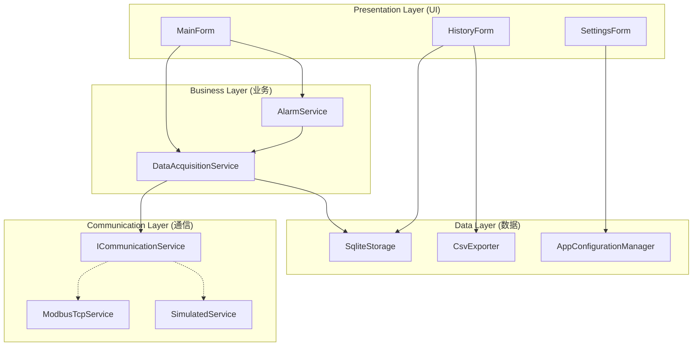
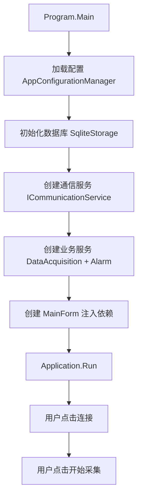
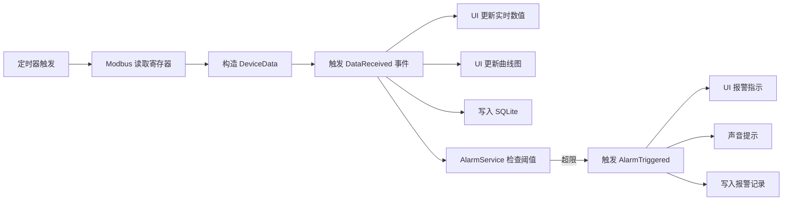

<ProgressIndicator
  current="winforms/winforms-project-temperature"
  items={[
    { slug: "winforms/winforms-roadmap", title: "路线图与岗位分析" },
    { slug: "winforms/winforms-basics", title: "WinForms 基础" },
    { slug: "winforms/winforms-serial-port", title: "串口通信实战" },
    { slug: "winforms/winforms-modbus-protocol", title: "Modbus 协议详解" },
    { slug: "winforms/winforms-multithreading-async", title: "多线程与异步" },
    { slug: "winforms/winforms-realtime-display", title: "实时数据展示" },
    { slug: "winforms/winforms-data-storage", title: "数据存储与导出" },
    { slug: "winforms/winforms-error-recovery", title: "异常处理与自动重连" },
    { slug: "winforms/winforms-project-temperature", title: "完整项目实战" },
  ]}
/>

# 完整项目实战：温控系统上位机从零到交付

前 8 篇文章我们分别学了 WinForms 基础、串口通信、Modbus 协议、多线程异步、实时数据展示、数据存储导出、异常处理与自动重连。每个知识点单独看都不难，但真正的上位机项目不是知识的简单拼凑——**你需要把所有知识点串起来，在架构设计、代码组织、异常处理、用户体验之间做出合理的权衡**。

这篇文章用一个完整的温控系统上位机项目，把前面所有知识串联成一个可交付的产品。从需求分析、架构设计、分层实现到打包部署，每一步都有完整代码和设计决策说明。

:::tip 阅读前提
本文是本系列第 9 篇（最终篇），假设你已阅读前 8 篇或已具备对应基础。文中的通信层、数据层、UI 层实现分别对应前面各篇讲解的知识，不会重复解释基础概念。
:::

---

## 一、需求分析

### 1.1 项目背景

温控系统是工业现场最常见的监控场景之一——半导体车间、食品加工、化工反应釜都需要精确的温度控制。上位机负责实时采集温度数据、显示趋势曲线、检测越限报警、存储历史记录。这类项目的复杂度适中，非常适合作为入门后的第一个完整项目。

### 1.2 功能需求

| 编号 | 功能 | 说明 | 对应知识篇 |
|------|------|------|-----------|
| F01 | Modbus TCP 连接/断开 | 支持手动连接和断开设备 | 串口通信 + Modbus |
| F02 | 实时温度采集 | 1 秒间隔自动读取温度寄存器 | Modbus + 多线程 |
| F03 | 温度曲线实时显示 | Chart 控件滚动显示最近 300 个数据点 | 实时数据展示 |
| F04 | 参数设定 | 设定目标温度、高/低温报警阈值 | Modbus 写寄存器 |
| F05 | 报警检测与提示 | 超温/低温时界面变色 + 声音提示 | 异常处理 |
| F06 | 历史数据查询 | 按日期范围查询历史温度记录 | 数据存储 |
| F07 | 数据导出 CSV | 将查询结果导出为 CSV 文件 | 数据导出 |
| F08 | 运行日志 | 记录操作和异常信息到日志文件 | 异常处理 |
| F09 | 自动重连 | 通信断开后自动尝试恢复 | 自动重连 |
| F10 | 系统托盘最小化 | 关闭到托盘继续运行 | WinForms 基础 |
| F11 | 窗口位置记忆 | 记住上次关闭时的位置和大小 | 配置管理 |

### 1.3 非功能需求

| 类型 | 指标 | 说明 |
|------|------|------|
| 稳定性 | 7×24 小时连续运行 | 内存不泄漏，线程不死锁 |
| 实时性 | 采集间隔 1 秒，UI 响应 < 100ms | 异步采集 + Invoke 更新 |
| 可维护性 | 分层架构，每层可独立测试 | 通信层可替换为模拟器 |
| 可部署性 | 单文件发布，无需安装运行时 | .NET 8 self-contained |

---

## 二、架构设计

### 2.1 分层架构



四层架构的职责边界：

| 层 | 职责 | 依赖方向 |
|----|------|---------|
| **Presentation** | 界面展示、用户交互、数据绑定 | → Business |
| **Business** | 业务逻辑：采集调度、报警判定、事件通知 | → Communication + Data |
| **Communication** | 通信抽象与实现：Modbus TCP、模拟器 | 无外部依赖 |
| **Data** | 数据持久化：SQLite、CSV、配置文件 | 无外部依赖 |

:::important 为什么这样分层
关键在于 **Communication 层的接口抽象**。`ICommunicationService` 让业务层不依赖具体通信方式——开发时用模拟器调试，部署时切换为真实 Modbus TCP，业务代码一行不用改。这也是依赖倒置原则（DIP）在上位机项目中最直接的应用。
:::

### 2.2 项目目录结构

<FileTree tree={[
  { name: "TemperatureController", type: "folder", comment: "项目根目录", children: [
    { name: "Models", type: "folder", comment: "数据模型", children: [
      { name: "DeviceData.cs", type: "file", comment: "设备实时数据" },
      { name: "AlarmRecord.cs", type: "file", comment: "报警记录" },
      { name: "HistoryRecord.cs", type: "file", comment: "历史数据" },
      { name: "AppConfiguration.cs", type: "file", comment: "应用配置" },
    ]},
    { name: "Communication", type: "folder", comment: "通信层", children: [
      { name: "ICommunicationService.cs", type: "file", comment: "通信接口" },
      { name: "ModbusTcpService.cs", type: "file", comment: "Modbus TCP 实现" },
      { name: "SimulatedCommunicationService.cs", type: "file", comment: "模拟器实现" },
    ]},
    { name: "Business", type: "folder", comment: "业务层", children: [
      { name: "DataAcquisitionService.cs", type: "file", comment: "数据采集服务" },
      { name: "AlarmService.cs", type: "file", comment: "报警检测服务" },
    ]},
    { name: "Data", type: "folder", comment: "数据层", children: [
      { name: "SqliteStorage.cs", type: "file", comment: "SQLite 数据库操作" },
      { name: "CsvExporter.cs", type: "file", comment: "CSV 导出" },
      { name: "AppConfigurationManager.cs", type: "file", comment: "配置管理" },
    ]},
    { name: "UI", type: "folder", comment: "界面层", children: [
      { name: "MainForm.cs", type: "file", comment: "主窗体" },
      { name: "MainForm.Designer.cs", type: "file", comment: "主窗体设计器" },
      { name: "HistoryForm.cs", type: "file", comment: "历史数据窗体" },
      { name: "SettingsForm.cs", type: "file", comment: "设置窗体" },
    ]},
    { name: "Program.cs", type: "file", comment: "程序入口" },
  ]},
]} />

---

## 三、数据模型层

模型是各层之间的数据契约，保持简洁和不可变性。

### 3.1 DeviceData — 设备实时数据

```csharp
namespace TemperatureController.Models;

public class DeviceData
{
    public DateTime Timestamp { get; init; } = DateTime.Now;
    public double Temperature { get; init; }
    public double SetTemperature { get; init; }
    public double HighAlarmLimit { get; init; }
    public double LowAlarmLimit { get; init; }
    public bool IsAlarmActive { get; init; }
    public string DeviceStatus { get; init; } = "Normal";
}
```

### 3.2 AlarmRecord — 报警记录

```csharp
namespace TemperatureController.Models;

public class AlarmRecord
{
    public int Id { get; set; }
    public DateTime Timestamp { get; set; }
    public AlarmType Type { get; set; }
    public double Temperature { get; set; }
    public double LimitValue { get; set; }
    public string Description { get; set; } = string.Empty;

    public static AlarmRecord CreateHigh( double temperature, double limit )
    {
        return new AlarmRecord
        {
            Timestamp = DateTime.Now,
            Type = AlarmType.HighTemperature,
            Temperature = temperature,
            LimitValue = limit,
            Description = $"超温报警: 当前温度 {temperature:F1}°C, 阈值 {limit:F1}°C"
        };
    }

    public static AlarmRecord CreateLow( double temperature, double limit )
    {
        return new AlarmRecord
        {
            Timestamp = DateTime.Now,
            Type = AlarmType.LowTemperature,
            Temperature = temperature,
            LimitValue = limit,
            Description = $"低温报警: 当前温度 {temperature:F1}°C, 阈值 {limit:F1}°C"
        };
    }
}

public enum AlarmType
{
    HighTemperature,
    LowTemperature
}
```

### 3.3 HistoryRecord — 历史数据

```csharp
namespace TemperatureController.Models;

public class HistoryRecord
{
    public int Id { get; set; }
    public DateTime Timestamp { get; set; }
    public double Temperature { get; set; }
    public double SetTemperature { get; set; }
}
```

### 3.4 AppConfiguration — 应用配置

```csharp
namespace TemperatureController.Models;

public class AppConfiguration
{
    public string IpAddress { get; set; } = "127.0.0.1";
    public int Port { get; set; } = 502;
    public byte SlaveId { get; set; } = 1;
    public int AcquireIntervalMs { get; set; } = 1000;
    public double HighAlarmLimit { get; set; } = 80.0;
    public double LowAlarmLimit { get; set; } = 10.0;
    public double SetTemperature { get; set; } = 25.0;
    public bool UseSimulator { get; set; } = true;
    public bool AutoReconnect { get; set; } = true;
    public int ReconnectIntervalMs { get; set; } = 5000;
    public int WindowX { get; set; } = 100;
    public int WindowY { get; set; } = 100;
    public int WindowWidth { get; set; } = 1200;
    public int WindowHeight { get; set; } = 800;
    public bool MinimizeToTray { get; set; } = true;
}
```

---

## 四、通信层实现

### 4.1 ICommunicationService 接口

接口是分层架构的灵魂。通信层通过接口与业务层解耦，使得切换 Modbus RTU、Modbus TCP 或模拟器只需替换实现类。

```csharp
namespace TemperatureController.Communication;

public interface ICommunicationService
{
    bool IsConnected { get; }
    event EventHandler<bool>? ConnectionStateChanged;
    event EventHandler<string>? ErrorOccurred;

    Task<bool> ConnectAsync( string ipAddress, int port, byte slaveId );
    Task DisconnectAsync();
    Task<ushort[]> ReadHoldingRegistersAsync( ushort startAddress, ushort count );
    Task WriteSingleRegisterAsync( ushort address, ushort value );
}
```

### 4.2 ModbusTcpService — Modbus TCP 实现

使用 NModbus4 库实现真实的 Modbus TCP 通信：

```csharp
using System.Net.Sockets;
using NModbus;
using TemperatureController.Models;

namespace TemperatureController.Communication;

public class ModbusTcpService : ICommunicationService
{
    private TcpClient? _tcpClient;
    private IModbusMaster? _master;
    private bool _isConnected;
    private readonly object _lock = new();

    public bool IsConnected
    {
        get { lock ( _lock ) { return _isConnected; } }
        private set { lock ( _lock ) { _isConnected = value; } }
    }

    public event EventHandler<bool>? ConnectionStateChanged;
    public event EventHandler<string>? ErrorOccurred;

    public async Task<bool> ConnectAsync( string ipAddress, int port, byte slaveId )
    {
        try
        {
            _tcpClient = new TcpClient();
            await _tcpClient.ConnectAsync( ipAddress, port );
            var factory = new ModbusFactory();
            _master = factory.CreateMaster( _tcpClient );
            _master.Transport.ReadTimeout = 3000;
            _master.Transport.WriteTimeout = 3000;
            IsConnected = true;
            ConnectionStateChanged?.Invoke( this, true );
            return true;
        }
        catch ( Exception ex )
        {
            ErrorOccurred?.Invoke( this, $"连接失败: {ex.Message}" );
            CleanupConnection();
            return false;
        }
    }

    public async Task DisconnectAsync()
    {
        CleanupConnection();
        ConnectionStateChanged?.Invoke( this, false );
        await Task.CompletedTask;
    }

    public async Task<ushort[]> ReadHoldingRegistersAsync( ushort startAddress, ushort count )
    {
        if ( !IsConnected || _master == null )
            throw new InvalidOperationException( "未连接" );

        try
        {
            return await _master.ReadHoldingRegistersAsync( 1, startAddress, count );
        }
        catch ( Exception ex )
        {
            IsConnected = false;
            ConnectionStateChanged?.Invoke( this, false );
            ErrorOccurred?.Invoke( this, $"读取失败: {ex.Message}" );
            throw;
        }
    }

    public async Task WriteSingleRegisterAsync( ushort address, ushort value )
    {
        if ( !IsConnected || _master == null )
            throw new InvalidOperationException( "未连接" );

        try
        {
            await _master.WriteSingleRegisterAsync( 1, address, value );
        }
        catch ( Exception ex )
        {
            IsConnected = false;
            ConnectionStateChanged?.Invoke( this, false );
            ErrorOccurred?.Invoke( this, $"写入失败: {ex.Message}" );
            throw;
        }
    }

    private void CleanupConnection()
    {
        IsConnected = false;
        try { _tcpClient?.Close(); } catch { }
        _tcpClient = null;
        _master = null;
    }
}
```

### 4.3 SimulatedCommunicationService — 模拟器

没有设备也能完整调试整个项目——模拟器是开发阶段最重要的工具：

```csharp
using TemperatureController.Models;

namespace TemperatureController.Communication;

public class SimulatedCommunicationService : ICommunicationService
{
    private bool _isConnected;
    private double _simulatedTemperature = 25.0;
    private double _targetTemperature = 25.0;
    private readonly Random _random = new();
    private CancellationTokenSource? _simCts;

    public bool IsConnected => _isConnected;
    public event EventHandler<bool>? ConnectionStateChanged;
    public event EventHandler<string>? ErrorOccurred;

    public Task<bool> ConnectAsync( string ipAddress, int port, byte slaveId )
    {
        _isConnected = true;
        _simCts = new CancellationTokenSource();
        _ = RunSimulationAsync( _simCts.Token );
        ConnectionStateChanged?.Invoke( this, true );
        return Task.FromResult( true );
    }

    public Task DisconnectAsync()
    {
        _simCts?.Cancel();
        _isConnected = false;
        ConnectionStateChanged?.Invoke( this, false );
        return Task.CompletedTask;
    }

    public Task<ushort[]> ReadHoldingRegistersAsync( ushort startAddress, ushort count )
    {
        if ( !_isConnected )
            throw new InvalidOperationException( "未连接" );

        ushort[] registers = new ushort[count];
        registers[0] = (ushort)( _simulatedTemperature * 10 );
        registers[1] = (ushort)( _targetTemperature * 10 );
        return Task.FromResult( registers );
    }

    public Task WriteSingleRegisterAsync( ushort address, ushort value )
    {
        if ( !_isConnected )
            throw new InvalidOperationException( "未连接" );

        if ( address == 1 )
            _targetTemperature = value / 10.0;

        return Task.CompletedTask;
    }

    private async Task RunSimulationAsync( CancellationToken ct )
    {
        while ( !ct.IsCancellationRequested )
        {
            try
            {
                await Task.Delay( 500, ct );
                double diff = _targetTemperature - _simulatedTemperature;
                double noise = _random.NextDouble() * 0.4 - 0.2;
                _simulatedTemperature += diff * 0.1 + noise;
                _simulatedTemperature = Math.Round( _simulatedTemperature, 1 );
            }
            catch ( OperationCanceledException ) { break; }
        }
    }
}
```

:::tip 模拟器的价值
模拟器不是玩具——它是保证项目**随时可运行**的关键。在真实项目中，设备经常不在手边，模拟器让你能随时调试 UI、业务逻辑、数据存储，而不依赖硬件。面试中提到你有模拟器意识，也是加分项。
:::

---

## 五、业务层实现

### 5.1 DataAcquisitionService — 数据采集服务

采集服务负责定时读取设备数据，并通过事件通知 UI 层：

```csharp
using TemperatureController.Communication;
using TemperatureController.Data;
using TemperatureController.Models;

namespace TemperatureController.Business;

public class DataAcquisitionService : IDisposable
{
    private readonly ICommunicationService _communication;
    private readonly SqliteStorage _storage;
    private readonly AppConfigurationManager _configManager;
    private CancellationTokenSource? _cts;
    private bool _isRunning;

    public bool IsRunning => _isRunning;
    public DeviceData? LatestData { get; private set; }

    public event EventHandler<DeviceData>? DataReceived;
    public event EventHandler<string>? ErrorOccurred;

    public DataAcquisitionService(
        ICommunicationService communication,
        SqliteStorage storage,
        AppConfigurationManager configManager )
    {
        _communication = communication;
        _storage = storage;
        _configManager = configManager;
    }

    public void Start()
    {
        if ( _isRunning ) return;
        _isRunning = true;
        _cts = new CancellationTokenSource();
        _ = AcquireLoopAsync( _cts.Token );
    }

    public void Stop()
    {
        _isRunning = false;
        _cts?.Cancel();
    }

    private async Task AcquireLoopAsync( CancellationToken ct )
    {
        while ( !ct.IsCancellationRequested )
        {
            try
            {
                if ( !_communication.IsConnected )
                {
                    await Task.Delay( 1000, ct );
                    continue;
                }

                var config = _configManager.Config;
                var registers = await _communication.ReadHoldingRegistersAsync( 0, 4 );

                var data = new DeviceData
                {
                    Temperature = registers[0] / 10.0,
                    SetTemperature = registers[1] / 10.0,
                    HighAlarmLimit = config.HighAlarmLimit,
                    LowAlarmLimit = config.LowAlarmLimit,
                    IsAlarmActive = registers[2] != 0,
                    DeviceStatus = registers[3] == 0 ? "Normal" : "Alarm"
                };

                LatestData = data;
                DataReceived?.Invoke( this, data );

                await _storage.InsertHistoryAsync( new HistoryRecord
                {
                    Timestamp = data.Timestamp,
                    Temperature = data.Temperature,
                    SetTemperature = data.SetTemperature
                } );
            }
            catch ( Exception ex )
            {
                ErrorOccurred?.Invoke( this, $"采集异常: {ex.Message}" );
            }

            try
            {
                var interval = _configManager.Config.AcquireIntervalMs;
                await Task.Delay( interval, ct );
            }
            catch ( OperationCanceledException ) { break; }
        }
    }

    public async Task WriteSetTemperatureAsync( double value )
    {
        if ( !_communication.IsConnected ) return;
        ushort registerValue = (ushort)( value * 10 );
        await _communication.WriteSingleRegisterAsync( 1, registerValue );
        _configManager.Config.SetTemperature = value;
        _configManager.Save();
    }

    public void Dispose()
    {
        Stop();
        _cts?.Dispose();
    }
}
```

### 5.2 AlarmService — 报警检测服务

报警服务订阅数据采集事件，执行阈值判断，并通过独立事件通知 UI：

```csharp
using TemperatureController.Models;

namespace TemperatureController.Business;

public class AlarmService
{
    private readonly AppConfigurationManager _configManager;
    private AlarmState _currentState = AlarmState.Normal;

    public AlarmState CurrentState => _currentState;
    public event EventHandler<AlarmRecord>? AlarmTriggered;
    public event EventHandler<AlarmState>? AlarmStateChanged;

    public AlarmService( AppConfigurationManager configManager )
    {
        _configManager = configManager;
    }

    public void CheckAlarm( DeviceData data )
    {
        var config = _configManager.Config;
        var previousState = _currentState;

        if ( data.Temperature > config.HighAlarmLimit )
        {
            _currentState = AlarmState.HighTemperature;
            if ( previousState != AlarmState.HighTemperature )
            {
                var record = AlarmRecord.CreateHigh( data.Temperature, config.HighAlarmLimit );
                AlarmTriggered?.Invoke( this, record );
            }
        }
        else if ( data.Temperature < config.LowAlarmLimit )
        {
            _currentState = AlarmState.LowTemperature;
            if ( previousState != AlarmState.LowTemperature )
            {
                var record = AlarmRecord.CreateLow( data.Temperature, config.LowAlarmLimit );
                AlarmTriggered?.Invoke( this, record );
            }
        }
        else
        {
            _currentState = AlarmState.Normal;
        }

        if ( previousState != _currentState )
        {
            AlarmStateChanged?.Invoke( this, _currentState );
        }
    }
}

public enum AlarmState
{
    Normal,
    HighTemperature,
    LowTemperature
}
```

:::note 报警去重
`AlarmService` 只在报警**状态切换**时触发事件。如果温度持续超温，不会每秒都产生新报警——这是实际项目中的常见需求，避免报警日志被重复记录淹没。
:::

---

## 六、数据层实现

### 6.1 SqliteStorage — SQLite 数据库

```csharp
using Microsoft.Data.Sqlite;
using TemperatureController.Models;

namespace TemperatureController.Data;

public class SqliteStorage : IDisposable
{
    private readonly SqliteConnection _connection;

    public SqliteStorage( string dbPath )
    {
        _connection = new SqliteConnection( $"Data Source={dbPath}" );
        _connection.Open();
        InitializeDatabase();
    }

    private void InitializeDatabase()
    {
        var cmd = _connection.CreateCommand();
        cmd.CommandText = @"
            CREATE TABLE IF NOT EXISTS HistoryRecords (
                Id INTEGER PRIMARY KEY AUTOINCREMENT,
                Timestamp TEXT NOT NULL,
                Temperature REAL NOT NULL,
                SetTemperature REAL NOT NULL
            );
            CREATE TABLE IF NOT EXISTS AlarmRecords (
                Id INTEGER PRIMARY KEY AUTOINCREMENT,
                Timestamp TEXT NOT NULL,
                Type INTEGER NOT NULL,
                Temperature REAL NOT NULL,
                LimitValue REAL NOT NULL,
                Description TEXT NOT NULL
            );
            CREATE INDEX IF NOT EXISTS idx_history_timestamp ON HistoryRecords(Timestamp);
            CREATE INDEX IF NOT EXISTS idx_alarm_timestamp ON AlarmRecords(Timestamp);
        ";
        cmd.ExecuteNonQuery();
    }

    public async Task InsertHistoryAsync( HistoryRecord record )
    {
        var cmd = _connection.CreateCommand();
        cmd.CommandText = @"
            INSERT INTO HistoryRecords (Timestamp, Temperature, SetTemperature)
            VALUES (@ts, @temp, @setTemp)";
        cmd.Parameters.AddWithValue( "@ts", record.Timestamp.ToString( "O" ) );
        cmd.Parameters.AddWithValue( "@temp", record.Temperature );
        cmd.Parameters.AddWithValue( "@setTemp", record.SetTemperature );
        await cmd.ExecuteNonQueryAsync();
    }

    public async Task InsertAlarmAsync( AlarmRecord record )
    {
        var cmd = _connection.CreateCommand();
        cmd.CommandText = @"
            INSERT INTO AlarmRecords (Timestamp, Type, Temperature, LimitValue, Description)
            VALUES (@ts, @type, @temp, @limit, @desc)";
        cmd.Parameters.AddWithValue( "@ts", record.Timestamp.ToString( "O" ) );
        cmd.Parameters.AddWithValue( "@type", (int)record.Type );
        cmd.Parameters.AddWithValue( "@temp", record.Temperature );
        cmd.Parameters.AddWithValue( "@limit", record.LimitValue );
        cmd.Parameters.AddWithValue( "@desc", record.Description );
        await cmd.ExecuteNonQueryAsync();
    }

    public List<HistoryRecord> QueryHistory( DateTime start, DateTime end )
    {
        var results = new List<HistoryRecord>();
        var cmd = _connection.CreateCommand();
        cmd.CommandText = @"
            SELECT Id, Timestamp, Temperature, SetTemperature
            FROM HistoryRecords
            WHERE Timestamp BETWEEN @start AND @end
            ORDER BY Timestamp";
        cmd.Parameters.AddWithValue( "@start", start.ToString( "O" ) );
        cmd.Parameters.AddWithValue( "@end", end.ToString( "O" ) );

        using var reader = cmd.ExecuteReader();
        while ( reader.Read() )
        {
            results.Add( new HistoryRecord
            {
                Id = reader.GetInt32( 0 ),
                Timestamp = DateTime.Parse( reader.GetString( 1 ) ),
                Temperature = reader.GetDouble( 2 ),
                SetTemperature = reader.GetDouble( 3 )
            } );
        }
        return results;
    }

    public List<AlarmRecord> QueryAlarms( DateTime start, DateTime end )
    {
        var results = new List<AlarmRecord>();
        var cmd = _connection.CreateCommand();
        cmd.CommandText = @"
            SELECT Id, Timestamp, Type, Temperature, LimitValue, Description
            FROM AlarmRecords
            WHERE Timestamp BETWEEN @start AND @end
            ORDER BY Timestamp DESC";
        cmd.Parameters.AddWithValue( "@start", start.ToString( "O" ) );
        cmd.Parameters.AddWithValue( "@end", end.ToString( "O" ) );

        using var reader = cmd.ExecuteReader();
        while ( reader.Read() )
        {
            results.Add( new AlarmRecord
            {
                Id = reader.GetInt32( 0 ),
                Timestamp = DateTime.Parse( reader.GetString( 1 ) ),
                Type = (AlarmType)reader.GetInt32( 2 ),
                Temperature = reader.GetDouble( 3 ),
                LimitValue = reader.GetDouble( 4 ),
                Description = reader.GetString( 5 )
            } );
        }
        return results;
    }

    public void DeleteOldRecords( int keepDays )
    {
        var cutoff = DateTime.Now.AddDays( -keepDays );
        var cmd = _connection.CreateCommand();
        cmd.CommandText = "DELETE FROM HistoryRecords WHERE Timestamp < @cutoff";
        cmd.Parameters.AddWithValue( "@cutoff", cutoff.ToString( "O" ) );
        cmd.ExecuteNonQuery();
    }

    public void Dispose()
    {
        _connection.Close();
        _connection.Dispose();
    }
}
```

### 6.2 CsvExporter — CSV 导出

```csharp
using System.Text;
using TemperatureController.Models;

namespace TemperatureController.Data;

public static class CsvExporter
{
    public static void ExportHistory( string filePath, List<HistoryRecord> records )
    {
        var sb = new StringBuilder();
        sb.AppendLine( "时间,温度(°C),设定温度(°C)" );
        foreach ( var r in records )
        {
            sb.AppendLine( $"{r.Timestamp:yyyy-MM-dd HH:mm:ss},{r.Temperature:F1},{r.SetTemperature:F1}" );
        }
        File.WriteAllText( filePath, sb.ToString(), Encoding.UTF8 );
    }

    public static void ExportAlarms( string filePath, List<AlarmRecord> records )
    {
        var sb = new StringBuilder();
        sb.AppendLine( "时间,报警类型,当前温度(°C),阈值(°C),描述" );
        foreach ( var r in records )
        {
            var typeStr = r.Type == AlarmType.HighTemperature ? "超温" : "低温";
            sb.AppendLine( $"{r.Timestamp:yyyy-MM-dd HH:mm:ss},{typeStr},{r.Temperature:F1},{r.LimitValue:F1},{r.Description}" );
        }
        File.WriteAllText( filePath, sb.ToString(), Encoding.UTF8 );
    }
}
```

### 6.3 AppConfigurationManager — 配置管理

```csharp
using System.Text.Json;
using TemperatureController.Models;

namespace TemperatureController.Data;

public class AppConfigurationManager
{
    private readonly string _configPath;
    private AppConfiguration _config = new();

    public AppConfiguration Config => _config;

    public AppConfigurationManager( string configPath )
    {
        _configPath = configPath;
        Load();
    }

    public void Load()
    {
        if ( !File.Exists( _configPath ) )
        {
            _config = new AppConfiguration();
            return;
        }

        try
        {
            var json = File.ReadAllText( _configPath );
            _config = JsonSerializer.Deserialize<AppConfiguration>( json ) ?? new AppConfiguration();
        }
        catch
        {
            _config = new AppConfiguration();
        }
    }

    public void Save()
    {
        var dir = Path.GetDirectoryName( _configPath );
        if ( !string.IsNullOrEmpty( dir ) && !Directory.Exists( dir ) )
            Directory.CreateDirectory( dir );

        var options = new JsonSerializerOptions { WriteIndented = true };
        var json = JsonSerializer.Serialize( _config, options );
        File.WriteAllText( _configPath, json );
    }
}
```

---

## 七、UI 层实现

### 7.1 MainForm — 主窗体

主窗体是整个上位机的核心界面，布局分为四个区域：

```csharp
using System.Media;
using TemperatureController.Business;
using TemperatureController.Communication;
using TemperatureController.Data;
using TemperatureController.Models;

namespace TemperatureController.UI;

public partial class MainForm : Form
{
    private readonly ICommunicationService _communication;
    private readonly DataAcquisitionService _acquisition;
    private readonly AlarmService _alarm;
    private readonly SqliteStorage _storage;
    private readonly AppConfigurationManager _configManager;
    private readonly NotifyIcon _notifyIcon;
    private readonly System.Windows.Forms.Timer _statusTimer;
    private readonly Queue<(DateTime Time, double Value)> _chartData = new();
    private const int MaxChartPoints = 300;

    public MainForm(
        ICommunicationService communication,
        DataAcquisitionService acquisition,
        AlarmService alarm,
        SqliteStorage storage,
        AppConfigurationManager configManager )
    {
        _communication = communication;
        _acquisition = acquisition;
        _alarm = alarm;
        _storage = storage;
        _configManager = configManager;

        InitializeComponent();
        InitializeChart();
        InitializeTrayIcon();
        ApplyWindowPosition();

        _statusTimer = new System.Windows.Forms.Timer { Interval = 1000 };
        _statusTimer.Tick += ( _, _ ) => toolStripStatusLabelTime.Text = DateTime.Now.ToString( "HH:mm:ss" );
        _statusTimer.Start();

        BindEvents();
    }

    private void BindEvents()
    {
        _communication.ConnectionStateChanged += OnConnectionStateChanged;
        _communication.ErrorOccurred += OnCommunicationError;
        _acquisition.DataReceived += OnDataReceived;
        _acquisition.ErrorOccurred += OnAcquisitionError;
        _alarm.AlarmTriggered += OnAlarmTriggered;
        _alarm.AlarmStateChanged += OnAlarmStateChanged;
    }

    private void OnConnectionStateChanged( object? sender, bool connected )
    {
        this.Invoke( () =>
        {
            toolStripStatusLabelConn.Text = connected ? "已连接" : "未连接";
            toolStripStatusLabelConn.ForeColor = connected ? Color.Green : Color.Red;
            btnConnect.Enabled = !connected;
            btnDisconnect.Enabled = connected;
            btnStartAcquire.Enabled = connected;
        } );
    }

    private void OnCommunicationError( object? sender, string error )
    {
        this.Invoke( () => AppendLog( $"[通信] {error}" ) );
    }

    private void OnDataReceived( object? sender, DeviceData data )
    {
        this.Invoke( () =>
        {
            UpdateRealtimeDisplay( data );
            UpdateChart( data );
            _alarm.CheckAlarm( data );
        } );
    }

    private void OnAcquisitionError( object? sender, string error )
    {
        this.Invoke( () => AppendLog( $"[采集] {error}" ) );
    }

    private void OnAlarmTriggered( object? sender, AlarmRecord record )
    {
        this.Invoke( () =>
        {
            AppendLog( $"[报警] {record.Description}" );
            _ = _storage.InsertAlarmAsync( record );
            SystemSounds.Exclamation.Play();
        } );
    }

    private void OnAlarmStateChanged( object? sender, AlarmState state )
    {
        this.Invoke( () =>
        {
            pnlAlarmIndicator.BackColor = state switch
            {
                AlarmState.HighTemperature => Color.Red,
                AlarmState.LowTemperature => Color.Blue,
                _ => Color.LimeGreen
            };
            lblAlarmState.Text = state switch
            {
                AlarmState.HighTemperature => "超温报警",
                AlarmState.LowTemperature => "低温报警",
                _ => "正常"
            };
        } );
    }

    private void UpdateRealtimeDisplay( DeviceData data )
    {
        lblCurrentTemp.Text = $"{data.Temperature:F1} °C";
        lblSetTemp.Text = $"{data.SetTemperature:F1} °C";
        lblHighLimit.Text = $"{data.HighAlarmLimit:F1} °C";
        lblLowLimit.Text = $"{data.LowAlarmLimit:F1} °C";
        lblDeviceStatus.Text = data.DeviceStatus;
    }

    private void UpdateChart( DeviceData data )
    {
        _chartData.Enqueue( (data.Timestamp, data.Temperature) );
        while ( _chartData.Count > MaxChartPoints )
            _chartData.Dequeue();

        chartTemperature.Series["Temperature"].Points.Clear();
        foreach ( var point in _chartData )
        {
            chartTemperature.Series["Temperature"].Points.AddXY(
                point.Time.ToString( "HH:mm:ss" ), point.Value );
        }
    }

    private async void btnConnect_Click( object sender, EventArgs e )
    {
        var config = _configManager.Config;
        bool success = await _communication.ConnectAsync(
            config.IpAddress, config.Port, config.SlaveId );
        if ( success )
            AppendLog( "[系统] 连接成功" );
    }

    private async void btnDisconnect_Click( object sender, EventArgs e )
    {
        _acquisition.Stop();
        await _communication.DisconnectAsync();
        AppendLog( "[系统] 已断开连接" );
    }

    private void btnStartAcquire_Click( object sender, EventArgs e )
    {
        _acquisition.Start();
        btnStartAcquire.Enabled = false;
        btnStopAcquire.Enabled = true;
        toolStripStatusLabelAcquire.Text = "采集中";
        AppendLog( "[系统] 开始采集" );
    }

    private void btnStopAcquire_Click( object sender, EventArgs e )
    {
        _acquisition.Stop();
        btnStartAcquire.Enabled = true;
        btnStopAcquire.Enabled = false;
        toolStripStatusLabelAcquire.Text = "已停止";
        AppendLog( "[系统] 停止采集" );
    }

    private async void btnSetTemp_Click( object sender, EventArgs e )
    {
        if ( double.TryParse( txtSetTemp.Text, out double value ) )
        {
            await _acquisition.WriteSetTemperatureAsync( value );
            AppendLog( $"[操作] 设定温度: {value:F1}°C" );
        }
        else
        {
            MessageBox.Show( "请输入有效的温度值", "输入错误", MessageBoxButtons.OK, MessageBoxIcon.Warning );
        }
    }

    private void btnHistory_Click( object sender, EventArgs e )
    {
        using var form = new HistoryForm( _storage );
        form.ShowDialog( this );
    }

    private void btnSettings_Click( object sender, EventArgs e )
    {
        using var form = new SettingsForm( _configManager );
        if ( form.ShowDialog( this ) == DialogResult.OK )
        {
            AppendLog( "[系统] 配置已更新" );
        }
    }

    private void AppendLog( string message )
    {
        if ( txtLog.InvokeRequired )
        {
            txtLog.Invoke( () => AppendLog( message ) );
            return;
        }
        txtLog.AppendText( $"[{DateTime.Now:HH:mm:ss}] {message}{Environment.NewLine}" );
        if ( txtLog.Lines.Length > 500 )
        {
            var lines = txtLog.Lines.Skip( 100 ).ToArray();
            txtLog.Lines = lines;
        }
    }

    private void InitializeChart()
    {
        chartTemperature.ChartAreas.Clear();
        chartTemperature.Series.Clear();

        var area = new System.Windows.Forms.DataVisualization.Charting.ChartArea( "Main" );
        area.AxisX.LabelStyle.Format = "HH:mm:ss";
        area.AxisX.IntervalType = System.Windows.Forms.DataVisualization.Charting.DateTimeIntervalType.Seconds;
        area.AxisX.Interval = 10;
        area.AxisY.Title = "温度 (°C)";
        chartTemperature.ChartAreas.Add( area );

        var series = new System.Windows.Forms.DataVisualization.Charting.Series( "Temperature" )
        {
            ChartType = System.Windows.Forms.DataVisualization.Charting.SeriesChartType.Line,
            Color = Color.DodgerBlue,
            BorderWidth = 2,
            XValueType = System.Windows.Forms.DataVisualization.Charting.ChartValueType.String
        };
        chartTemperature.Series.Add( series );
    }

    private void InitializeTrayIcon()
    {
        _notifyIcon = new NotifyIcon
        {
            Icon = this.Icon,
            Text = "温控系统上位机",
            Visible = true
        };
        _notifyIcon.DoubleClick += ( _, _ ) =>
        {
            this.Show();
            this.WindowState = FormWindowState.Normal;
        };
        var menu = new ContextMenuStrip();
        menu.Items.Add( "显示主窗口", null, ( _, _ ) =>
        {
            this.Show();
            this.WindowState = FormWindowState.Normal;
        } );
        menu.Items.Add( "退出", null, ( _, _ ) => CloseApp() );
        _notifyIcon.ContextMenuStrip = menu;
    }

    private void ApplyWindowPosition()
    {
        var config = _configManager.Config;
        this.StartPosition = FormStartPosition.Manual;
        this.Location = new Point( config.WindowX, config.WindowY );
        this.Size = new Size( config.WindowWidth, config.WindowHeight );
    }

    private void SaveWindowPosition()
    {
        _configManager.Config.WindowX = this.Location.X;
        _configManager.Config.WindowY = this.Location.Y;
        _configManager.Config.WindowWidth = this.Size.Width;
        _configManager.Config.WindowHeight = this.Size.Height;
        _configManager.Save();
    }

    protected override void OnFormClosing( FormClosingEventArgs e )
    {
        if ( _configManager.Config.MinimizeToTray && e.CloseReason == CloseReason.UserClosing )
        {
            e.Cancel = true;
            this.Hide();
            _notifyIcon.ShowBalloonTip( 2000, "温控系统", "程序已最小化到托盘", ToolTipIcon.Info );
            return;
        }
        CloseApp();
    }

    private void CloseApp()
    {
        SaveWindowPosition();
        _acquisition.Stop();
        _acquisition.Dispose();
        _ = _communication.DisconnectAsync();
        _notifyIcon.Visible = false;
        Application.Exit();
    }
}
```

<CodeAnnotation
  language="csharp"
  lines={[
    { code: 'private readonly Queue<(DateTime Time, double Value)> _chartData = new();', note: '用 Queue 维护固定窗口的曲线数据，超过 300 点自动出队' },
    { code: 'private const int MaxChartPoints = 300;' },
    { code: '' },
    { code: 'private void BindEvents()' },
    { code: '{' },
    { code: '    _communication.ConnectionStateChanged += OnConnectionStateChanged;', note: '各层通过事件解耦：通信层只管通知，UI 层只管响应' },
    { code: '    _communication.ErrorOccurred += OnCommunicationError;' },
    { code: '    _acquisition.DataReceived += OnDataReceived;' },
    { code: '    _acquisition.ErrorOccurred += OnAcquisitionError;' },
    { code: '    _alarm.AlarmTriggered += OnAlarmTriggered;' },
    { code: '    _alarm.AlarmStateChanged += OnAlarmStateChanged;' },
    { code: '}' },
    { code: '' },
    { code: 'this.Invoke( () =>', note: '业务层事件在后台线程触发，必须 Invoke 回 UI 线程更新控件' },
    { code: '{' },
    { code: '    toolStripStatusLabelConn.Text = connected ? "已连接" : "未连接";' },
  ]}
/>

### 7.2 MainForm 布局代码（Designer 片段）

以下是主窗体的关键布局定义，展示四个区域的组织方式：

```csharp
private void InitializeComponent()
{
    // 顶部工具栏
    ToolStrip toolStrip = new ToolStrip();
    btnConnect = new ToolStripButton( "连接" );
    btnDisconnect = new ToolStripButton( "断开" ) { Enabled = false };
    btnStartAcquire = new ToolStripButton( "开始采集" ) { Enabled = false };
    btnStopAcquire = new ToolStripButton( "停止采集" ) { Enabled = false };
    toolStrip.Items.AddRange( new ToolStripItem[] {
        btnConnect, btnDisconnect,
        new ToolStripSeparator(),
        btnStartAcquire, btnStopAcquire,
        new ToolStripSeparator(),
        new ToolStripLabel( "设定温度:" ),
        txtSetTemp = new ToolStripTextBox { Text = "25.0", Width = 60 },
        btnSetTemp = new ToolStripButton( "设定" ),
        new ToolStripSeparator(),
        btnHistory = new ToolStripButton( "历史查询" ),
        btnSettings = new ToolStripButton( "设置" ),
    } );

    // 中部：曲线区 + 右侧面板
    SplitContainer splitMain = new SplitContainer
    {
        Dock = DockStyle.Fill,
        Orientation = Orientation.Vertical,
        SplitterDistance = 750,
        Panel1MinSize = 400,
        Panel2MinSize = 250,
    };
    chartTemperature = new Chart { Dock = DockStyle.Fill };

    // 右侧参数面板
    Panel pnlRight = new Panel { Dock = DockStyle.Fill };
    lblCurrentTemp = new Label { Text = "--.- °C", Font = new Font( "Consolas", 24 ), AutoSize = true, Location = new Point( 20, 20 ) };
    lblSetTemp = new Label { Text = "设定: --.- °C", Location = new Point( 20, 80 ) };
    lblHighLimit = new Label { Text = "高温阈值: --.- °C", Location = new Point( 20, 110 ) };
    lblLowLimit = new Label { Text = "低温阈值: --.- °C", Location = new Point( 20, 140 ) };
    lblDeviceStatus = new Label { Text = "设备状态: --", Location = new Point( 20, 170 ) };
    pnlAlarmIndicator = new Panel { BackColor = Color.LimeGreen, Size = new Size( 20, 20 ), Location = new Point( 20, 210 ) };
    lblAlarmState = new Label { Text = "正常", Location = new Point( 50, 210 ) };
    pnlRight.Controls.AddRange( new Control[] {
        lblCurrentTemp, lblSetTemp, lblHighLimit, lblLowLimit,
        lblDeviceStatus, pnlAlarmIndicator, lblAlarmState } );

    splitMain.Panel1.Controls.Add( chartTemperature );
    splitMain.Panel2.Controls.Add( pnlRight );

    // 底部：日志区 + 状态栏
    SplitContainer splitBottom = new SplitContainer
    {
        Dock = DockStyle.Fill,
        Orientation = Orientation.Horizontal,
        SplitterDistance = 500,
    };
    splitBottom.Panel1.Controls.Add( splitMain );
    txtLog = new TextBox { Dock = DockStyle.Fill, ReadOnly = true, ScrollBars = ScrollBars.Vertical, Height = 120 };
    splitBottom.Panel2.Controls.Add( txtLog );

    StatusStrip statusStrip = new StatusStrip();
    toolStripStatusLabelConn = new ToolStripStatusLabel( "未连接" ) { ForeColor = Color.Red };
    toolStripStatusLabelAcquire = new ToolStripStatusLabel( "已停止" );
    toolStripStatusLabelTime = new ToolStripStatusLabel();
    statusStrip.Items.AddRange( new ToolStripItem[] {
        toolStripStatusLabelConn, new ToolStripStatusLabel( " | " ),
        toolStripStatusLabelAcquire, new ToolStripStatusLabel( " | " ),
        toolStripStatusLabelTime } );

    this.Controls.AddRange( new Control[] { splitBottom, toolStrip, statusStrip } );
    this.Text = "温控系统上位机";
    this.Size = new Size( 1200, 800 );
}
```

### 7.3 HistoryForm — 历史数据窗体

```csharp
using TemperatureController.Data;
using TemperatureController.Models;

namespace TemperatureController.UI;

public partial class HistoryForm : Form
{
    private readonly SqliteStorage _storage;
    private List<HistoryRecord> _currentRecords = new();

    public HistoryForm( SqliteStorage storage )
    {
        _storage = storage;
        InitializeComponent();
    }

    private void InitializeComponent()
    {
        this.Text = "历史数据查询";
        this.Size = new Size( 900, 600 );
        this.StartPosition = FormStartPosition.CenterParent;

        var pnlTop = new Panel { Dock = DockStyle.Top, Height = 50 };
        dtpStart = new DateTimePicker { Location = new Point( 10, 15 ), Format = DateTimePickerFormat.Short };
        dtpEnd = new DateTimePicker { Location = new Point( 180, 15 ), Format = DateTimePickerFormat.Short };
        dtpEnd.Value = DateTime.Now;
        dtpStart.Value = DateTime.Now.AddDays( -1 );
        var btnQuery = new Button { Text = "查询", Location = new Point( 350, 12 ), Size = new Size( 75, 28 ) };
        var btnExport = new Button { Text = "导出CSV", Location = new Point( 440, 12 ), Size = new Size( 85, 28 ) };
        btnQuery.Click += BtnQuery_Click;
        btnExport.Click += BtnExport_Click;
        pnlTop.Controls.AddRange( new Control[] {
            new Label { Text = "开始:", Location = new Point( 10, 0 ), AutoSize = true },
            dtpStart, dtpEnd,
            new Label { Text = "结束:", Location = new Point( 180, 0 ), AutoSize = true },
            btnQuery, btnExport } );

        dgvHistory = new DataGridView
        {
            Dock = DockStyle.Fill,
            ReadOnly = true,
            AllowUserToAddRows = false,
            AutoSizeColumnsMode = DataGridViewAutoSizeColumnsMode.Fill,
            SelectionMode = DataGridViewSelectionMode.FullRowSelect
        };
        dgvHistory.Columns.AddRange( new DataGridViewColumn[] {
            new DataGridViewTextBoxColumn { DataPropertyName = "Timestamp", HeaderText = "时间", DefaultCellStyle = new DataGridViewCellStyle { Format = "yyyy-MM-dd HH:mm:ss" } },
            new DataGridViewTextBoxColumn { DataPropertyName = "Temperature", HeaderText = "温度(°C)", DefaultCellStyle = new DataGridViewCellStyle { Format = "F1" } },
            new DataGridViewTextBoxColumn { DataPropertyName = "SetTemperature", HeaderText = "设定温度(°C)", DefaultCellStyle = new DataGridViewCellStyle { Format = "F1" } }
        } );

        this.Controls.AddRange( new Control[] { dgvHistory, pnlTop } );
    }

    private void BtnQuery_Click( object? sender, EventArgs e )
    {
        _currentRecords = _storage.QueryHistory( dtpStart.Value, dtpEnd.Value );
        dgvHistory.DataSource = _currentRecords;
    }

    private void BtnExport_Click( object? sender, EventArgs e )
    {
        if ( _currentRecords.Count == 0 )
        {
            MessageBox.Show( "无数据可导出", "提示", MessageBoxButtons.OK, MessageBoxIcon.Information );
            return;
        }

        using var sfd = new SaveFileDialog
        {
            Filter = "CSV 文件|*.csv",
            FileName = $"温度历史_{DateTime.Now:yyyyMMdd}.csv"
        };
        if ( sfd.ShowDialog() == DialogResult.OK )
        {
            CsvExporter.ExportHistory( sfd.FileName, _currentRecords );
            MessageBox.Show( "导出成功", "提示", MessageBoxButtons.OK, MessageBoxIcon.Information );
        }
    }

    private DateTimePicker dtpStart;
    private DateTimePicker dtpEnd;
    private DataGridView dgvHistory;
}
```

### 7.4 SettingsForm — 设置窗体

```csharp
using TemperatureController.Data;

namespace TemperatureController.UI;

public partial class SettingsForm : Form
{
    private readonly AppConfigurationManager _configManager;

    public SettingsForm( AppConfigurationManager configManager )
    {
        _configManager = configManager;
        InitializeComponent();
        LoadSettings();
    }

    private void InitializeComponent()
    {
        this.Text = "系统设置";
        this.Size = new Size( 450, 400 );
        this.StartPosition = FormStartPosition.CenterParent;
        this.FormBorderStyle = FormBorderStyle.FixedDialog;
        this.MaximizeBox = false;
        this.MinimizeBox = false;

        var tlp = new TableLayoutPanel
        {
            Dock = DockStyle.Fill,
            ColumnCount = 2,
            RowCount = 9,
            Padding = new Padding( 15 )
        };
        tlp.ColumnStyles.Add( new ColumnStyle( SizeType.Absolute, 130 ) );
        tlp.ColumnStyles.Add( new ColumnStyle( SizeType.Percent, 100 ) );

        txtIpAddress = new TextBox();
        nudPort = new NumericUpDown { Minimum = 1, Maximum = 65535 };
        nudSlaveId = new NumericUpDown { Minimum = 1, Maximum = 247 };
        nudInterval = new NumericUpDown { Minimum = 500, Maximum = 60000, Increment = 500 };
        nudHighLimit = new NumericUpDown { Minimum = -100, Maximum = 500, DecimalPlaces = 1, Increment = 0.5m };
        nudLowLimit = new NumericUpDown { Minimum = -100, Maximum = 500, DecimalPlaces = 1, Increment = 0.5m };
        chkSimulator = new CheckBox();
        chkAutoReconnect = new CheckBox();
        chkMinimizeToTray = new CheckBox();

        string[] labels = { "IP 地址:", "端口:", "从站地址:", "采集间隔(ms):",
            "高温阈值(°C):", "低温阈值(°C):", "使用模拟器:", "自动重连:", "最小化到托盘:" };
        Control[] controls = { txtIpAddress, nudPort, nudSlaveId, nudInterval,
            nudHighLimit, nudLowLimit, chkSimulator, chkAutoReconnect, chkMinimizeToTray };

        for ( int i = 0; i < labels.Length; i++ )
        {
            tlp.Controls.Add( new Label { Text = labels[i], Anchor = AnchorStyles.Left, AutoSize = true }, 0, i );
            tlp.Controls.Add( controls[i], 1, i );
        }

        var pnlBottom = new Panel { Dock = DockStyle.Bottom, Height = 45 };
        var btnSave = new Button { Text = "保存", DialogResult = DialogResult.OK, Size = new Size( 85, 30 ) };
        var btnCancel = new Button { Text = "取消", DialogResult = DialogResult.Cancel, Size = new Size( 85, 30 ) };
        btnSave.Location = new Point( this.ClientSize.Width - 200, 8 );
        btnCancel.Location = new Point( this.ClientSize.Width - 100, 8 );
        btnSave.Anchor = AnchorStyles.Right;
        btnCancel.Anchor = AnchorStyles.Right;
        btnSave.Click += BtnSave_Click;
        pnlBottom.Controls.AddRange( new Control[] { btnSave, btnCancel } );

        this.Controls.AddRange( new Control[] { tlp, pnlBottom } );
        this.AcceptButton = btnSave;
        this.CancelButton = btnCancel;
    }

    private void LoadSettings()
    {
        var config = _configManager.Config;
        txtIpAddress.Text = config.IpAddress;
        nudPort.Value = config.Port;
        nudSlaveId.Value = config.SlaveId;
        nudInterval.Value = config.AcquireIntervalMs;
        nudHighLimit.Value = (decimal)config.HighAlarmLimit;
        nudLowLimit.Value = (decimal)config.LowAlarmLimit;
        chkSimulator.Checked = config.UseSimulator;
        chkAutoReconnect.Checked = config.AutoReconnect;
        chkMinimizeToTray.Checked = config.MinimizeToTray;
    }

    private void BtnSave_Click( object? sender, EventArgs e )
    {
        var config = _configManager.Config;
        config.IpAddress = txtIpAddress.Text;
        config.Port = (int)nudPort.Value;
        config.SlaveId = (byte)nudSlaveId.Value;
        config.AcquireIntervalMs = (int)nudInterval.Value;
        config.HighAlarmLimit = (double)nudHighLimit.Value;
        config.LowAlarmLimit = (double)nudLowLimit.Value;
        config.UseSimulator = chkSimulator.Checked;
        config.AutoReconnect = chkAutoReconnect.Checked;
        config.MinimizeToTray = chkMinimizeToTray.Checked;
        _configManager.Save();
    }

    private TextBox txtIpAddress;
    private NumericUpDown nudPort;
    private NumericUpDown nudSlaveId;
    private NumericUpDown nudInterval;
    private NumericUpDown nudHighLimit;
    private NumericUpDown nudLowLimit;
    private CheckBox chkSimulator;
    private CheckBox chkAutoReconnect;
    private CheckBox chkMinimizeToTray;
}
```

---

## 八、核心流程代码

### 8.1 启动流程



### 8.2 采集流程

每个采集周期的完整数据流：



### 8.3 自动重连实现

在 MainForm 中监听通信断开事件，自动尝试恢复：

```csharp
private bool _reconnecting;
private readonly object _reconnectLock = new();

private void OnConnectionStateChanged( object? sender, bool connected )
{
    this.Invoke( () =>
    {
        toolStripStatusLabelConn.Text = connected ? "已连接" : "未连接";
        toolStripStatusLabelConn.ForeColor = connected ? Color.Green : Color.Red;
        btnConnect.Enabled = !connected;
        btnDisconnect.Enabled = connected;
        btnStartAcquire.Enabled = connected;

        if ( !connected && _configManager.Config.AutoReconnect && _acquisition.IsRunning )
        {
            _ = TryReconnectAsync();
        }
    } );
}

private async Task TryReconnectAsync()
{
    lock ( _reconnectLock )
    {
        if ( _reconnecting ) return;
        _reconnecting = true;
    }

    try
    {
        var config = _configManager.Config;
        int attempts = 0;
        while ( attempts < 10 && !_communication.IsConnected )
        {
            attempts++;
            AppendLog( $"[重连] 第 {attempts} 次尝试..." );
            bool success = await _communication.ConnectAsync(
                config.IpAddress, config.Port, config.SlaveId );
            if ( success )
            {
                AppendLog( "[重连] 连接恢复" );
                return;
            }
            await Task.Delay( config.ReconnectIntervalMs );
        }
        AppendLog( "[重连] 重连失败，已达到最大尝试次数" );
        _acquisition.Stop();
    }
    finally
    {
        lock ( _reconnectLock ) { _reconnecting = false; }
    }
}
```

### 8.4 关闭流程

```csharp
private void CloseApp()
{
    SaveWindowPosition();
    _acquisition.Stop();
    _acquisition.Dispose();
    _ = _communication.DisconnectAsync();
    _notifyIcon.Visible = false;
    Application.Exit();
}
```

<CodeAnnotation
  language="csharp"
  lines={[
    { code: 'private void CloseApp()', note: '关闭时按顺序释放资源：停采集 → 保存配置 → 断通信 → 退出' },
    { code: '{' },
    { code: '    SaveWindowPosition();' },
    { code: '    _acquisition.Stop();' },
    { code: '    _acquisition.Dispose();' },
    { code: '    _ = _communication.DisconnectAsync();' },
    { code: '    _notifyIcon.Visible = false;' },
    { code: '    Application.Exit();' },
    { code: '}' },
  ]}
/>

---

## 九、Program.cs 与全局配置

```csharp
using System.Runtime.InteropServices;
using TemperatureController.Business;
using TemperatureController.Communication;
using TemperatureController.Data;
using TemperatureController.Models;
using TemperatureController.UI;

namespace TemperatureController;

internal static class Program
{
    private static Mutex? _mutex;

    [STAThread]
    static void Main()
    {
        ApplicationConfiguration.Initialize();

        Application.SetUnhandledExceptionMode( UnhandledExceptionMode.CatchException );
        Application.ThreadException += Application_ThreadException;
        AppDomain.CurrentDomain.UnhandledException += CurrentDomain_UnhandledException;

        if ( !EnsureSingleInstance() )
        {
            MessageBox.Show( "程序已在运行", "提示", MessageBoxButtons.OK, MessageBoxIcon.Information );
            return;
        }

        var appDataDir = Path.Combine(
            Environment.GetFolderPath( Environment.SpecialFolder.ApplicationData ),
            "TemperatureController" );
        Directory.CreateDirectory( appDataDir );

        var configManager = new AppConfigurationManager(
            Path.Combine( appDataDir, "config.json" ) );
        var storage = new SqliteStorage(
            Path.Combine( appDataDir, "data.db" ) );

        ICommunicationService communication = configManager.Config.UseSimulator
            ? new SimulatedCommunicationService()
            : new ModbusTcpService();

        var acquisition = new DataAcquisitionService( communication, storage, configManager );
        var alarm = new AlarmService( configManager );

        using var mainForm = new MainForm( communication, acquisition, alarm, storage, configManager );
        Application.Run( mainForm );

        _mutex?.ReleaseMutex();
    }

    private static bool EnsureSingleInstance()
    {
        _mutex = new Mutex( true, "TemperatureController_SingleInstance", out bool createdNew );
        return createdNew;
    }

    private static void Application_ThreadException( object sender, System.Threading.ThreadExceptionEventArgs e )
    {
        File.AppendAllText( "crash.log",
            $"[{DateTime.Now:O}] UI异常: {e.Exception}\n" );
        MessageBox.Show( $"发生未处理的异常:\n{e.Exception.Message}",
            "错误", MessageBoxButtons.OK, MessageBoxIcon.Error );
    }

    private static void CurrentDomain_UnhandledException( object sender, UnhandledExceptionEventArgs e )
    {
        var ex = e.ExceptionObject as Exception;
        File.AppendAllText( "crash.log",
            $"[{DateTime.Now:O}] 未处理异常: {ex}\n" );
    }
}
```

<CodeAnnotation
  language="csharp"
  lines={[
    { code: 'Application.SetUnhandledExceptionMode( UnhandledExceptionMode.CatchException );', note: '捕获 UI 线程未处理异常，防止程序静默崩溃' },
    { code: 'Application.ThreadException += Application_ThreadException;' },
    { code: 'AppDomain.CurrentDomain.UnhandledException += CurrentDomain_UnhandledException;' },
    { code: '' },
    { code: 'if ( !EnsureSingleInstance() )', note: 'Mutex 实现单实例运行，防止用户重复启动' },
    { code: '{' },
    { code: '    MessageBox.Show( "程序已在运行", "提示", MessageBoxButtons.OK, MessageBoxIcon.Information );' },
    { code: '    return;' },
    { code: '}' },
    { code: '' },
    { code: 'ICommunicationService communication = configManager.Config.UseSimulator', note: '根据配置选择通信实现——开发用模拟器，部署用 Modbus TCP' },
    { code: '    ? new SimulatedCommunicationService()' },
    { code: '    : new ModbusTcpService();' },
  ]}
/>

---

## 十、打包与部署

### 10.1 NuGet 依赖

项目需要安装以下 NuGet 包：

```xml
<ItemGroup>
  <PackageReference Include="Microsoft.Data.Sqlite" Version="8.0.*" />
  <PackageReference Include="NModbus" Version="4.*" />
  <PackageReference Include="System.Text.Json" Version="8.0.*" />
</ItemGroup>
```

### 10.2 发布配置

<Steps>
### 命令行发布（单文件）

```bash
dotnet publish -c Release -r win-x64 --self-contained true -p:PublishSingleFile=true -p:IncludeNativeLibrariesForSelfExtract=true -o ./publish
```

关键参数说明：
- `-r win-x64`：目标运行时为 Windows 64 位
- `--self-contained true`：打包 .NET 运行时，用户机器无需安装
- `PublishSingleFile`：所有依赖打包成单个 exe
- `IncludeNativeLibrariesForSelfExtract`：SQLite 等原生库也会包含在内

### 生成结果

发布后 `publish/` 目录下只有一个 `TemperatureController.exe`（约 60-80MB），双击即可运行。

### Inno Setup 制作安装包

如果需要更专业的安装体验（桌面快捷方式、开机启动、卸载程序），可以用 Inno Setup：

```ini
[Setup]
AppName=温控系统上位机
AppVersion=1.0.0
DefaultDirName={pf}\TemperatureController
DefaultGroupName=温控系统
UninstallDisplayIcon={app}\TemperatureController.exe
OutputBaseFilename=TemperatureController_Setup_1.0.0

[Files]
Source: "publish\TemperatureController.exe"; DestDir: "{app}"; Flags: ignoreversion

[Icons]
Name: "{group}\温控系统上位机"; Filename: "{app}\TemperatureController.exe"
Name: "{commondesktop}\温控系统上位机"; Filename: "{app}\TemperatureController.exe"

[Tasks]
Name: "startup"; Description: "开机自动启动"; GroupDescription: "附加选项:"

[Registry]
Root: HKCU; Subkey: "Software\Microsoft\Windows\CurrentVersion\Run"; ValueType: string; ValueName: "TemperatureController"; ValueData: "{app}\TemperatureController.exe"; Flags: uninsdeletevalue; Tasks: startup
```
</Steps>

:::warning 部署注意事项
上位机通常部署在 Windows 7/10 的工控机上。如果目标机器是 Windows 7，需要确保系统已安装必要的更新补丁。.NET 8 self-contained 部署虽然不依赖系统运行时，但底层仍依赖 Windows API。建议在目标系统上充分测试。
:::

---

## 十一、测试与调试

### 11.1 使用模拟器测试

模拟器让项目无需真实设备即可完整运行：

<Steps>
### 启用模拟器

在设置窗体勾选"使用模拟器"，或在 `config.json` 中设置：

```json
{
  "UseSimulator": true,
  "SetTemperature": 60.0
}
```

### 验证基本功能

1. 点击"连接"——状态栏应显示"已连接"
2. 点击"开始采集"——曲线开始滚动，温度逐渐趋近设定值
3. 修改设定温度——观察曲线跟随变化
4. 打开历史查询——确认数据已入库

### 模拟通信断开

在模拟器运行时，在代码中临时加入断开模拟：

```csharp
// 在 SimulatedCommunicationService 中临时加入
if ( _random.NextDouble() < 0.02 )
{
    _isConnected = false;
    ConnectionStateChanged?.Invoke( this, false );
    ErrorOccurred?.Invoke( this, "模拟连接断开" );
}
```

验证自动重连是否在 5 秒后触发。

### 模拟超温报警

将设定温度设为 90°C，高温阈值设为 80°C，观察：
- 报警指示灯变红
- 报警日志出现记录
- 系统声音提示
</Steps>

### 11.2 长时间稳定性测试

7×24 运行是上位机的基本要求。验证方法：

| 测试项 | 方法 | 预期结果 |
|--------|------|---------|
| 内存泄漏 | 运行 24 小时，每 4 小时记录进程内存 | 内存占用稳定，不持续增长 |
| 线程泄漏 | 任务管理器查看线程数 | 线程数稳定在 5-8 个 |
| 数据完整性 | 查询 24 小时历史记录数 | 记录数 ≈ 86400（每秒一条） |
| 曲线流畅性 | 观察第 24 小时的曲线刷新 | 无卡顿、无闪烁 |

:::tip 内存泄漏排查
如果内存持续增长，重点检查：1) 事件订阅未取消导致对象无法 GC；2) `Chart` 控件数据点未清理；3) 日志 `TextBox` 的 `Lines` 数组无限增长。本文代码已对后两点做了防护（`Queue` 限制 300 点、`TextBox` 超过 500 行自动裁剪）。
:::

---

## 十二、项目扩展方向

这个温控系统是一个完整的起点，实际项目中常见的扩展方向：

| 方向 | 说明 | 涉及的新技术 |
|------|------|-------------|
| 多设备支持 | 同时监控多台温控设备 | 设备管理器、多线程采集、TabControl |
| WPF 版本迁移 | 更现代的 UI 框架，MVVM 架构 | WPF、MVVM、ObservableCollection |
| Web 远程监控 | 浏览器查看实时数据 | Blazor Server / SignalR |
| 数据上云 | 历史数据同步到云端 | MQTT、HTTP API、Azure IoT |
| 报表生成 | 日报/月报自动生成 | NPOI / ClosedXML 操作 Excel |
| 视频监控集成 | 集成摄像头画面 | EmguCV、RTSP 协议 |

:::details 多设备支持的核心改动 | 多设备是上位机项目最常见的扩展需求
多设备的关键改动在通信层和业务层：

1. **通信层**：为每台设备创建独立的 `ICommunicationService` 实例，放入 `Dictionary<string, ICommunicationService>` 管理
2. **业务层**：`DataAcquisitionService` 改为 `DeviceManager`，管理多个采集任务，每个任务有独立的 `CancellationTokenSource`
3. **UI 层**：用 `TabControl` 展示多设备，每个 Tab 对应一台设备的实时数据和曲线
4. **数据模型**：`DeviceData` 和 `HistoryRecord` 增加 `DeviceId` 字段

这个改动的工作量主要在 UI 层的布局调整，核心架构不需要大改——这就是分层架构的价值。
:::

---

## 总结

这篇文章把前 8 篇的所有知识串成了一个可交付的完整项目。回顾一下核心设计决策：

1. **分层架构**让每层可独立开发和测试——通信层可以替换为模拟器，UI 层可以替换为 WPF
2. **接口抽象**（`ICommunicationService`）是依赖倒置的直接体现——业务层不关心数据从哪来
3. **事件驱动**让层与层之间松耦合——采集服务不知道谁在监听数据，UI 不知道数据怎么来的
4. **模拟器优先**保证项目随时可运行——开发效率远高于"等设备到了再说"
5. **自动重连 + 全局异常捕获**是上位机稳定运行的底线——7×24 不是说说而已

这 9 篇文章覆盖了上位机开发的核心知识体系。从 WinForms 基础到完整项目，你已经具备了独立开发一个可交付上位机的能力。接下来就是在真实项目中积累经验——每个项目都会遇到之前没见过的问题，解决问题的过程就是成长的过程。
