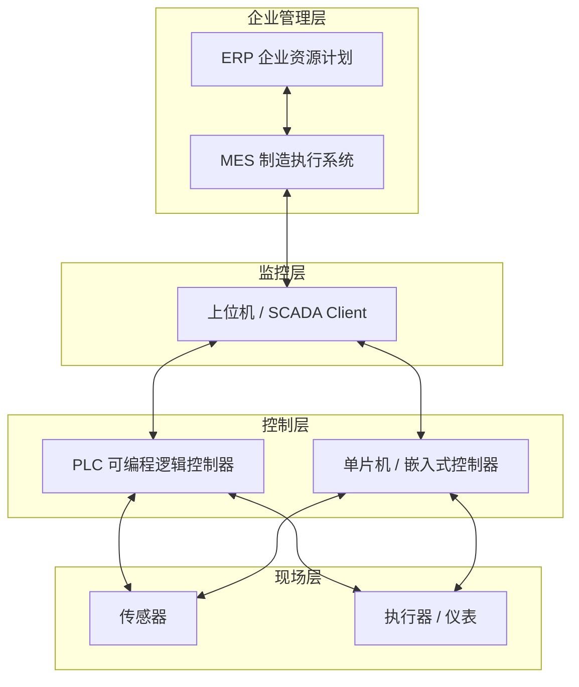

<ProgressIndicator
  current="winforms/winforms-roadmap"
  items={[
    { slug: "winforms/winforms-roadmap", title: "路线图与职业指南" },
    { slug: "winforms/winforms-basics", title: "WinForms 基础" },
    { slug: "winforms/winforms-serial-port", title: "串口通信" },
    { slug: "winforms/winforms-modbus-protocol", title: "Modbus 协议" },
    { slug: "winforms/winforms-multithreading-async", title: "多线程与异步" },
    { slug: "winforms/winforms-realtime-display", title: "实时数据展示" },
    { slug: "winforms/winforms-data-storage", title: "数据存储与导出" },
    { slug: "winforms/winforms-error-recovery", title: "异常处理与自动重连" },
    { slug: "winforms/winforms-project-temperature", title: "完整项目实战" },
  ]}
/>

# C# WinForms 上位机开发路线图：从入门到就业

你可能在招聘网站上看到过"上位机开发工程师"这个岗位，也可能正在做 .NET 开发想转向工控领域，又或者刚学完 C# 想找一个方向深耕。不管哪种情况，你面对的核心问题是一样的：**上位机开发到底要学什么？学到什么程度能找到工作？学习路线怎么规划？**

这篇文章就是来回答这些问题的。我们会从上位机是什么讲起，梳理清楚岗位的技术栈全景，给出一条按能力递进的学习路线，并列出面试中最常被问到的问题。读完之后，你会对上位机开发有一个完整的认知框架，知道每一步该学什么、为什么学、学完能做什么。

:::tip 本系列定位
这是 **C# WinForms 上位机开发**系列的第 1 篇，本系列共 9 篇，从 WinForms 基础到完整项目实战，覆盖上位机开发全链路。建议按顺序阅读，也可以根据已有基础跳到对应章节。
:::

---

## 一、什么是上位机

### 1.1 工业自动化系统架构

在工业现场，设备之间有明确的层次关系。理解这个架构，你才能明白上位机在整个系统中扮演什么角色、为什么需要这些技术能力。



每一层的职责和关注点都不同：

| 层次 | 代表设备 | 核心职责 | 典型协议 |
|------|----------|----------|----------|
| 企业管理层 | ERP / MES | 生产计划、物料管理、质量追溯 | HTTP API、数据库 |
| 监控层 | **上位机（SCADA Client）** | 数据采集、可视化监控、报警管理 | Modbus、OPC UA、MQTT |
| 控制层 | PLC / 单片机 | 逻辑控制、实时运算 | Modbus RTU、自由口协议 |
| 现场层 | 传感器 / 执行器 | 物理量测量、动作执行 | 4-20mA、0-10V、HART |

### 1.2 上位机 vs 下位机

很多人搞不清上位机和下位机的区别，这里明确一下：

- **下位机**（PLC、单片机、RTU）：直接连着传感器和执行器，负责实时采集和控制，运行周期通常是毫秒级
- **上位机**（PC 端软件）：通过通信协议从下位机获取数据、下发指令，侧重于人机交互和数据管理

简单说：**下位机干活，上位机管事**。下位机关注实时性和可靠性，上位机关注可视化、数据管理和操作便捷性。

### 1.3 上位机与 MES/ERP 的关系

上位机处于控制层和管理层之间，是一个承上启下的角色：

- **向下**：通过 Modbus、OPC UA 等工控协议与 PLC/仪表通信，采集实时数据、下发控制指令
- **向上**：将采集到的数据整理后上报给 MES/ERP 系统，通常通过数据库写入或 Web API 接口
- **横向**：作为通信网关，对接不同厂家的设备和协议，做协议转换

在一些中小型项目中，上位机可能同时承担 MES 的部分职责（如数据归档、报表生成、质量追溯），这也是上位机开发岗位技术面较广的原因之一。

### 1.4 上位机的六大核心职责

| 职责 | 说明 | 涉及的技术能力 |
|------|------|----------------|
| 数据采集 | 从下位机定时或事件驱动地读取温度、压力、流量等实时数据 | 串口通信、网络通信、Modbus/OPC UA |
| 远程控制 | 向下位机发送启动、停止、参数设定等控制指令 | 协议报文构造、指令确认机制 |
| 数据展示 | 实时曲线、数据表格、仪表盘、状态指示灯 | WinForms/WPF 控件、Chart、DataGridView |
| 数据存储 | 历史数据归档到数据库或文件，支持查询和导出 | SQLite/SQL Server、CSV、NPOI 报表 |
| 报警管理 | 越限报警、设备故障报警，声光提示并记录 | 定时检测、事件驱动、日志框架 |
| 通信网关 | 对接多种协议和设备，充当协议转换桥梁 | 多协议解析、数据格式映射 |

:::important 上位机开发的核心是通信
如果你只能记住一件事：上位机开发的核心能力是**通信**。不管用什么 UI 框架、什么数据库，最终都是围绕"怎样可靠地把数据从设备搬到 PC、把指令从 PC 发到设备"这个问题展开的。面试中最常问的也是通信相关的知识点。
:::

### 1.5 上位机开发的典型行业

上位机开发不是只在某个行业才有需求，以下是主要的行业分布：

| 行业 | 典型场景 | 常见设备 |
|------|----------|----------|
| 制造业 | 产线监控、质量检测、设备状态管理 | PLC、变频器、视觉传感器 |
| 能源 | 电力监控、光伏/风电运维、油气管道 | RTU、智能电表、保护装置 |
| 环保 | 污水处理监控、废气排放监测 | 在线分析仪、PLC |
| 楼宇 | 暖通空调控制、照明管理、能耗监测 | BACnet 控制器、DDC |
| 水务 | 自来水厂/污水厂 SCADA | PLC、流量计、液位计 |
| 半导体 | 晶圆制造设备监控、洁净室环境控制 | PLC、温湿度传感器、气体检测仪 |

不同行业的技术栈大同小异，核心都是 C# + 通信 + 数据展示。区别在于业务逻辑和行业规范——比如半导体行业对数据精度和追溯性要求极高，环保行业对报表和合规审计要求更多。

---

## 二、上位机岗位的技术栈全景

上位机开发的技术栈可以按"入职门槛 → 差异化竞争力 → 长期成长"三个层次来理解。以下表格帮你建立清晰的能力地图。

### 2.1 必会层——入职门槛

这些是上位机岗位的硬性要求，面试必问，入职第一天就要用：

| 技术能力 | 为什么必须 | 学习难度 |
|----------|-----------|---------|
| C# 语言基础 + 面向对象 | 所有代码都写在这个基础上 | ★★☆ |
| WinForms 窗体开发 | 上位机 UI 的主流方案，90% 的项目在用 | ★★☆ |
| 串口通信 (SerialPort) | 现场设备最常用的通信方式 | ★★★ |
| 网络通信 (TcpClient/Socket) | Modbus TCP、设备网关、远程监控的基础 | ★★★ |
| Modbus 协议 (RTU + TCP) | 工控领域最通用的通信协议，几乎必考 | ★★★ |
| 多线程 / 异步编程 | UI 不卡死的根本保证 | ★★★★ |
| 实时数据展示控件 | 上位机的核心价值就是"看得见" | ★★☆ |

:::warning 通信 + 多线程 = 面试生死线
如果你能把串口读写的完整流程讲清楚、能说清 Modbus RTU 和 TCP 的区别、知道 UI 线程和工作线程怎么交互——面试基本就过了。这三个知识点是上位机面试的"硬通货"。
:::

### 2.2 进阶层——差异化竞争力

掌握了必会层之后，以下能力能让你在候选人中脱颖而出：

| 技术能力 | 什么时候用 | 学习难度 |
|----------|-----------|---------|
| WPF + MVVM | 新项目 UI 要求高、需要数据绑定 | ★★★★ |
| OPC UA 协议 | 对接西门子/AB 等大厂 PLC | ★★★★ |
| MQTT 物联网协议 | 设备上云、远程监控场景 | ★★★ |
| SQLite / SQL Server | 历史数据存储、查询、报表 | ★★☆ |
| NPOI 报表生成 | 导出 Excel 报表（甲方最常提的需求） | ★★☆ |
| NLog / Serilog | 结构化日志记录，出问题时能快速定位 | ★★☆ |

:::tip WPF 值得学吗？
现在很多新项目确实在用 WPF，但 WinForms 仍然是存量最大的方案。建议先精通 WinForms 入行，再学 WPF 作为能力拓展。两者在通信层、数据层的代码是完全共通的，差别只在 UI 层。
:::

### 2.3 拓展层——长期成长

以下能力不是入职必须，但决定了你能走多远：

| 技术能力 | 解决什么问题 | 适合阶段 |
|----------|-------------|---------|
| 实时数据库 (InfluxDB) | 海量时序数据的高效存储和查询 | 高频采集场景（>1000 点/秒） |
| Docker 容器化部署 | 标准化部署流程，减少现场安装问题 | 项目多了之后 |
| Web API / SignalR | 远程监控、移动端查看、多客户端共享 | 项目需要远程访问时 |
| DDD 领域驱动设计 | 复杂业务逻辑的代码组织 | 大型项目、团队协作 |

:::note
拓展层的技术不需要现在就学，但在工作 1-2 年后，你会自然遇到这些需求。到时候再学也完全来得及——有前面的基础，上手会很快。
:::

---

## 三、学习路线——按能力递进

下面是本系列文章的学习路线，每个阶段都对应系列中的一篇文章。按顺序走完，你就能从零基础达到可以独立完成上位机项目的水平。

<Steps>

### WinForms 基础

**学什么**：窗体生命周期、常用控件（Button、TextBox、Label、ComboBox）、布局系统（TableLayoutPanel、FlowLayoutPanel）、事件机制、自定义控件

**为什么学**：WinForms 是上位机 UI 开发的基础设施。不懂窗体生命周期和布局，后续的所有功能都无处安放。

**学完能做什么**：搭建出基本的上位机界面框架，能放控件、能响应事件、能做简单布局

**预计学习时间**：3-5 天

→ 下一篇：[WinForms 基础](/posts/winforms/winforms-basics)

### 串口通信

**学什么**：SerialPort 类的完整使用、数据发送与接收、帧拼接与解析、超时处理、编码问题

**为什么学**：现场设备最常用的通信方式就是串口（RS-232/RS-485），不会串口通信就做不了上位机。

**学完能做什么**：实现 PC 与串口设备的稳定通信，能正确处理数据帧的拼接和解析

**预计学习时间**：5-7 天

→ 下一篇：[串口通信](/posts/winforms/winforms-serial-port)

### Modbus 协议

**学什么**：Modbus RTU/TCP 协议原理、功能码详解、报文构造与解析、CRC16 校验、C# 实现完整读写流程

**为什么学**：Modbus 是工控行业最通用的通信协议，几乎所有上位机项目都会用到。面试必考。

**学完能做什么**：独立实现 Modbus RTU 和 TCP 读写，能与真实的 PLC/仪表通信

**预计学习时间**：5-7 天

→ 下一篇：[Modbus 协议](/posts/winforms/winforms-modbus-protocol)

### 多线程与异步

**学什么**：Thread/Task/async/await、UI 线程与工作线程、Invoke/BeginInvoke、线程安全、取消与超时

**为什么学**：通信是耗时操作，不能在 UI 线程上做，否则界面会卡死。这是上位机开发中最容易出 bug 的地方。

**学完能做什么**：写出通信不卡界面、取消和超时都能正确处理的代码

**预计学习时间**：5-7 天

→ 下一篇：[多线程与异步](/posts/winforms/winforms-multithreading-async)

### 实时数据展示

**学什么**：Chart 控件绑定实时曲线、DataGridView 高性能刷新、状态指示灯、仪表盘控件、数据绑定机制

**为什么学**：上位机的核心价值是"看得见"，数据展示能力直接影响用户体验和项目验收。

**学完能做什么**：实现实时曲线滚动、数据表格刷新、状态指示灯变化等常见展示效果

**预计学习时间**：3-5 天

→ 下一篇：[实时数据展示](/posts/winforms/winforms-realtime-display)

### 数据存储与导出

**学什么**：SQLite 嵌入式数据库、SQL Server 基本操作、CSV 文件读写、NPOI 导出 Excel、NLog/Serilog 日志记录

**为什么学**：甲方通常要求历史数据可追溯、能导出报表、出问题时能查日志。这些是项目交付的标配。

**学完能做什么**：实现数据自动归档、历史查询、Excel 报表导出、结构化日志记录

**预计学习时间**：3-5 天

→ 下一篇：[数据存储与导出](/posts/winforms/winforms-data-storage)

### 异常处理与自动重连

**学什么**：通信异常分类与处理策略、自动重连机制设计、心跳检测、异常通知、全局异常捕获

**为什么学**：工业现场环境复杂，通信断开是常态。没有自动重连和异常处理的上位机，在现场根本没法用。

**学完能做什么**：实现断线自动重连、异常分级处理、运行状态可视化

**预计学习时间**：3-5 天

→ 下一篇：[异常处理与自动重连](/posts/winforms/winforms-error-recovery)

### 完整项目实战

**学什么**：将前面 7 个阶段的知识整合到一个真实的温控系统上位机项目中，包括项目架构设计、功能模块划分、代码组织、调试和优化

**为什么学**：零散的知识点必须通过完整项目才能真正融会贯通。面试时能讲出一个完整项目的实现细节，比列举知识点有说服力得多。

**学完能做什么**：独立完成一个可交付的上位机项目，具备求职和入职上手的能力

**预计学习时间**：7-10 天

→ 下一篇：[完整项目实战](/posts/winforms/winforms-project-temperature)

</Steps>

:::important 学习时间估算
按照以上路线，零基础到能独立做项目大约需要 **35-50 天**（每天有效学习 3-4 小时）。如果已有 C# 基础，可以跳过第 1 阶段，时间会缩短到 **25-40 天**。关键不是赶进度，而是每个阶段都动手写代码、跑通示例。
:::

---

## 四、面试高频考察点

以下 10 个问题是上位机岗位面试中出现频率最高的，每个问题都给出回答要点，帮你快速准备。

### 1. 串口通信帧拼接怎么处理？

串口接收数据是流式的，一次 `DataReceived` 事件不一定能拿到完整的一帧。正确做法是：

- 维护一个接收缓冲区（`List<byte>` 或 `byte[]`），每次收到数据追加到缓冲区
- 按协议定义的帧格式（起始字节、长度字段、结束标志等）从缓冲区中提取完整帧
- 提取后从缓冲区移除已处理的数据，剩余部分留给下次拼接

```csharp
private List<byte> _buffer = new List<byte>();

private void OnDataReceived(object sender, SerialDataReceivedEventArgs e)
{
    int bytesToRead = _serialPort.BytesToRead;
    byte[] temp = new byte[bytesToRead];
    _serialPort.Read(temp, 0, bytesToRead);
    _buffer.AddRange(temp);

    while (TryExtractFrame(_buffer, out byte[] frame))
    {
        ProcessFrame(frame);
    }
}
```

### 2. Modbus RTU 和 TCP 的区别？

| 对比项 | Modbus RTU | Modbus TCP |
|--------|-----------|-----------|
| 传输介质 | 串口（RS-232/RS-485） | 以太网 |
| 报文格式 | 设备地址 + 功能码 + 数据 + CRC | MBAP 头（事务元+协议头+长度+单元ID）+ 功能码 + 数据 |
| 校验方式 | CRC16 校验（必须） | TCP 协议本身保证完整性，无 CRC |
| 通信方式 | 一主多从，轮询 | 一主多从，可并发 |
| 响应时间 | 典型 100ms-1s | 典型 10ms-100ms |

:::note 面试加分回答
可以补充：Modbus RTU 的报文之间需要 3.5 字符时间的间隔来区分帧边界，这是 RTU 模式下帧同步的核心机制。而 TCP 模式因为有了 MBAP 头中的长度字段，不存在这个问题。
:::

### 3. UI 线程和工作线程怎么交互？

WinForms 的控件只能由创建它们的线程（UI 线程）访问。工作线程要更新 UI，必须通过 `Control.Invoke`（同步）或 `Control.BeginInvoke`（异步）将操作"投递"到 UI 线程执行：

```csharp
private void OnDataReceived(object sender, SerialDataReceivedEventArgs e)
{
    string data = ReadData();

    if (textBox1.InvokeRequired)
    {
        textBox1.BeginInvoke(new Action(() => textBox1.AppendText(data)));
    }
    else
    {
        textBox1.AppendText(data);
    }
}
```

面试时可以补充：`Invoke` 会阻塞工作线程直到 UI 线程执行完毕，`BeginInvoke` 不会阻塞。在上位机通信场景中，推荐用 `BeginInvoke` 避免工作线程被 UI 卡住。

### 4. async void 和 async Task 的区别？

- `async Task`：标准的异步方法返回类型，调用者可以 `await` 它，异常会被捕获到返回的 Task 中
- `async void`：仅用于事件处理器（如按钮点击），异常无法被调用者捕获，会直接抛到 `SynchronizationContext` 上导致应用崩溃

**核心原则**：除了事件处理器，永远不要用 `async void`。用 `async Task` 替代。

```csharp
// 错误：异常无法被捕获
private async void FetchData()
{
    await Task.Delay(1000);
    throw new Exception("boom"); // 直接崩溃
}

// 正确：异常被包裹在 Task 中
private async Task FetchDataAsync()
{
    await Task.Delay(1000);
    throw new Exception("boom"); // 调用者可以 catch
}
```

### 5. 如何实现自动重连？

自动重连的核心逻辑是一个带退避策略的重试循环：

1. 检测到连接断开
2. 按指数退避策略等待（1s → 2s → 4s → 8s → 最大间隔）
3. 尝试重新连接
4. 成功则恢复正常通信，失败则继续等待重试
5. 同时提供手动重连和取消重连的能力

```csharp
private async Task AutoReconnectAsync(CancellationToken ct)
{
    int delay = 1000;
    const int maxDelay = 30000;

    while (!ct.IsCancellationRequested)
    {
        try
        {
            await Task.Delay(delay, ct);
            await ConnectAsync(ct);
            delay = 1000; // 重连成功，重置延迟
            return;
        }
        catch
        {
            delay = Math.Min(delay * 2, maxDelay);
        }
    }
}
```

面试时可以补充：退避策略避免在网络持续不可用时疯狂重连消耗资源；必须有 `CancellationToken` 让用户能主动取消。

### 6. 什么是 InvokeRequired？

`InvokeRequired` 是 `Control` 类的一个属性，返回 `bool`，表示当前线程是否不是控件创建所在的线程。如果为 `true`，说明你在非 UI 线程上，必须通过 `Invoke/BeginInvoke` 才能访问控件；如果为 `false`，可以直接操作。

本质上是 WinForms 做 UI 线程安全检查的机制。面试时可以联系到 WPF 中的类似概念——`Dispatcher.CheckAccess()`，功能相同。

### 7. CRC16 校验算法原理

CRC（Cyclic Redundancy Check，循环冗余校验）是 Modbus RTU 报文的校验机制。原理是将报文数据作为多项式，对生成多项式做模 2 除法，得到的余数就是 CRC 值。

Modbus RTU 使用的生成多项式是 `0xA001`（即 `x^16 + x^15 + x^2 + 1` 的反转表示）。实际实现中，常用查表法加速：

```csharp
private static readonly ushort[] CrcTable = new ushort[256];

static ModbusCrc()
{
    for (ushort i = 0; i < 256; i++)
    {
        ushort crc = i;
        for (int j = 0; j < 8; j++)
        {
            if ((crc & 0x0001) != 0)
                crc = (ushort)((crc >> 1) ^ 0xA001);
            else
                crc >>= 1;
        }
        CrcTable[i] = crc;
    }
}

public static ushort Compute(byte[] data, int offset, int length)
{
    ushort crc = 0xFFFF;
    for (int i = offset; i < offset + length; i++)
    {
        crc = (ushort)((crc >> 8) ^ CrcTable[(crc ^ data[i]) & 0xFF]);
    }
    return crc;
}
```

面试时说清"查表法比逐位计算快很多"和"CRC 值在 Modbus 报文中低字节在前"就够了。

### 8. DataGridView 如何高性能刷新？

直接清空再重新绑定所有数据会导致闪烁和卡顿。优化思路：

- **只更新变化的单元格**：通过 `Rows[i].Cells[j].Value` 逐个更新，而不是重新绑定整个数据源
- **批量更新时暂停绘制**：`dataGridView.SuspendLayout()` / `ResumeLayout()`
- **启用双缓冲**：通过反射设置 `DoubleBuffered = true` 减少闪烁
- **虚拟模式**：数据量特别大时（>1 万行），启用 `VirtualMode`，按需加载单元格数据

```csharp
// 启用双缓冲（DataGridView 默认不公开此属性）
var dgvType = typeof(DataGridView);
var pi = dgvType.GetProperty("DoubleBuffered", BindingFlags.Instance | BindingFlags.NonPublic);
pi?.SetValue(dataGridView1, true);
```

### 9. 如何处理通信超时？

通信超时是上位机开发中最常见的异常之一，处理策略：

1. **设置合理的超时时间**：`SerialPort.ReadTimeout` / `TcpClient.ReceiveTimeout`，通常 1-3 秒
2. **区分超时和断连**：超时可能是设备暂时忙碌，断连需要重连
3. **超时计数器**：连续 N 次超时才判定为断连，避免偶发超时误判
4. **超时后的恢复**：清除缓冲区 → 重试 → 超过阈值则触发重连

```csharp
private int _timeoutCount = 0;
private const int MaxTimeoutCount = 3;

private async Task<byte[]> SendAndReceiveAsync(byte[] request, CancellationToken ct)
{
    await SendAsync(request, ct);

    try
    {
        var response = await ReceiveWithTimeoutAsync(3000, ct);
        _timeoutCount = 0;
        return response;
    }
    catch (TimeoutException)
    {
        _timeoutCount++;
        if (_timeoutCount >= MaxTimeoutCount)
        {
            _timeoutCount = 0;
            throw new CommunicationException("连续超时，连接可能已断开");
        }
        throw;
    }
}
```

### 10. 上位机项目中最难的问题是什么？

这是开放性问题，考察你的项目经验和问题解决能力。推荐这样回答：

> 最难的是**保证通信的稳定性**。工业现场环境复杂，电磁干扰大，通信线可能很长，设备可能突然断电。所以上位机必须处理各种异常情况：通信超时、数据帧不完整、校验错误、设备离线、网络波动等。单纯实现读写功能不难，难的是在各种异常情况下都能稳定运行、自动恢复、不丢数据。

然后可以举一个具体的例子，比如"项目中遇到过 RS-485 总线上某个设备故障导致整条总线通信异常的问题，通过逐个排查、增加超时隔离、用独立任务轮询每个设备来隔离故障点"。

:::tip 面试回答技巧
对于开放性问题，用"总—分"结构回答：先给出核心观点（一句话），再展开具体细节或举例。这样逻辑清晰，面试官也容易跟进。
:::

---

## 五、推荐开发工具和调试工具

上位机开发离不开调试工具，因为你大部分时间都在和"设备通不通、数据对不对"打交道。以下是必备工具清单：

### 5.1 Visual Studio 配置

Visual Studio 是 C# WinForms 开发的标准 IDE，推荐配置：

| 配置项 | 推荐设置 | 说明 |
|--------|---------|------|
| 版本 | Visual Studio 2022 Community | 免费版即可，支持 .NET 8 |
| 工作负载 | .NET 桌面开发 | 包含 WinForms 设计器 |
| NuGet 包源 | 添加 nuget.org | 有些包国内镜像更新不及时 |
| 调试选项 | 启用"非用户代码调试" | 方便调试框架内部代码 |

安装时确保勾选 ".NET 桌面开发" 工作负载，这样 WinForms 设计器和项目模板才能正常使用。

### 5.2 虚拟串口工具

在没有真实硬件时，用虚拟串口工具模拟串口通信：

- **VSPD (Virtual Serial Port Driver)**：创建虚拟串口对，一端发送、另一端接收，开发调试必备
- **com0com**：开源免费的虚拟串口驱动，功能与 VSPD 类似

使用方式：安装后创建一对虚拟串口（如 COM1 ↔ COM2），程序连 COM1，用串口调试助手连 COM2，就能模拟完整的串口通信流程。

### 5.3 Modbus 模拟器

用于模拟 Modbus 从站设备，不需要真实 PLC 就能测试上位机的 Modbus 通信功能：

- **ModRSSim**：免费，支持 Modbus RTU 和 TCP，可以自定义寄存器值
- **Simply Modbus Slave**：界面简洁，适合快速验证报文格式
- **Modbus Slave (ModbusTools)**：功能最全，支持多种功能码和数据类型

:::tip 调试流程建议
推荐的开发流程：先用虚拟串口 + Modbus 模拟器验证通信逻辑 → 再用串口调试助手手动发送报文确认报文格式 → 最后接到真实设备上联调。每一步都验证通过再进入下一步，比直接接真设备高效得多。
:::

### 5.4 网络调试助手

调试 TCP/UDP 通信时的必备工具：

- **SocketTool**：支持 TCP Server/Client、UDP 收发，界面直观
- **NetAssist（网络调试助手）**：国产工具，中文界面，支持 HEX 收发

用途：模拟 Modbus TCP 从站、测试自定义 TCP 协议、抓取和对比报文内容。

### 5.5 串口调试助手

直接查看串口收发的原始数据，排查帧拼接、编码、校验问题：

- **SSCOM**：经典串口调试工具，支持 HEX 显示和发送
- **XCOM**：支持多串口同时监控，适合多设备场景
- **AccessPort**：支持串口数据监控和过滤

:::warning 调试时注意端口占用
串口是独占资源，一个端口同时只能被一个程序打开。调试时如果程序已经打开了 COM3，串口调试助手就无法再打开 COM3。建议用虚拟串口对来解决这个问题：程序连 COM1，调试助手连 COM2。
:::

---

## 六、本系列文章的阅读建议

本系列共 9 篇文章，从基础到实战按能力递进排列：

| 序号 | 文章 | 核心内容 |
|------|------|---------|
| 1 | 路线图与职业指南（本文） | 上位机是什么、技术栈全景、学习路线、面试准备 |
| 2 | [WinForms 基础](/posts/winforms/winforms-basics) | 窗体生命周期、控件、布局、事件机制 |
| 3 | [串口通信](/posts/winforms/winforms-serial-port) | SerialPort 完整用法、帧拼接、超时处理 |
| 4 | [Modbus 协议](/posts/winforms/winforms-modbus-protocol) | RTU/TCP 原理、报文解析、CRC16、C# 实现 |
| 5 | [多线程与异步](/posts/winforms/winforms-multithreading-async) | Task/async/await、Invoke、线程安全 |
| 6 | [实时数据展示](/posts/winforms/winforms-realtime-display) | Chart 曲线、DataGridView、状态指示灯 |
| 7 | [数据存储与导出](/posts/winforms/winforms-data-storage) | SQLite、Excel 导出、日志记录 |
| 8 | [异常处理与自动重连](/posts/winforms/winforms-error-recovery) | 异常分类、重连策略、心跳检测 |
| 9 | [完整项目实战](/posts/winforms/winforms-project-temperature) | 温控系统上位机，整合所有知识点 |

### 阅读策略

:::note 新手建议
如果你是零基础或刚学完 C#，**按顺序阅读**。每篇文章都建立在前一篇文章的基础上，跳着看容易产生知识断层。每个阶段都要动手写代码、跑通示例，不要只看不动手。
:::

:::tip 有基础的开发者
如果你已经有 WinForms 或通信开发经验，可以跳过熟悉的部分，直接进入需要的章节。各篇文章之间虽然有递进关系，但每篇也自成体系，可以独立阅读。
:::

:::important 项目实战不要跳过
第 9 篇（完整项目实战）是整个系列的"验收篇"，把前面所有知识串成一个可运行的项目。**无论你前面跳了多少，这一篇一定要做**。面试时能讲出一个完整项目的实现细节，远比列举零散的知识点有说服力。
:::

---

<Glossary term="上位机：Host Computer / SCADA Client，工业自动化系统中运行在 PC 端的监控软件，负责与下位机通信、数据采集、可视化和控制指令下发">
  上位机
</Glossary>
开发是一个"入门容易、精通难"的领域。核心的通信和展示并不复杂，但要做到在各种异常情况下稳定运行、用户体验流畅、数据不丢失，需要大量的实践积累。

这个系列会带你走过从零到能做项目的完整路径。下一步，我们从 WinForms 基础开始——这是所有上位机 UI 的根基。

→ 下一篇：[WinForms 基础](/posts/winforms/winforms-basics)
