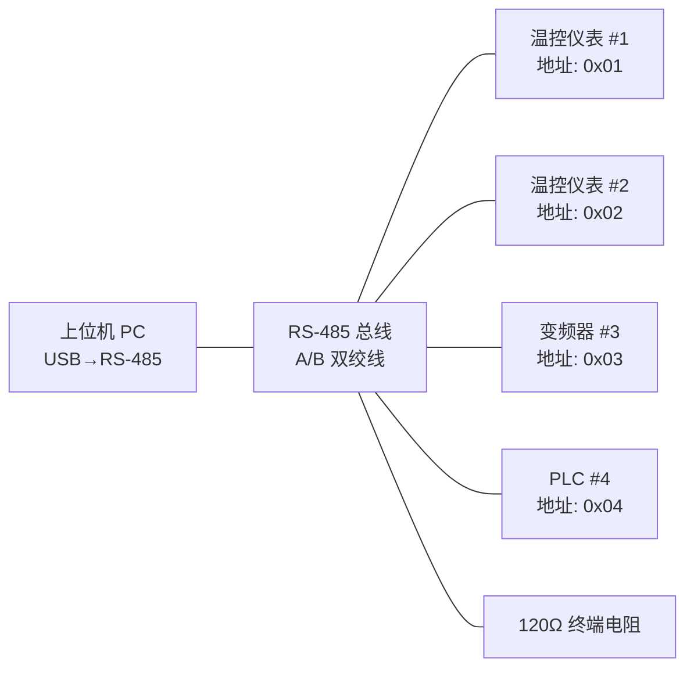

<ProgressIndicator
  current="winforms/winforms-serial-port"
  items={[
    { slug: "winforms/winforms-roadmap", title: "路线图与岗位分析" },
    { slug: "winforms/winforms-basics", title: "WinForms 基础" },
    { slug: "winforms/winforms-serial-port", title: "串口通信实战" },
    { slug: "winforms/winforms-modbus-protocol", title: "Modbus 协议详解" },
    { slug: "winforms/winforms-multithreading-async", title: "多线程与异步" },
    { slug: "winforms/winforms-realtime-display", title: "实时数据展示" },
    { slug: "winforms/winforms-data-storage", title: "数据存储与导出" },
    { slug: "winforms/winforms-error-recovery", title: "异常处理与自动重连" },
    { slug: "winforms/winforms-project-temperature", title: "完整项目实战" },
  ]}
/>

# 串口通信实战：从 RS-485 到帧拼接的完整指南

串口通信是上位机开发的核心能力，没有之一。在工控领域，RS-485 是最广泛使用的物理接口——从 PLC 到温控仪表，从变频器到智能传感器，几乎都提供 RS-485 通信口。你的上位机程序如果无法可靠地收发串口数据，其他一切功能都无从谈起。

但串口通信的难点不在于"怎么打开串口发数据"，而在于**数据接收后的帧拼接**。`SerialPort` 的 `DataReceived` 事件触发时，你拿到的往往不是一个完整的协议帧——可能是半帧，也可能是两个半帧粘在一起。如果你不理解粘包/拆包的原理，写出来的程序就会偶发丢数据、解析错乱。

这篇文章从物理层原理出发，逐层深入到 `SerialPort` 类的每个属性、数据收发的完整流程、帧拼接的三种策略、CRC 校验实现，最后落到 RS-485 半双工控制和调试实战。读完之后，你将真正理解串口通信的全链路，而不仅仅是会调用几个 API。

---

## 一、串口通信物理层基础

### 1.1 四种常见串行接口

上位机开发中会遇到四种物理层接口，它们的电气特性差异巨大，选错接口会导致通信不稳定甚至损坏设备：

| 参数 | RS-232 | RS-485 | RS-422 | TTL/UART |
|------|--------|--------|--------|----------|
| 传输模式 | 全双工 | 半双工 | 全双工 | 全双工 |
| 最大距离 | 15m | 1200m | 1200m | 3m以内 |
| 最大节点数 | 1 对 1 | 32（中继可扩展至 256） | 10 | 1 对 1 |
| 信号方式 | 单端（共地） | 差分（A/B 两线） | 差分（4 线） | 单端（共地） |
| 逻辑电平 | ±3V ~ ±15V | 差分 ±0.2V 以上 | 差分 ±0.2V 以上 | 0/3.3V 或 0/5V |
| 抗干扰能力 | 弱 | 强 | 强 | 极弱 |
| 典型应用 | 调试口、老式设备 | 工控总线（主流） | 长距离全双工 | MCU 之间通信 |

:::important RS-485 是上位机的默认选择
工控现场电磁干扰严重、传输距离远、需要一主多从——RS-485 的差分信号抗干扰、长距离传输、多点通信三个特性完美匹配。90% 以上的上位机串口通信走的是 RS-485。
:::

### 1.2 RS-485 接线方式

RS-485 有两种接线方式：

**两线制（最常用）**：只有 A、B 两根信号线，半双工通信。所有设备并联在 A、B 线上，同一时刻只有一个设备能发送。

**四线制**：用两对差分线（A/B 发送 + A/B 接收），可以实现全双工，但实际上四线制通常用于一个主站 + 多个从站的星型拓扑，并不常见。

接线要点：

- A 接 A、B 接 B，不要反接（反接会导致信号极性反转，通信失败）
- 总线两端各加一个 120Ω 终端电阻，消除信号反射
- 总线长度超过 300m 或波特率超过 115200 时，终端电阻不可省略
- 屏蔽层单点接地，避免地环路

### 1.3 USB 转串口芯片

现代 PC 已经没有原生 RS-232/RS-485 接口，上位机通过 USB 转串口适配器连接设备。常见的芯片方案：

| 芯片 | 特点 | 驱动 | 适用场景 |
|------|------|------|----------|
| CH340 | 便宜，国产，淘宝常见 | 自动安装（Win10+） | 低成本项目 |
| CP2102 | Silicon Labs，稳定性好 | 官方驱动 | 工控项目首选 |
| FT232 | FTDI，最稳定，支持硬流控 | 官方驱动 | 高可靠性需求 |

:::warning CH340 的坑
CH340 的劣质仿制品很多，驱动兼容性问题频发。如果通信莫名丢数据，先换 CP2102 或 FT232 排除硬件问题。
:::

### 1.4 典型拓扑结构

一个典型的上位机 RS-485 通信拓扑：



上位机作为主站（Master），逐个轮询从站（Slave）。每个从站有唯一地址，只有被主站点名时才响应。这就是 Modbus RTU 的基本工作方式，我们将在下一篇[/posts/winforms/winforms-modbus-protocol](/posts/winforms/winforms-modbus-protocol)详细展开。

---

## 二、SerialPort 类详解

### 2.1 命名空间与安装

`SerialPort` 位于 `System.IO.Ports` 命名空间。在 .NET Framework 中开箱即用，但 **.NET 6+ 需要单独安装 NuGet 包**：

```bash
dotnet add package System.IO.Ports
```

安装后在代码中引入：

```csharp
using System.IO.Ports;
```

### 2.2 核心属性一览

`SerialPort` 的属性多且每个都影响通信行为，逐一理解才能正确配置：

**PortName** —— 串口名称，格式为 `COM1`、`COM2` 等。用 `SerialPort.GetPortNames()` 枚举可用端口。

**BaudRate** —— 波特率，每秒传输的位数。常用值及选择原则：

| 波特率 | 典型用途 |
|--------|----------|
| 9600 | Modbus RTU 最常用，大多数仪表默认值 |
| 19200 | 变频器常用 |
| 38400 | 中速设备 |
| 115200 | 高速数据采集、调试口 |

:::tip 波特率选择原则
通信双方必须一致。不确定设备波特率时，从 9600 开始尝试。波特率越高，对线缆质量要求越高，长距离通信优先用低波特率。
:::

**DataBits** —— 数据位，通常为 7 或 8。现代设备几乎都用 8 位。

**StopBits** —— 停止位，`StopBits` 枚举值：`One`（最常用）、`Two`、`OnePointFive`。停止位标志一个字符结束，增加停止位可以降低传输效率但提高可靠性。

**Parity** —— 校验位，`Parity` 枚举值：`None`（最常用）、`Odd`、`Even`、`Mark`、`Space`。校验位用于检测单 bit 错误，但现代协议通常用 CRC 替代，所以 Parity 一般设为 `None`。

**Handshake** —— 流控方式，这是最容易忽略的属性：

| 值 | 说明 | 适用场景 |
|----|------|----------|
| `None` | 无流控 | 大多数情况 |
| `RequestToSend` | 硬件流控（RTS/CTS） | 高速传输、防止缓冲区溢出 |
| `XOnXOff` | 软件流控（XON/XOFF 字符） | 无硬件流控线时使用 |
| `RequestToSendXOnXOff` | 硬件+软件双流控 | 极高可靠性需求 |

:::warning 流控与 RS-485 的冲突
RS-485 半双工模式下，RTS 线通常被用作收发方向控制，而不是流控。如果你设置了 `Handshake = RequestToSend`，RTS 会被流控机制自动管理，与 485 的收发切换冲突。RS-485 通信时流控必须设为 `None`。
:::

**ReadTimeout / WriteTimeout** —— 读写超时，毫秒为单位。`-1` 表示无限等待（默认值，生产环境绝不能用）。建议设置 500~2000ms。

**ReadBufferSize / WriteBufferSize** —— 内核缓冲区大小，默认 4096 字节。高速通信时可能需要加大。

**BytesToRead / BytesToWrite** —— 当前缓冲区中未读/未写的字节数，只读属性。

**DtrEnable / RtsEnable** —— DTR 和 RTS 信号线控制。RS-485 收发切换需要控制 RTS（后续详述）。

### 2.3 完整初始化代码

```csharp
public SerialPort CreateSerialPort(string portName, int baudRate = 9600)
{
    var port = new SerialPort
    {
        PortName = portName,
        BaudRate = baudRate,
        DataBits = 8,
        StopBits = StopBits.One,
        Parity = Parity.None,
        Handshake = Handshake.None,
        ReadTimeout = 1000,
        WriteTimeout = 1000,
        ReadBufferSize = 4096,
        WriteBufferSize = 2048,
        DtrEnable = false,
        RtsEnable = false
    };
    return port;
}
```

---

## 三、串口打开与关闭

### 3.1 安全的开关模式

串口操作必须处理异常——端口被占用、设备未连接、权限不足都是运行时常客：

```csharp
public class SafeSerialPort : IDisposable
{
    private SerialPort? _port;
    private readonly object _lock = new();

    public bool IsOpen
    {
        get
        {
            lock (_lock)
            {
                return _port?.IsOpen ?? false;
            }
        }
    }

    public bool Open(string portName, int baudRate)
    {
        lock (_lock)
        {
            try
            {
                if (_port?.IsOpen == true)
                {
                    _port.Close();
                }

                _port = new SerialPort(portName, baudRate)
                {
                    DataBits = 8,
                    StopBits = StopBits.One,
                    Parity = Parity.None,
                    Handshake = Handshake.None,
                    ReadTimeout = 1000,
                    WriteTimeout = 1000
                };

                _port.Open();
                return true;
            }
            catch (UnauthorizedAccessException)
            {
                return false;
            }
            catch (IOException)
            {
                return false;
            }
            catch (ArgumentException)
            {
                return false;
            }
        }
    }

    public void Close()
    {
        lock (_lock)
        {
            try
            {
                if (_port?.IsOpen == true)
                {
                    _port.Close();
                }
            }
            catch
            {
            }
        }
    }

    public SerialPort? GetPort()
    {
        lock (_lock)
        {
            return _port?.IsOpen == true ? _port : null;
        }
    }

    public void Dispose()
    {
        Close();
        _port?.Dispose();
    }
}
```

三种常见异常的含义：

| 异常 | 原因 | 处理 |
|------|------|------|
| `UnauthorizedAccessException` | 端口被其他程序占用 | 提示用户关闭占用程序 |
| `IOException` | 端口不存在或 USB 设备已拔出 | 提示用户检查连接 |
| `ArgumentException` | PortName 格式错误 | 检查参数 |

### 3.2 获取可用串口列表

`SerialPort.GetPortNames()` 只返回注册表中的 COM 口名称，但有些可能是蓝牙虚拟口等不可用端口。更实用的做法是尝试打开来验证：

```csharp
public List<string> GetAvailablePorts()
{
    var available = new List<string>();
    foreach (var name in SerialPort.GetPortNames())
    {
        try
        {
            using var port = new SerialPort(name);
            port.Open();
            port.Close();
            available.Add(name);
        }
        catch
        {
        }
    }
    return available;
}
```

:::tip 生产环境的端口刷新
上位机启动时刷新一次端口列表不够——用户可能中途插拔 USB 转串口线。最佳实践是用 WMI 事件监听 USB 设备变化，实时刷新。
:::

### 3.3 串口热插拔检测

用 WMI 监听 USB 设备的插入和移除事件：

```csharp
using System.Management;

public class UsbDeviceWatcher : IDisposable
{
    private ManagementEventWatcher? _insertWatcher;
    private ManagementEventWatcher? _removeWatcher;

    public event Action? DeviceChanged;

    public void Start()
    {
        var insertQuery = new WqlEventQuery(
            "SELECT * FROM __InstanceArrivalEvent WITHIN 2 " +
            "WHERE TargetInstance ISA 'Win32_USBControllerDevice'");
        var removeQuery = new WqlEventQuery(
            "SELECT * FROM __InstanceDeletionEvent WITHIN 2 " +
            "WHERE TargetInstance ISA 'Win32_USBControllerDevice'");

        _insertWatcher = new ManagementEventWatcher(insertQuery);
        _removeWatcher = new ManagementEventWatcher(removeQuery);

        _insertWatcher.EventArrived += (_, _) => DeviceChanged?.Invoke();
        _removeWatcher.EventArrived += (_, _) => DeviceChanged?.Invoke();

        _insertWatcher.Start();
        _removeWatcher.Start();
    }

    public void Dispose()
    {
        _insertWatcher?.Stop();
        _removeWatcher?.Stop();
        _insertWatcher?.Dispose();
        _removeWatcher?.Dispose();
    }
}
```

:::details WMI 监听的局限性 | 进阶话题
WMI 事件有 1~2 秒延迟，且在某些精简版 Windows 上可能不可用。如果需要毫秒级检测，可以用 `SetupDi` 系列 Win32 API 配合 `RegisterDeviceNotification` 实现，但代码复杂度显著增加。大多数上位机场景下，WMI 的延迟完全可以接受。
:::

---

## 四、数据发送

### 4.1 三种 Write 方法

`SerialPort` 提供三种发送方法，适用于不同场景：

<CodeAnnotation
  language="csharp"
  lines={[
    { code: 'byte[] frame = BuildModbusFrame(0x01, 0x03, 0x0000, 0x000A);', note: '构建协议帧（地址 + 功能码 + 数据 + CRC）' },
    { code: '' },
    { code: 'port.Write(frame, 0, frame.Length);', note: '方法1: 发送字节数组 —— 协议通信首选，精确控制每个字节' },
    { code: '' },
    { code: 'port.Write("Hello Device\\r\\n");', note: '方法2: 发送字符串 —— 文本协议（如 AT 指令）场景' },
    { code: '' },
    { code: 'port.WriteLine("AT+VER");', note: '方法3: 发送一行 —— 自动追加换行符，用于行式文本协议' },
  ]}
/>

### 4.2 大数据分片发送

某些场景（如固件升级）需要发送大量数据，一次性写入可能导致缓冲区溢出或阻塞 UI：

```csharp
public async Task SendLargeDataAsync(SerialPort port, byte[] data, int chunkSize = 256)
{
    int offset = 0;
    while (offset < data.Length)
    {
        int count = Math.Min(chunkSize, data.Length - offset);
        port.Write(data, offset, count);
        offset += count;

        await Task.Delay(20);
    }
}
```

### 4.3 发送完成的确认

写完数据不代表数据已经从串口硬件发出——它可能还在内核缓冲区中。如果需要确认发送完成（尤其在 RS-485 切换收发方向时），可以检查 `BytesToWrite`：

```csharp
public void WriteAndWait(SerialPort port, byte[] data)
{
    port.Write(data, 0, data.Length);

    while (port.BytesToWrite > 0)
    {
        Thread.Sleep(1);
    }

    Thread.Sleep(5);
}
```

:::warning 为什么还要额外 Sleep
`BytesToWrite == 0` 只表示数据已从内核缓冲区提交给串口硬件，但 UART 发送移位寄存器可能还在输出最后一个字节。在 RS-485 半双工场景下，如果不等最后一个字节发完就切换为接收模式，最后一个字节会被截断。5ms 的裕量对 9600 波特率足够。
:::

---

## 五、数据接收 —— 核心难点

串口接收是上位机通信最核心也最容易出问题的环节。理解 DataReceived 事件的机制和帧拼接策略，是从"能用"到"可靠"的关键跨越。

### 5.1 DataReceived 事件机制

```csharp
port.DataReceived += OnDataReceived;

private void OnDataReceived(object sender, SerialDataReceivedEventArgs e)
{
    var port = (SerialPort)sender;
    int bytesToRead = port.BytesToRead;
    byte[] buffer = new byte[bytesToRead];
    port.Read(buffer, 0, bytesToRead);
}
```

`DataReceived` 事件由后台线程触发，**不在 UI 线程上**。如果要在事件中更新 UI，必须使用 `Invoke`：

```csharp
private void OnDataReceived(object sender, SerialDataReceivedEventArgs e)
{
    var port = (SerialPort)sender;
    byte[] buffer = new byte[port.BytesToRead];
    port.Read(buffer, 0, buffer.Length);

    if (InvokeRequired)
    {
        BeginInvoke(new Action(() => UpdateUI(buffer)));
    }
    else
    {
        UpdateUI(buffer);
    }
}
```

**ReceivedBytesThreshold** 属性控制触发阈值——当缓冲区中未读字节数 ≥ 此值时触发事件。默认值是 1，即收到任何数据都触发。

### 5.2 粘包与拆包：一次触发 ≠ 一个完整帧

这是串口通信最核心的问题。`DataReceived` 事件触发时，你拿到的数据可能是：


为什么会出现粘包/拆包？

- **拆包**：操作系统底层按中断粒度提交数据，一帧 8 字节的数据可能分两次中断到达
- **粘包**：如果从站连续快速回复多帧，数据在内核缓冲区中积压，一次读取可能拿到多帧

:::important 绝不能假设一次 DataReceived 就是一个完整帧
这是上位机新手上位机最常犯的错误。如果直接在 `DataReceived` 里解析帧，看似能跑，一旦通信频率高或数据量大就会偶发丢帧、错帧，极难排查。
:::

### 5.3 三种帧拼接策略

#### 策略一：固定长度帧

最简单的策略——每帧固定 N 字节。读取时按 N 切分：

```csharp
public class FixedLengthFrameParser
{
    private readonly List<byte> _buffer = new();
    private readonly int _frameLength;

    public FixedLengthFrameParser(int frameLength)
    {
        _frameLength = frameLength;
    }

    public event Action<byte[]>? FrameReceived;

    public void AppendData(byte[] data)
    {
        _buffer.AddRange(data);

        while (_buffer.Count >= _frameLength)
        {
            byte[] frame = _buffer.GetRange(0, _frameLength).ToArray();
            _buffer.RemoveRange(0, _frameLength);
            FrameReceived?.Invoke(frame);
        }
    }

    public void Clear() => _buffer.Clear();
}
```

适用场景：自定义协议、每帧长度固定的简单设备。

#### 策略二：长度字段帧

帧头包含长度信息——先读长度，再按长度读取数据：

```csharp
public class LengthFieldFrameParser
{
    private readonly List<byte> _buffer = new();
    private readonly int _headerLength;

    public LengthFieldFrameParser(int headerLength = 2)
    {
        _headerLength = headerLength;
    }

    public event Action<byte[]>? FrameReceived;

    public void AppendData(byte[] data)
    {
        _buffer.AddRange(data);
        ExtractFrames();
    }

    private void ExtractFrames()
    {
        while (true)
        {
            if (_buffer.Count < _headerLength)
                break;

            int frameLength = GetFrameLength(_buffer);
            if (frameLength <= 0 || frameLength > 1024)
            {
                _buffer.RemoveAt(0);
                continue;
            }

            if (_buffer.Count < frameLength)
                break;

            byte[] frame = _buffer.GetRange(0, frameLength).ToArray();
            _buffer.RemoveRange(0, frameLength);
            FrameReceived?.Invoke(frame);
        }
    }

    private int GetFrameLength(List<byte> buffer)
    {
        return buffer[1] + 2;
    }

    public void Clear() => _buffer.Clear();
}
```

适用场景：Modbus ASCII、自定义协议中带长度字段的帧。

#### 策略三：起始/结束符帧 + 静默间隔

Modbus RTU 就采用这种策略——帧之间有 ≥3.5 个字符时间的静默间隔作为帧边界：

```csharp
public class SilenceIntervalFrameParser
{
    private readonly List<byte> _buffer = new();
    private readonly System.Timers.Timer _silenceTimer;
    private readonly int _minFrameLength;

    public SilenceIntervalFrameParser(
        int silenceMs = 10, int minFrameLength = 4)
    {
        _minFrameLength = minFrameLength;
        _silenceTimer = new System.Timers.Timer(silenceMs)
        {
            AutoReset = false
        };
        _silenceTimer.Elapsed += OnSilenceDetected;
    }

    public event Action<byte[]>? FrameReceived;

    public void AppendData(byte[] data)
    {
        _buffer.AddRange(data);
        _silenceTimer.Stop();
        _silenceTimer.Start();
    }

    private void OnSilenceDetected(
        object? sender, System.Timers.ElapsedEventArgs e)
    {
        if (_buffer.Count >= _minFrameLength)
        {
            byte[] frame = _buffer.ToArray();
            _buffer.Clear();
            FrameReceived?.Invoke(frame);
        }
        else
        {
            _buffer.Clear();
        }
    }

    public void Clear()
    {
        _silenceTimer.Stop();
        _buffer.Clear();
    }
}
```

静默间隔的计算：9600 波特率下，一个字符时间 ≈ 1ms（1起始 + 8数据 + 1校验 + 1停止 = 11 bit / 9600 ≈ 1.15ms），3.5 个字符时间 ≈ 4ms。一般设 10~20ms 留足裕量。

:::tip 三种策略的选择
- 固定长度：简单设备、自定义协议
- 长度字段：协议头中有长度信息
- 静默间隔：**Modbus RTU 标准做法**，也是工控最常用的方式
:::

### 5.4 事件驱动 vs 主动轮询

除了 `DataReceived` 事件，还可以用定时器主动轮询读取：

<CodeTabs items={["事件驱动", "主动轮询"]}>
```csharp
port.DataReceived += OnDataReceived;

private void OnDataReceived(object sender, SerialDataReceivedEventArgs e)
{
    var port = (SerialPort)sender;
    byte[] buffer = new byte[port.BytesToRead];
    port.Read(buffer, 0, buffer.Length);
    _frameParser.AppendData(buffer);
}
```
---
```csharp
private readonly System.Timers.Timer _pollTimer = new(50);

public void StartPoll(SerialPort port)
{
    _pollTimer.Elapsed += (_, _) =>
    {
        if (port.IsOpen && port.BytesToRead > 0)
        {
            byte[] buffer = new byte[port.BytesToRead];
            port.Read(buffer, 0, buffer.Length);
            _frameParser.AppendData(buffer);
        }
    };
    _pollTimer.Start();
}
```
</CodeTabs>

| 对比项 | 事件驱动 | 主动轮询 |
|--------|----------|----------|
| 响应速度 | 即时 | 取决于轮询间隔 |
| CPU 占用 | 低 | 恒定开销 |
| 稳定性 | 某些驱动可能丢事件 | 更可控 |
| 适用场景 | 大多数情况 | 对事件可靠性有疑虑时 |

:::note 实战建议
生产环境推荐**事件驱动 + 心跳超时检测**。用事件驱动实现正常收发，用定时器检测"多久没收到数据"来判断通信是否中断。后续的[/posts/winforms/winforms-error-recovery](/posts/winforms/winforms-error-recovery)会详细展开自动重连机制。
:::

---

## 六、CRC 与校验算法

### 6.1 为什么需要校验

工业现场电磁干扰严重——电机启停、变频器运行、焊接设备等都会产生强干扰脉冲。差分信号可以抗共模干扰，但无法抗突发脉冲干扰。一个 bit 翻转就可能把"读取温度"指令变成"写入参数"指令，后果严重。

校验算法检测数据在传输过程中是否出错，是工业通信的安全底线。

### 6.2 CRC16 算法详解（Modbus 专用）

CRC（Cyclic Redundancy Check，循环冗余校验）的核心思想：把数据视为一个大整数，除以一个多项式，余数作为校验码。Modbus RTU 使用 CRC16，多项式为 `0xA001`（即 `0x8005` 的位反转）。

**计算过程**：

1. 预置 CRC 寄存器为 `0xFFFF`
2. 对每个数据字节：与 CRC 低 8 位异或
3. 对结果的每一位：如果最低位为 1，右移一位后异或 `0xA001`；如果为 0，直接右移
4. 重复 2~3 直到所有字节处理完
5. 最终 CRC 值的低字节在前、高字节在后（小端序）追加到数据末尾

```csharp
public static class Crc16
{
    public static ushort Compute(byte[] data, int offset = 0, int length = 0)
    {
        if (length == 0) length = data.Length - offset;

        ushort crc = 0xFFFF;

        for (int i = offset; i < offset + length; i++)
        {
            crc ^= data[i];

            for (int j = 0; j < 8; j++)
            {
                if ((crc & 0x0001) != 0)
                {
                    crc = (ushort)((crc >> 1) ^ 0xA001);
                }
                else
                {
                    crc = (ushort)(crc >> 1);
                }
            }
        }

        return crc;
    }

    public static byte[] ComputeBytes(byte[] data, int offset = 0, int length = 0)
    {
        ushort crc = Compute(data, offset, length);
        return new byte[] { (byte)(crc & 0xFF), (byte)((crc >> 8) & 0xFF) };
    }

    public static bool Validate(byte[] frame)
    {
        if (frame.Length < 3) return false;

        ushort receivedCrc = (ushort)(frame[frame.Length - 1] << 8 |
                                       frame[frame.Length - 2]);
        ushort calculatedCrc = Compute(frame, 0, frame.Length - 2);
        return receivedCrc == calculatedCrc;
    }
}
```

### 6.3 CRC16 查表法实现

逐位计算的内循环效率较低。查表法预先计算 256 个 CRC 值，运行时直接查表，速度提升 5~8 倍：

```csharp
public static class Crc16Table
{
    private static readonly ushort[] Table = GenerateTable();

    private static ushort[] GenerateTable()
    {
        var table = new ushort[256];
        for (int i = 0; i < 256; i++)
        {
            ushort crc = (ushort)i;
            for (int j = 0; j < 8; j++)
            {
                if ((crc & 0x0001) != 0)
                    crc = (ushort)((crc >> 1) ^ 0xA001);
                else
                    crc = (ushort)(crc >> 1);
            }
            table[i] = crc;
        }
        return table;
    }

    public static ushort Compute(byte[] data, int offset = 0, int length = 0)
    {
        if (length == 0) length = data.Length - offset;

        ushort crc = 0xFFFF;
        for (int i = offset; i < offset + length; i++)
        {
            crc = (ushort)((crc >> 8) ^ Table[(crc ^ data[i]) & 0xFF]);
        }
        return crc;
    }
}
```

### 6.4 其他校验算法

:::details LRC 校验（Modbus ASCII 模式）
Modbus ASCII 模式使用 LRC（Longitudinal Redundancy Check），计算方式是所有数据字节求和取反加 1：

```csharp
public static byte ComputeLrc(byte[] data, int offset = 0, int length = 0)
{
    if (length == 0) length = data.Length - offset;

    byte lrc = 0;
    for (int i = offset; i < offset + length; i++)
    {
        lrc += data[i];
    }
    return (byte)(~lrc + 1);
}
```

LRC 只能检测奇数个 bit 错误，检错能力远弱于 CRC16。Modbus ASCII 模式在工控中很少使用。
:::

:::details 累加和校验（CheckSum）
最简单的校验——所有字节求和取低 8 位：

```csharp
public static byte ComputeCheckSum(byte[] data, int offset = 0, int length = 0)
{
    if (length == 0) length = data.Length - offset;

    byte sum = 0;
    for (int i = offset; i < offset + length; i++)
    {
        sum += data[i];
    }
    return sum;
}
```

检错能力最弱，仅适用于干扰极小的环境或数据量极小的场景。
:::

**校验算法选择建议**：

| 算法 | 检错能力 | 计算复杂度 | 适用场景 |
|------|----------|------------|----------|
| CRC16 | 强（检测所有 1~2 bit 错误，突发错误检测率 >99.99%） | 中 | **Modbus RTU / 工控首选** |
| CRC32 | 极强 | 高 | 文件传输、数据完整性校验 |
| LRC | 弱 | 低 | Modbus ASCII（不推荐新项目） |
| CheckSum | 极弱 | 极低 | 仅作辅助参考，不能独立使用 |

---

## 七、超时与错误处理

### 7.1 超时设置

生产环境必须设置超时——无限等待意味着一个设备不响应就卡死整个程序：

```csharp
port.ReadTimeout = 1000;
port.WriteTimeout = 500;
```

- **ReadTimeout**：通常设 500~2000ms，取决于设备响应速度和波特率
- **WriteTimeout**：通常设 200~500ms，写操作一般不会超时

### 7.2 异常处理模式

串口操作可能抛出三类异常，需要分别处理：

```csharp
public byte[] SendAndReceive(SerialPort port, byte[] command, int expectedLength)
{
    try
    {
        port.DiscardInBuffer();
        port.Write(command, 0, command.Length);

        var response = new List<byte>();
        var startTime = Stopwatch.GetTimestamp();

        while (Stopwatch.GetElapsedTime(startTime).TotalMilliseconds < port.ReadTimeout)
        {
            if (port.BytesToRead > 0)
            {
                byte[] chunk = new byte[port.BytesToRead];
                int read = port.Read(chunk, 0, chunk.Length);
                response.AddRange(chunk.Take(read));

                if (response.Count >= expectedLength)
                    return response.ToArray();
            }

            Thread.Sleep(1);
        }

        throw new TimeoutException(
            $"等待响应超时，已收到 {response.Count}/{expectedLength} 字节");
    }
    catch (TimeoutException)
    {
        throw;
    }
    catch (InvalidOperationException ex)
    {
        throw new InvalidOperationException("串口未打开或已关闭", ex);
    }
    catch (IOException ex)
    {
        throw new IOException("串口通信异常，设备可能已断开", ex);
    }
}
```

### 7.3 串口意外断开检测

USB 转串口线被拔出时，`SerialPort` 的 `IsOpen` 属性可能仍然返回 `true`，但读写操作会抛出异常。检测策略：

```csharp
public class SerialPortMonitor
{
    private readonly SerialPort _port;
    private readonly System.Timers.Timer _timer;
    private int _errorCount;

    public event Action? PortDisconnected;

    public SerialPortMonitor(SerialPort port, int intervalMs = 2000)
    {
        _port = port;
        _timer = new System.Timers.Timer(intervalMs);
        _timer.Elapsed += CheckPort;
    }

    public void Start() => _timer.Start();
    public void Stop() => _timer.Stop();

    private void CheckPort(object? sender, System.Timers.ElapsedEventArgs e)
    {
        if (!_port.IsOpen)
        {
            OnDisconnected();
            return;
        }

        try
        {
            byte b = (byte)_port.ReadByte();
            if (b >= 0)
            {
                _errorCount = 0;
            }
        }
        catch
        {
            _errorCount++;
            if (_errorCount >= 3)
            {
                OnDisconnected();
            }
        }
    }

    private void OnDisconnected()
    {
        _errorCount = 0;
        _timer.Stop();
        PortDisconnected?.Invoke();
    }
}
```

:::warning 不要用 IsOpen 判断断线
`IsOpen` 只反映 `Open()/Close()` 的调用状态，不反映 USB 设备的物理连接状态。USB 线拔出后 `IsOpen` 仍可能为 `true`，直到你尝试读写才抛异常。正确做法是捕获读写异常，连续失败 N 次后判定断线。
:::

### 7.4 通信重试策略

```csharp
public async Task<byte[]> SendWithRetryAsync(
    SerialPort port,
    byte[] command,
    int expectedLength,
    int maxRetries = 3,
    int retryDelayMs = 500)
{
    for (int attempt = 1; attempt <= maxRetries; attempt++)
    {
        try
        {
            return SendAndReceive(port, command, expectedLength);
        }
        catch (TimeoutException)
        {
            if (attempt == maxRetries)
                throw;

            await Task.Delay(retryDelayMs);
        }
        catch (IOException)
        {
            if (attempt == maxRetries)
                throw;

            await Task.Delay(retryDelayMs);
        }
    }

    throw new InvalidOperationException("不应到达此处");
}
```

---

## 八、半双工 RS-485 通信要点

RS-485 是半双工总线——同一时刻只有一个设备可以发送。上位机作为主站，需要精确控制收发方向。

### 8.1 RTS 控制收发方向

大部分 USB 转 RS-485 适配器使用 RTS 信号线控制 485 收发芯片的方向：

- **RTS = high** → 发送模式（驱动器使能）
- **RTS = low** → 接收模式（接收器使能）

```csharp
public class Rs485Port
{
    private readonly SerialPort _port;

    public Rs485Port(SerialPort port)
    {
        _port = port;
    }

    public byte[] SendAndReceive(byte[] command, int expectedLength, int timeoutMs = 1000)
    {
        _port.DiscardInBuffer();

        _port.RtsEnable = true;
        Thread.Sleep(2);

        _port.Write(command, 0, command.Length);

        while (_port.BytesToWrite > 0)
        {
            Thread.Sleep(1);
        }
        Thread.Sleep(5);

        _port.RtsEnable = false;

        return ReadResponse(expectedLength, timeoutMs);
    }

    private byte[] ReadResponse(int expectedLength, int timeoutMs)
    {
        var response = new List<byte>();
        var sw = Stopwatch.StartNew();

        while (sw.ElapsedMilliseconds < timeoutMs)
        {
            if (_port.BytesToRead > 0)
            {
                byte[] chunk = new byte[_port.BytesToRead];
                int read = _port.Read(chunk, 0, chunk.Length);
                response.AddRange(chunk.Take(read));

                if (response.Count >= expectedLength)
                    return response.ToArray();
            }

            Thread.Sleep(1);
        }

        throw new TimeoutException("RS-485 响应超时");
    }
}
```

:::important Turnaround Delay
从站收到请求后，需要一定时间处理并准备响应。这个间隔叫 **Turnaround Delay**。Modbus 标准规定从站响应时间不超过 200ms，实际设备通常在 10~50ms 内响应。主站发送后要留足等待时间，不能立即切换到接收模式。
:::

### 8.2 多从站轮询间隔控制

RS-485 总线上挂多个从站时，主站逐个轮询。两次请求之间必须有间隔，否则前一个从站的响应尾巴可能与后一个请求冲突：

```csharp
public class ModbusPoller
{
    private readonly Rs485Port _port;
    private readonly List<byte> _slaveAddresses;
    private readonly int _interFrameDelay;

    public ModbusPoller(Rs485Port port, List<byte> slaveAddresses, int baudRate)
    {
        _port = port;
        _slaveAddresses = slaveAddresses;
        _interFrameDelay = CalculateInterFrameDelay(baudRate);
    }

    private int CalculateInterFrameDelay(int baudRate)
    {
        double charTimeMs = 11.0 / baudRate * 1000;
        return Math.Max((int)(3.5 * charTimeMs), 4);
    }

    public async Task PollAllAsync(CancellationToken ct = default)
    {
        foreach (byte address in _slaveAddresses)
        {
            ct.ThrowIfCancellationRequested();

            try
            {
                byte[] command = BuildReadCommand(address, 0x0000, 10);
                byte[] response = _port.SendAndReceive(command, 8 + 10 * 2);
                ProcessResponse(address, response);
            }
            catch (TimeoutException)
            {
                OnSlaveTimeout(address);
            }

            await Task.Delay(_interFrameDelay, ct);
        }
    }

    private byte[] BuildReadCommand(byte address, ushort startReg, ushort count)
    {
        var frame = new List<byte> { address, 0x03 };
        frame.AddRange(BitConverter.GetBytes(startReg).Reverse());
        frame.AddRange(BitConverter.GetBytes(count).Reverse());

        ushort crc = Crc16.Compute(frame.ToArray());
        frame.Add((byte)(crc & 0xFF));
        frame.Add((byte)((crc >> 8) & 0xFF));

        return frame.ToArray();
    }

    protected virtual void ProcessResponse(byte address, byte[] response) { }
    protected virtual void OnSlaveTimeout(byte address) { }
}
```

---

## 九、串口调试实战

### 9.1 环境搭建

<Steps>

### 安装虚拟串口工具

下载安装 **VSPD（Virtual Serial Port Driver）**，创建一对虚拟串口（如 COM1 ↔ COM2）。写入 COM1 的数据会自动出现在 COM2，反之亦然，完美模拟真实串口通信。

### 安装串口调试助手

推荐 **SSCOM** 或 **PortMon**，用于手动发送/接收十六进制数据，验证协议帧格式。

### 创建测试项目

```bash
dotnet new winforms -n SerialPortDebug
dotnet add package System.IO.Ports
```

</Steps>

### 9.2 用 C# 写一个串口调试工具

这个调试工具包含串口开关、十六进制收发、帧拼接验证功能，是理解串口通信的绝佳实践：

```csharp
using System.IO.Ports;

public partial class DebugForm : Form
{
    private SerialPort? _port;
    private readonly List<byte> _rxBuffer = new();
    private readonly StringBuilder _log = new();

    public DebugForm()
    {
        InitializeControls();
    }

    private void InitializeControls()
    {
        Text = "串口调试工具";
        Size = new Size(800, 600);

        var topPanel = new Panel { Dock = DockStyle.Top, Height = 40 };

        var cmbPorts = new ComboBox { Left = 10, Top = 10, Width = 100 };
        cmbPorts.Items.AddRange(SerialPort.GetPortNames());
        if (cmbPorts.Items.Count > 0) cmbPorts.SelectedIndex = 0;

        var cmbBaud = new ComboBox { Left = 120, Top = 10, Width = 80 };
        cmbBaud.Items.AddRange(new object[] { 9600, 19200, 38400, 115200 });
        cmbBaud.SelectedIndex = 0;

        var btnOpen = new Button { Text = "打开", Left = 210, Top = 8, Width = 60 };
        var btnClose = new Button { Text = "关闭", Left = 280, Top = 8, Width = 60 };
        btnClose.Enabled = false;

        var btnSend = new Button { Text = "发送", Left = 360, Top = 8, Width = 60 };
        var txtSend = new TextBox { Left = 430, Top = 10, Width = 200, Text = "01 03 00 00 00 0A" };

        var chkHex = new CheckBox { Text = "HEX", Left = 640, Top = 10 };

        topPanel.Controls.AddRange(new Control[] {
            cmbPorts, cmbBaud, btnOpen, btnClose, btnSend, txtSend, chkHex });

        var txtLog = new RichTextBox {
            Dock = DockStyle.Fill,
            Font = new Font("Consolas", 10),
            ReadOnly = true
        };

        Controls.Add(txtLog);
        Controls.Add(topPanel);

        btnOpen.Click += (_, _) =>
        {
            try
            {
                _port = new SerialPort(
                    cmbPorts.SelectedItem?.ToString() ?? "COM1",
                    (int)(cmbBaud.SelectedItem ?? 9600))
                {
                    DataBits = 8,
                    StopBits = StopBits.One,
                    Parity = Parity.None,
                    ReadTimeout = 1000,
                    WriteTimeout = 1000
                };
                _port.DataReceived += OnDataReceived;
                _port.Open();

                btnOpen.Enabled = false;
                btnClose.Enabled = true;
                AppendLog($"[OPEN] {_port.PortName} @ {_port.BaudRate}");
            }
            catch (Exception ex)
            {
                MessageBox.Show($"打开失败: {ex.Message}");
            }
        };

        btnClose.Click += (_, _) =>
        {
            ClosePort();
            btnOpen.Enabled = true;
            btnClose.Enabled = false;
        };

        btnSend.Click += (_, _) =>
        {
            if (_port?.IsOpen != true) return;

            try
            {
                byte[] data = chkHex.Checked
                    ? HexStringToBytes(txtSend.Text)
                    : System.Text.Encoding.UTF8.GetBytes(txtSend.Text);

                _port.Write(data, 0, data.Length);
                AppendLog($"[TX] {BytesToHexString(data)} ({data.Length}B)");
            }
            catch (Exception ex)
            {
                AppendLog($"[ERR] 发送失败: {ex.Message}");
            }
        };

        FormClosing += (_, _) => ClosePort();
    }

    private void OnDataReceived(object sender, SerialDataReceivedEventArgs e)
    {
        var port = (SerialPort)sender;
        byte[] buffer = new byte[port.BytesToRead];
        port.Read(buffer, 0, buffer.Length);

        _rxBuffer.AddRange(buffer);
        BeginInvoke(new Action(() =>
        {
            AppendLog($"[RX] {BytesToHexString(buffer)} ({buffer.Length}B, " +
                      $"缓冲区: {_rxBuffer.Count}B)");
        }));
    }

    private void AppendLog(string message)
    {
        _log.AppendLine($"[{DateTime.Now:HH:mm:ss.fff}] {message}");

        if (Controls.OfType<RichTextBox>().FirstOrDefault() is RichTextBox rtb)
        {
            rtb.Text = _log.ToString();
            rtb.SelectionStart = rtb.Text.Length;
            rtb.ScrollToCaret();
        }
    }

    private void ClosePort()
    {
        if (_port?.IsOpen == true)
        {
            _port.DataReceived -= OnDataReceived;
            _port.Close();
            AppendLog("[CLOSED]");
        }
        _port?.Dispose();
        _port = null;
    }

    private static byte[] HexStringToBytes(string hex)
    {
        hex = hex.Replace(" ", "").Replace("-", "");
        var bytes = new byte[hex.Length / 2];
        for (int i = 0; i < bytes.Length; i++)
        {
            bytes[i] = Convert.ToByte(hex.Substring(i * 2, 2), 16);
        }
        return bytes;
    }

    private static string BytesToHexString(byte[] bytes)
    {
        return string.Join(" ", bytes.Select(b => b.ToString("X2")));
    }
}
```

### 9.3 常见问题排查清单

| 现象 | 可能原因 | 排查方法 |
|------|----------|----------|
| 打开串口失败 | 端口被占用 | 关闭其他串口程序（SSCOM 等） |
| 发送无响应 | 波特率不匹配 | 尝试 9600 / 19200 / 38400 / 115200 |
| 收到乱码 | 波特率/数据位/校验位不匹配 | 核对设备手册的串口参数 |
| 数据丢失 | 帧拼接逻辑错误 | 用调试工具对比原始数据 |
| CRC 校验失败 | 字节序错误或算法不对 | 用在线 CRC 计算器验证 |
| 通信偶尔中断 | USB 线接触不良 | 更换 USB 线，换用 CP2102/FT232 |
| 多设备通信冲突 | 轮询间隔太短 | 增大帧间延迟 |
| 收到完整帧被拆成两次 | 拆包问题 | 使用帧拼接器，不要直接解析 |

:::important 调试核心思路
串口调试的核心是**先看到原始数据，再分析协议逻辑**。不要一上来就写协议解析代码——先用调试工具确认物理层通信正常，再逐步加入帧拼接和 CRC 校验。分层排查，逐层确认。
:::

---

## 十、总结与下一步

这篇文章从物理层到应用层，完整梳理了串口通信的核心知识：

1. **物理层**：RS-485 差分信号、抗干扰、接线方式
2. **SerialPort 类**：每个属性的含义和选择原则
3. **数据收发**：三种 Write 方法、DataReceived 事件机制
4. **帧拼接**：粘包/拆包的原理和三种解决策略——这是可靠通信的关键
5. **CRC 校验**：CRC16 计算和查表法实现
6. **RS-485 半双工**：RTS 收发控制、Turnaround Delay、轮询间隔
7. **错误处理**：超时、断线检测、重试策略

串口通信是 Modbus 协议的载体。下一篇[/posts/winforms/winforms-modbus-protocol](/posts/winforms/winforms-modbus-protocol)将在此基础上深入 Modbus RTU/TCP 协议的报文格式、功能码详解和 C# 完整实现，把串口通信能力转化为可用的协议栈。
